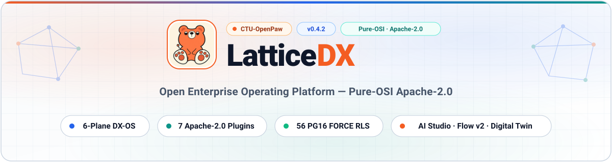
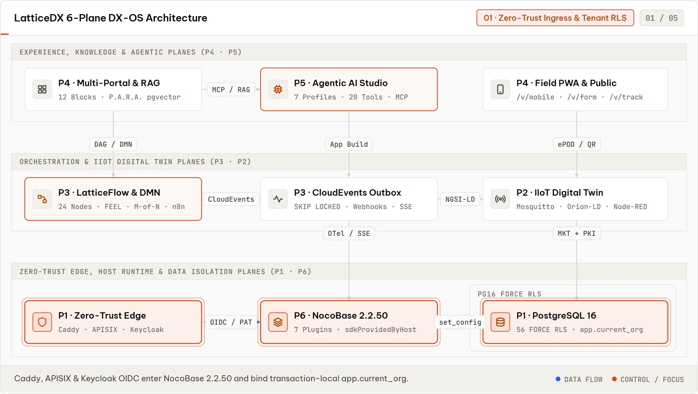
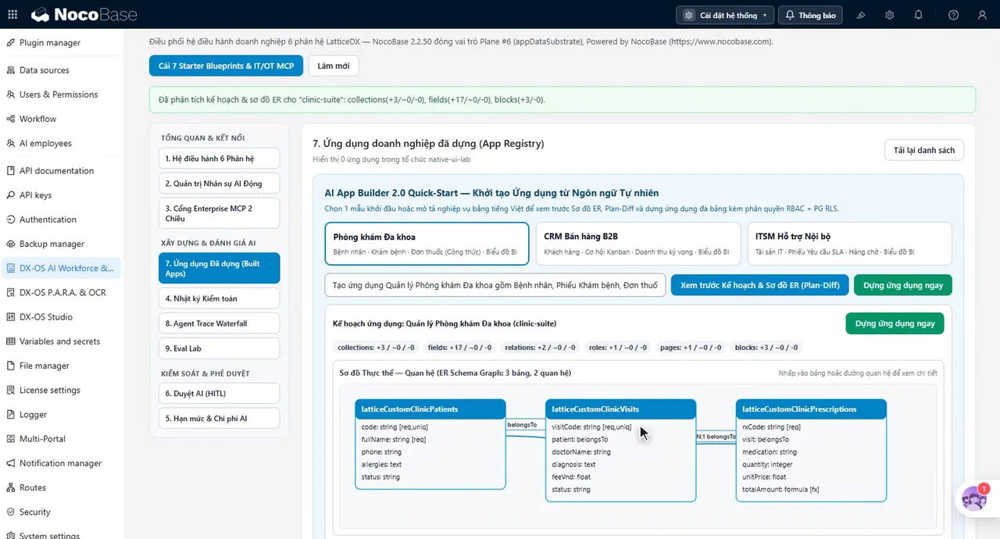
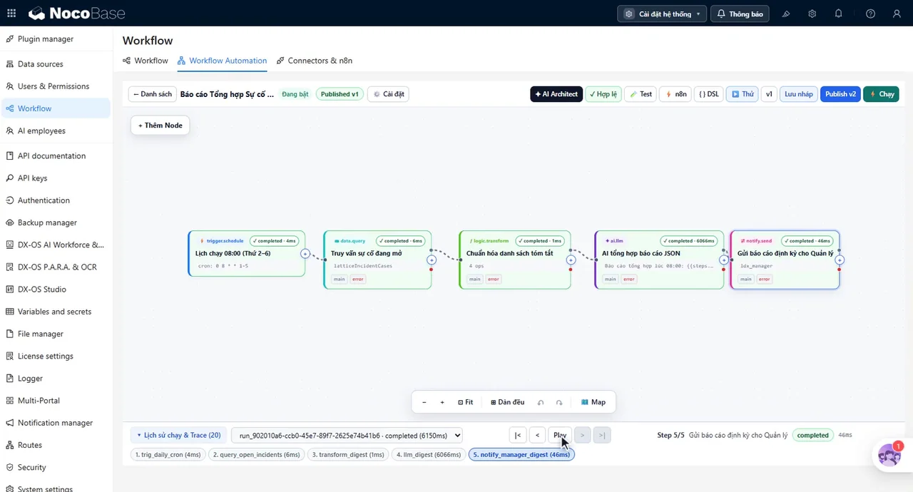
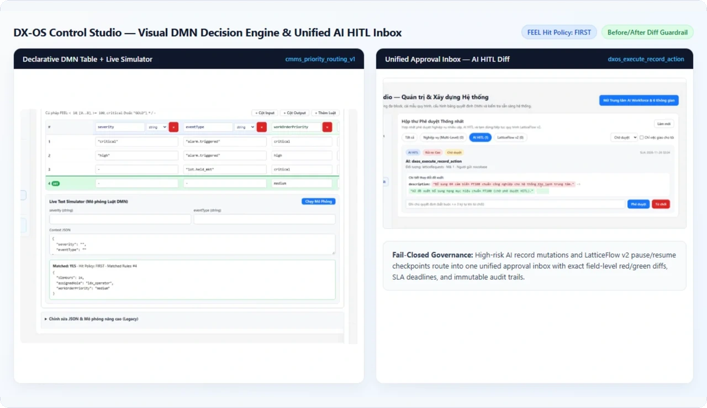
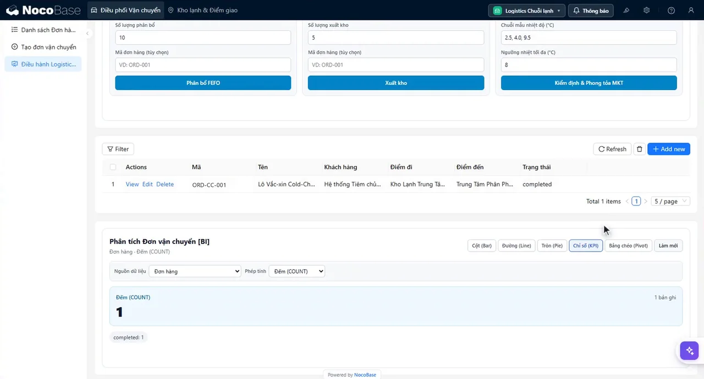
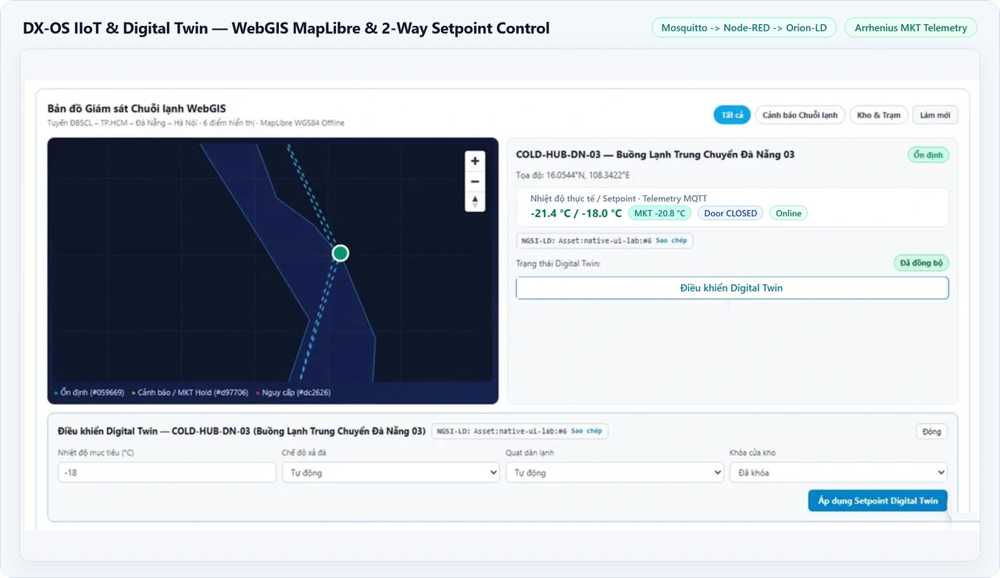
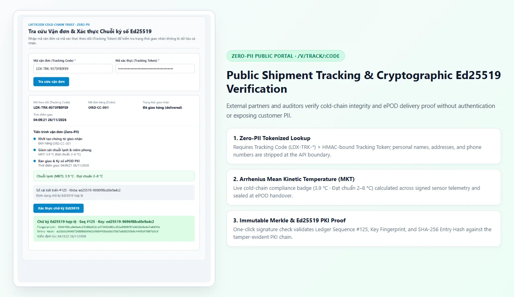

<!--
@file LatticeDX — Open Digital Enterprise Platform
@author CTU-OpenPaw
@copyright (C) 2026 CTU-OpenPaw
@license Apache-2.0
@see https://github.com/CTU-OpenPaw/lattice-dx
SPDX-License-Identifier: Apache-2.0
-->

<div align="center">

<picture>
  <source media="(prefers-color-scheme: dark)" srcset="./docs/assets/hero-dark.svg" />
  <source media="(prefers-color-scheme: light)" srcset="./docs/assets/hero-light.svg" />
  
</picture>

<p>
  <a href="./README.md">Tiếng Việt</a> | <strong>English</strong>
</p>

<p>
  <a href="https://github.com/CTU-OpenPaw/lattice-dx/actions/workflows/ci.yml"></a>
  <a href="https://github.com/CTU-OpenPaw/lattice-dx/actions/workflows/codeql.yml"></a>
  <a href="./LICENSE"></a>
  <a href="https://ctu-openpaw.github.io/lattice-docs/en/"></a>
</p>

<p>
  <a href="https://ctu-openpaw.github.io/lattice-docs/en/">Documentation</a> ·
  <a href="#quick-start">Quick Start</a> ·
  <a href="#platform-architecture">Architecture</a> ·
  <a href="https://github.com/CTU-OpenPaw/lattice-templates">Templates</a> ·
  <a href="https://github.com/CTU-OpenPaw/lattice-dx/discussions">Discussions</a>
</p>

</div>

LatticeDX (`v0.4.2`) is a 6-plane open enterprise operating platform built as seven Pure-OSI `Apache-2.0` plugins for the `NocoBase 2.2.50` runtime, unifying multi-portal applications, DAG/DMN workflows, agentic AI, and IIoT digital twins. Multi-tenant isolation is enforced directly in PostgreSQL 16 across 56 static `FORCE ROW LEVEL SECURITY` tables (plus dynamic `latticeCustom*` tables) under the transaction-local `app.current_org` context and non-superuser `nocobase_app` role.

<p align="center">
  
  <br />
  <sub><em>DX-OS AI Studio coordinating all six operational planes across business portals, DAG orchestration, and IIoT telemetry. Full documentation at <a href="https://ctu-openpaw.github.io/lattice-docs/en/">ctu-openpaw.github.io/lattice-docs/en</a>.</em></sub>
</p>

---

## Core Capabilities

| Domain | Architecture & Key Modules | Reference |
| --- | --- | --- |
| **Multi-Portal & Native v2 UI** | 12 `Dxos*BlockModel`s, 8 `ldx_*` roles, `/p/*` operational portals, zero-PII public forms (`/v/form/:slug`), and an offline Mobile Field PWA (`/v/mobile`) backed by an IndexedDB outbox. | [Multi-Portal & Blocks](https://ctu-openpaw.github.io/lattice-docs/en/studio/native-blocks) |
| **DAG Workflows & Visual DMN** | `LatticeFlow v2` (24 node types across 6 groups, `Draft/Publish` versioning, durable `loopCursor` HITL), zero-`eval` `Visual DMN` (`FIRST`, `UNIQUE`, `COLLECT`, `PRIORITY`), `M-of-N` approvals, and stock `n8n` REST v1 bridge. | [LatticeFlow & DMN](https://ctu-openpaw.github.io/lattice-docs/en/automation/latticeflow-overview) |
| **AI Studio & App Builder 2.0** | 7 Starter Profiles, 20 audited Unified Tools, `plan -> build -> patch -> rollback -> safe teardown` app lifecycle, Streamable MCP gateway (`/api/dxos-mcp`), and Google/LF A2A protocol. | [AI Studio](https://ctu-openpaw.github.io/lattice-docs/en/ai/overview-and-profiles) |
| **P.A.R.A. Vault & Hybrid RAG** | P.A.R.A. knowledge spaces, pure Node.js PDF/DOCX/XLSX/PPTX extraction, OCR-to-Record autofill, and hybrid `tsvector` + `pgvector` search with RRF fusion (`k = 60`). | [P.A.R.A. Hybrid RAG](https://ctu-openpaw.github.io/lattice-docs/en/ai/para-knowledge-rag) |
| **IIoT Digital Twin & Cold-Chain** | Mosquitto `2.0.21` DynSec/LWT, FIWARE Orion-LD `1.12.0` 2-way NGSI-LD, Node-RED `4.0.9` downlink, Arrhenius MKT calculations, FEFO WMS, and Ed25519 QR ePOD tracking (`/v/track/:code`). | [IIoT Digital Twin](https://ctu-openpaw.github.io/lattice-docs/en/domains/iiot-digital-twin) |
| **Zero-Trust Security & RLS** | Caddy `2.10`, APISIX `3.19.0`, Keycloak `26.8.2` OIDC/PKCE, Valkey `8.1`, 56 static PG16 `FORCE RLS` tables, scoped `ldx_pat_*` API keys, `AES-256-GCM` vault, and `Ed25519` + Merkle ledger. | [Multi-Tenancy RLS](https://ctu-openpaw.github.io/lattice-docs/en/architecture/multi-tenancy-rls) |

---

## Platform Architecture

<p align="center">
  <picture>
    <source media="(prefers-color-scheme: dark)" srcset="./docs/assets/architecture-6plane-dark.webp" />
    <source media="(prefers-color-scheme: light)" srcset="./docs/assets/architecture-6plane-light.webp" />
    
  </picture>
  <br />
  <sub><em>Six-plane data flow from Zero-Trust ingress, multi-portal experience, LatticeFlow v2, and IIoT Digital Twin down to PostgreSQL 16 FORCE RLS. Explore interactively in the <a href="https://ctu-openpaw.github.io/lattice-docs/en/architecture/overview">6-Plane Architecture Explorer</a>.</em></sub>
</p>

---

## 7-Plugin Modular Core (`sdkProvidedByHost: true`)

All first-party extensions live under `plugins/nocobase/*`, carry version `0.4.2` under `Apache-2.0`, and declare `"nocobase": { "sdkProvidedByHost": true }`. The `nocobase/nocobase:2.2.50` host runs externally as an OCI container outside the Git repository with NocoBase Clause 5.2 attribution preserved.

| Package | Version | Responsibilities | Docs |
| --- | :---: | --- | --- |
| [`@latticedx/plugin-lattice-foundation`](plugins/nocobase/plugin-lattice-foundation/README.md) | `0.4.2` | 56 static PG16 `FORCE RLS` tables (`app.current_org`), Multi-Portal, Mobile PWA, Public Forms, `dxosApprovals` (`M-of-N`), `dxosNotify`, `ldx_pat_*` keys, `dxosLedger` (`Ed25519` + Merkle), `dxosVault` (`AES-256-GCM`), CloudEvents `dxosEvents`, OpenAPI 3.1/AsyncAPI 3.0, and OTel/Prometheus. | [Architecture](https://ctu-openpaw.github.io/lattice-docs/en/architecture/plugin-system) |
| [`@latticedx/plugin-enterprise-auth`](plugins/nocobase/plugin-enterprise-auth/README.md) | `0.4.2` | Keycloak OIDC + PKCE `S256` authentication mapped to native NocoBase sessions, Valkey `8.1` session state, Backchannel Logout, and anti-escalation group-to-role sync. | [Security Model](https://ctu-openpaw.github.io/lattice-docs/en/architecture/security-model) |
| [`@latticedx/plugin-dxos-para`](plugins/nocobase/plugin-dxos-para/README.md) | `0.4.2` | P.A.R.A. vault (`latticeParaDocuments`, `latticeParaChunks`), pure Node.js PDF/Office extraction, OCR-to-Record autofill, and `tsvector` + `pgvector` RRF hybrid RAG. | [P.A.R.A. RAG](https://ctu-openpaw.github.io/lattice-docs/en/ai/para-knowledge-rag) |
| [`@latticedx/plugin-dxos-blocks`](plugins/nocobase/plugin-dxos-blocks/README.md) | `0.4.2` | 12 Native v2 `BlockModel`s (`DxosBiChartBlockModel`, `DxosWebGisBlockModel` via `maplibre-gl`, `DxosWmsOpsBlockModel`, `DxosKanbanScheduleBlockModel`), `dxosBroker` MQTT/Orion-LD, and RBAC exports. | [Native Blocks](https://ctu-openpaw.github.io/lattice-docs/en/studio/native-blocks) |
| [`@latticedx/plugin-dxos-studio`](plugins/nocobase/plugin-dxos-studio/README.md) | `0.4.2` | Control Studio (11 Studio tabs, 6 governance consoles, Visual DMN), LatticeFlow v2 (`@xyflow/react`), OMS/WMS FEFO/ePOD, stock `n8n` REST v1 bridge, Custom Collections (`latticeCustom*`) + AST formulas, and GitOps Solution Bundle v3. | [Control Studio & Flow](https://ctu-openpaw.github.io/lattice-docs/en/automation/latticeflow-overview) |
| [`@latticedx/plugin-dxos-ai`](plugins/nocobase/plugin-dxos-ai/README.md) | `0.4.2` | AI Studio with 7 Starter Profiles, 20 Unified Tools, App Builder 2.0, Streamable MCP (`/api/dxos-mcp`, `/api/dxos-mcp/it-ot`), A2A (`/.well-known/agent-card.json`), Eval Lab, and PII redaction. | [AI Studio & MCP](https://ctu-openpaw.github.io/lattice-docs/en/ai/mcp-gateway) |
| [`@latticedx/plugin-action-bridge`](plugins/nocobase/action-bridge/README.md) | `0.4.2` | Action execution proxy (`dxActions`) and workflow compatibility bridge between Fastify `@dx/api` and `/lattice/*` routes. | [REST API](https://ctu-openpaw.github.io/lattice-docs/en/reference/rest-api) |

---

## Quick Start

Prerequisites: **Node.js `24.x`** (`>=24 <25`), **pnpm `10.23.0`**, **Git**, **tar**, and **Docker Engine / Docker Compose v2+**.

### 1. Clone and install workspace dependencies

```sh
git clone https://github.com/CTU-OpenPaw/lattice-dx.git
cd lattice-dx
pnpm install --frozen-lockfile
```

### 2. Configure environment variables

```sh
cp .env.example .env
```

*(For Zero-Trust production deployments with Caddy, APISIX, and the non-superuser `nocobase_app` role, start from [`infra/compose/prod.env.example`](infra/compose/prod.env.example) and replace all local fixture credentials.)*

### 3. Boot an isolated runtime

```sh
# Boot a clean NocoBase 2.2.50 host with all 7 Apache-2.0 plugins on port 13014
pnpm native:clean --port=13014

# Or start the Core + NocoBase Compose stack
docker compose --env-file .env -f infra/compose/core.yml -f infra/compose/nocobase.yml up -d
```

Open `http://localhost:13014` to access the admin studios (`/admin/lattice-workspace`, `/admin/settings/dxos-ai`, `/admin/settings/dxos-studio`) and operational portals (`/p/logistics`, `/p/incidents`, `/p/cmms`, `/v/mobile`). Full Compose profiles (`iiot`, `integration`, `observability`, `pdf`) are documented in the [Quick Start Guide](https://ctu-openpaw.github.io/lattice-docs/en/getting-started/quickstart) and [Production Deployment Guide](https://ctu-openpaw.github.io/lattice-docs/en/getting-started/production-deployment).

<details>
<summary>Source Build &amp; Verification Commands</summary>

```sh
# Install locked enterprise-auth dependency and build all 7 plugins
npm ci --prefix plugins/nocobase/plugin-enterprise-auth --ignore-scripts --no-audit --no-fund
node plugins/nocobase/action-bridge/build.mjs
node plugins/nocobase/plugin-lattice-foundation/scripts/build.mjs
node plugins/nocobase/plugin-enterprise-auth/build.mjs
node plugins/nocobase/plugin-dxos-para/build.mjs
node plugins/nocobase/plugin-dxos-blocks/build.mjs
node plugins/nocobase/plugin-dxos-studio/build.mjs
node plugins/nocobase/plugin-dxos-ai/build.mjs

# Run typecheck, unit/integration suites, build, and Pure-OSI gates
pnpm check
node scripts/source-headers.mjs --check
pnpm pof:check
pnpm release:sbom -- --check
node --test plugins/nocobase/*/tests/*.test.cjs scripts/tests/*.test.mjs tests/native-ui-fixture.test.mjs tests/nocobase-externals.test.mjs
```

</details>

---

## Product Showcase

<table width="100%">
  <tr>
    <td width="50%" valign="top">
      
      <br />
      <sub><strong>App Builder 2.0 &amp; Visual ER</strong> — Generate multi-entity schemas with PostgreSQL <code>FORCE RLS</code>, inspect Plan-Diffs, and roll back versions.</sub>
    </td>
    <td width="50%" valign="top">
      
      <br />
      <sub><strong>LatticeFlow v2 DAG Studio</strong> — Author 24 node types on a <code>@xyflow/react</code> canvas with Draft/Publish states and Live Step Trace.</sub>
    </td>
  </tr>
  <tr>
    <td width="50%" valign="top">
      
      <br />
      <sub><strong>Visual DMN &amp; Unified HITL Inbox</strong> — Simulate FEEL decision tables and review AI proposals with before/after field diffs.</sub>
    </td>
    <td width="50%" valign="top">
      
      <br />
      <sub><strong>Logistics, WMS FEFO &amp; BI</strong> — Manage cold-chain FEFO lot allocation, Arrhenius MKT holds, and in-portal BI aggregations.</sub>
    </td>
  </tr>
  <tr>
    <td width="50%" valign="top">
      
      <br />
      <sub><strong>WebGIS &amp; 2-Way Digital Twin</strong> — Monitor cold-chain hubs on <code>maplibre-gl</code> and push setpoints across Mosquitto, Orion-LD, and Node-RED.</sub>
    </td>
    <td width="50%" valign="top">
      
      <br />
      <sub><strong>Zero-PII Tracking &amp; Ed25519 PKI</strong> — Verify ePOD delivery signatures publicly at <code>/v/track/:code</code> without exposing personal data.</sub>
    </td>
  </tr>
</table>

---

## Ecosystem, Open Source & Attribution

| Repository | Role | License | Links |
| --- | --- | :---: | --- |
| **`CTU-OpenPaw/lattice-dx`** | Core DX-OS platform (`v0.4.2`): 7 NocoBase plugins, Fastify API, worker, file scanner, and digest-pinned Compose stacks. | `Apache-2.0` | [Repository](https://github.com/CTU-OpenPaw/lattice-dx) |
| **`CTU-OpenPaw/lattice-docs`** | Bilingual technical documentation portal (Vietnamese / English) built with VitePress and interactive architecture diagrams. | `MIT` / `Apache-2.0` | [Live Docs](https://ctu-openpaw.github.io/lattice-docs/en/) · [Repo](https://github.com/CTU-OpenPaw/lattice-docs) |
| **`CTU-OpenPaw/lattice-templates`** | Sanitized Solution Bundle v3, LatticeFlow v2, DMN, n8n, Public Forms, and Business Pack template library. | `Apache-2.0` | [Repository](https://github.com/CTU-OpenPaw/lattice-templates) |
| **`CTU-OpenPaw/.github`** | Organization profile, community health baselines, and cross-repository governance. | `Apache-2.0` | [Organization](https://github.com/CTU-OpenPaw) · [Repo](https://github.com/CTU-OpenPaw/.github) |

| Aspect | Standard & Details |
| --- | --- |
| Pure-OSI Boundary & Licensing | All original LatticeDX source code is licensed under [`Apache-2.0`](LICENSE). The Git repository and source release tarballs contain zero `upstream/nocobase` submodules, zero `.gitmodules`, and zero `BSL-1.1` dependencies. See [Licensing & Pure-OSI Policy](https://ctu-openpaw.github.io/lattice-docs/en/open-source/licensing) and [`NOTICE`](NOTICE). |
| NocoBase `2.2.50` Clause 5.2 Attribution | The `nocobase/nocobase:2.2.50` host runs solely as an external OCI container outside the Git tree. All seven plugins declare `"sdkProvidedByHost": true` and preserve `Powered by NocoBase` (`v2.2.50`, `https://www.nocobase.com`, `License settings`). See [Third-Party & NocoBase Attribution](https://ctu-openpaw.github.io/lattice-docs/en/open-source/third-party-and-nocobase). |
| Contributing & Security | Review [`CONTRIBUTING.md`](CONTRIBUTING.md) and [`CODE_OF_CONDUCT.md`](CODE_OF_CONDUCT.md). Report security issues privately per [`SECURITY.md`](SECURITY.md) via [GitHub Security Advisories](https://github.com/CTU-OpenPaw/lattice-dx/security/advisories/new). |
