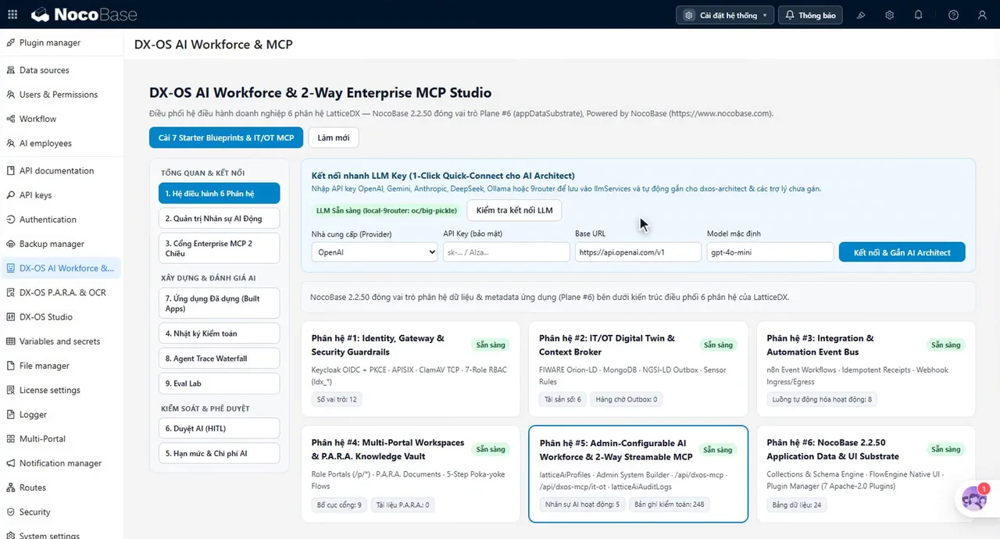
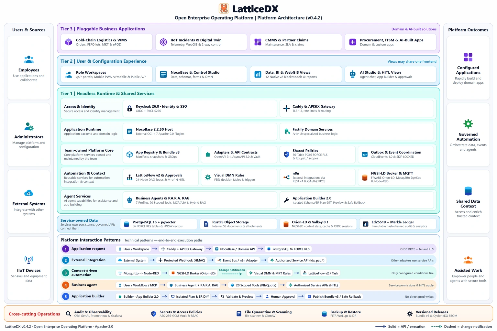
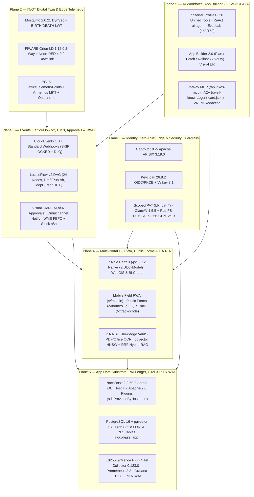
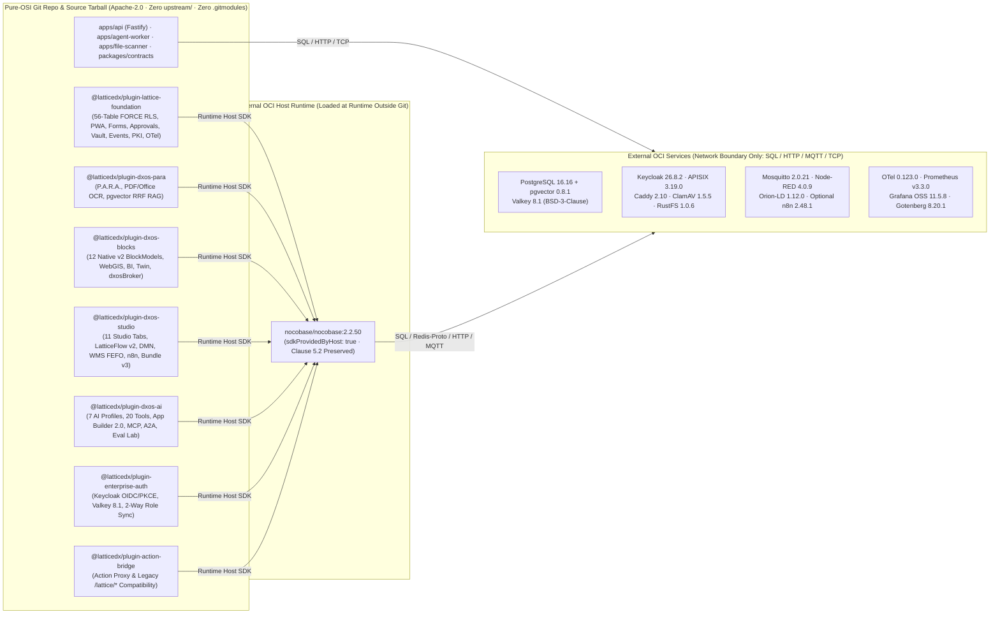

<!--
@file LatticeDX — Open Digital Enterprise Platform
@author CTU-OpenPaw
@copyright (C) 2026 CTU-OpenPaw
@license Apache-2.0
@see https://github.com/CTU-OpenPaw/lattice-dx
SPDX-License-Identifier: Apache-2.0
-->

<div align="center">

<picture>
  <source media="(prefers-color-scheme: dark)" srcset="./docs/assets/hero-dark.svg" />
  <source media="(prefers-color-scheme: light)" srcset="./docs/assets/hero-light.svg" />
  
</picture>

<p>
  <strong>Open-Core 6-Plane Digital Enterprise Operating Platform (<code>[H]</code> People · <code>[P]</code> Process · <code>[D]</code> Data · <code>[I]</code> Intelligence)</strong><br />
  Unifying Agentic App Builder 2.0, Deterministic DAG/DMN Workflows, 56-Table PostgreSQL 16 <code>FORCE RLS</code>, and 2-Way IIoT Digital Twins on Pure-OSI <code>Apache-2.0</code>.
</p>

<p>
  <a href="./README.md">Tiếng Việt</a> | <strong>English</strong>
</p>

<p>
  <a href="https://github.com/CTU-OpenPaw/lattice-dx/actions/workflows/ci.yml"></a>
  <a href="https://github.com/CTU-OpenPaw/lattice-dx/actions/workflows/codeql.yml"></a>
  <a href="./LICENSE"></a>
  <a href="./CHANGELOG.md"></a>
  <a href="https://github.com/CTU-OpenPaw/lattice-dx/releases/tag/v0.4.1"></a>
  <a href="./package.json">=24 <25" /></a>
</p>

<p>
  <a href="./docs/oss-pof-compliance.md"></a>
  <a href="./docs/sbom-cyclonedx.json"></a>
  <a href="./CHANGELOG.md"></a>
  <a href="./docs/E2E_TESTING_GUIDE_HUNG.md"></a>
  <a href="./scripts/eval-vietnamese-nl-agent.mjs"></a>
</p>

<p>
  <a href="https://ctu-openpaw.github.io/lattice-docs/en/">Documentation</a> •
  <a href="#-platform-architecture">Architecture</a> •
  <a href="#-live-system-showcase">Visual Showcase</a> •
  <a href="#-3-step-quick-start">Quick Start</a> •
  <a href="#-7-apache-20-plugins-on-nocobase-2250">7 Plugins</a> •
  <a href="#-ctu-openpaw-ecosystem">Ecosystem</a> •
  <a href="#-pure-osi-compliance--verification">Compliance</a>
</p>

</div>

---

## 💡 Why LatticeDX?

Modern enterprises rarely fail for lack of forms or CRUD tables—they struggle because identity, workflows, operational data, IIoT telemetry, and AI agents live in fragmented silos or restrictive proprietary stacks. **LatticeDX `v0.4.2` (DX-OS Open-Core Championship Edition)**, built by **CTU-OpenPaw** for **OLP PMNM 2026 (VFOSSA)**, unifies **People (`[H]`) · Process (`[P]`) · Data (`[D]`) · Intelligence (`[I]`)** in a single Pure-OSI `Apache-2.0` platform:

- **Agentic App Builder 2.0 + Multi-Portal Native UI:** Ship full multi-entity apps from natural language using **20 Unified AI Tools** (`11` Admin Builder + `6` Operational + `3` Persistent Memory) and **7 Starter AI Profiles**, with dry-run `plan_enterprise_app`, iterative `patch_enterprise_app`, Visual ER Graph, snapshot `rollback_enterprise_app`, deterministic `verify_app`, **12 Native v2 BlockModels**, **7 role-scoped portals (`/p/*`)**, offline-capable **Mobile Field PWA (`/v/mobile`)**, and zero-PII **Public Portals (`/v/form/:slug`, `/v/track/:code`)**.
- **Deterministic DAG & Visual DMN Workflows:** Orchestrate complex operations in **LatticeFlow v2** (**24 built-in node types across 6 groups**, `Draft/Publish` version rollback, live canvas step trace, persistent `loopCursor` HITL pause/resume, `control.merge` `first_completed`, ReAct multi-turn `ai.agent`) paired with a zero-`eval` **Visual DMN Engine** (`FIRST`, `UNIQUE`, `COLLECT`, `PRIORITY`), **Multi-Level `M-of-N` Approvals**, and role-scoped **Delegations**.
- **Defense-in-Depth Multi-Tenant Isolation (56-Table PG16 `FORCE RLS`):** Enforce tenant boundaries in PostgreSQL 16 under the non-superuser `nocobase_app` role across **56 static `FORCE ROW LEVEL SECURITY` tables** (`54` camelCase + `2` snake_case + dynamic `latticeCustom*` tables including `belongsToMany` join tables) via an `AsyncLocalStorage` transaction bridge—backed by **Ed25519 + Merkle PKI ledgers**, scoped **`ldx_pat_*`** API keys, **Keycloak OIDC/PKCE + Valkey 8.1**, and **ClamAV + RustFS** file quarantine.
- **2-Way IIoT Digital Twin & Closed-Loop Automation:** Bridge physical cold-chain assets into enterprise action using Pure-OSI **Eclipse Mosquitto `2.0.21`** Dynamic Security + LWT, **FIWARE Orion-LD `1.12.0`** 2-way NGSI-LD subscriptions, **Node-RED `4.0.9`** normalization & downlink, PostgreSQL 16 `latticeTelemetryPoints` (with Arrhenius MKT and anomaly quarantine—zero BSL-1.1 time-series DB), **CloudEvents 1.0 + Standard Webhooks**, and optional external stock **`n8n 2.48.1`** REST v1 + OAuth2 PKCE S256.
- **100% Pure-OSI `Apache-2.0` — Zero Vendor Lock-In, Zero BSL-1.1:** The entire Git repository and `latticedx-0.4.2-src.tar.gz` release archive contain **zero** `upstream/nocobase` Git submodules, **zero** `.gitmodules`, and **zero** BSL-1.1 components (`ThingsBoard` and `EMQX` are strictly excluded and blocked by CI/SBOM checks). The NocoBase `2.2.50` host runs cleanly as an external OCI container while all 7 LatticeDX plugins declare `"sdkProvidedByHost": true` and preserve NocoBase Clause 5.2 attribution.

---

## 🖼️ Live System Showcase

<p align="center">
  
</p>

<table align="center" width="100%">
  <tr>
    <td width="50%" align="center" valign="top">
      <br />
      <sub><strong>1. DX-OS AI Studio &amp; 6-Plane Control Center</strong> — 9-tab studio featuring 7 Starter AI Profiles, 20 Unified Tools, Trace Waterfall, Eval Lab (<code>163/163</code>), PostgreSQL Quotas &amp; VN PII Redaction.</sub>
    </td>
    <td width="50%" align="center" valign="top">
      <br />
      <sub><strong>2. App Builder 2.0 &amp; Visual ER Graph</strong> — Topological multi-entity generation (<code>plan</code> / <code>patch</code> / <code>rollback</code> / <code>verify</code>), <code>belongsToMany</code> <code>FORCE RLS</code>, and GitOps Bundle v3 export.</sub>
    </td>
  </tr>
  <tr>
    <td width="50%" align="center" valign="top">
      <br />
      <sub><strong>3. LatticeFlow v2 DAG Studio</strong> — 24 node types across 6 groups (<code>@xyflow/react</code> + <code>@dagrejs/dagre</code>), Draft/Publish versioning, Live Step Trace, ReAct <code>ai.agent</code> &amp; durable <code>loopCursor</code> HITL.</sub>
    </td>
    <td width="50%" align="center" valign="top">
      <br />
      <sub><strong>4. Control Studio, Visual DMN &amp; Unified HITL Inbox</strong> — 11 Studio tabs + 6 Governance Consoles, zero-<code>eval</code> Visual DMN (<code>FIRST</code>/<code>UNIQUE</code>/<code>COLLECT</code>/<code>PRIORITY</code>), and unified multi-source approvals.</sub>
    </td>
  </tr>
  <tr>
    <td width="50%" align="center" valign="top">
      <br />
      <sub><strong>5. Logistics Cockpit, WMS FEFO &amp; BI Charts</strong> — <code>DxosWmsOpsBlockModel</code> (<code>FOR UPDATE</code> FEFO, Arrhenius MKT hold/QA release), Kanban/7-day Schedule, and SQL-aggregated <code>DxosBiChartBlockModel</code>.</sub>
    </td>
    <td width="50%" align="center" valign="top">
      <br />
      <sub><strong>6. WebGIS Digital Twin &amp; IIoT Telemetry</strong> — <code>DxosWebGisBlockModel</code> (<code>maplibre-gl</code> + offline WGS84 fallback), Mosquitto DynSec/LWT, Orion-LD 2-way sync, and <code>|ΔT| &gt; 2.0°C</code> HITL Twin guard.</sub>
    </td>
  </tr>
  <tr>
    <td width="50%" align="center" valign="top">
      <br />
      <sub><strong>7. Public Zero-PII QR Tracking &amp; Ed25519 PKI</strong> — ISO/IEC 18004 SVG QR vouchers verified publicly at <code>/v/track/:code</code> with Ed25519 + Merkle proof while keeping ePOD/PII gated by <code>trackingToken</code>.</sub>
    </td>
    <td width="50%" align="center" valign="top">
      <br />
      <sub><strong>8. Mobile Field PWA (<code>/v/mobile</code>) &amp; CMMS Portals</strong> — IndexedDB offline outbox (<code>quarantined</code> on <code>4xx</code>, <code>401</code> pause, <code>NetworkOnly</code> API SW), 512 KB ePOD photo capture, and 1-click CMMS maintenance.</sub>
    </td>
  </tr>
</table>

---

## 🏛️ Platform Architecture

<p align="center">
  
</p>

### 1. 6-Plane DX-OS Operating Matrix



### 2. 7-Plugin Modularity on NocoBase `2.2.50` (`sdkProvidedByHost: true`)



---

## 🧩 7 Apache-2.0 Plugins on NocoBase 2.2.50

All NocoBase extensions reside under `plugins/nocobase/*`, declare `"version": "0.4.2"`, `"license": "Apache-2.0"`, and `"nocobase": { "sdkProvidedByHost": true }` (`testedRuntime: "2.2.50"`), and preserve NocoBase Clause 5.2 attribution (`Powered by NocoBase`, `v2.2.50`, `https://www.nocobase.com`, `License settings`):

| Plugin Package | Version | Pillar | Primary Responsibilities |
| :--- | :---: | :---: | :--- |
| [`@latticedx/plugin-lattice-foundation`](plugins/nocobase/plugin-lattice-foundation/README.md) | `0.4.2` | `[D][H][I]` | Core collections, 7 `ldx_*` roles, Multi-Portal, Mobile Field PWA (`/v/mobile`), Public Forms (`/v/form/:slug`), Multi-Level `M-of-N` Approvals & Unified Inbox (`dxosApprovals`), Omnichannel Notify (`dxosNotify`), PaaS Keys (`ldx_pat_*`), Ed25519/Merkle PKI Ledger (`dxosLedger`), Hot–Warm–Cold Governance/Lineage/Quarantine/MKT (`dxosDataGov`), **56 static PG16 `FORCE RLS` tables** (+ dynamic `latticeCustom*` + `nocobase_app`), OTel GenAI (`latticeAiTraces`), AES-256-GCM Connector Vault (`dxosVault`), CloudEvents 1.0 + Standard Webhooks (`dxosEvents`), OpenAPI 3.1 / AsyncAPI 3.0 & Prometheus `/api/dxos:metrics`. |
| [`@latticedx/plugin-dxos-para`](plugins/nocobase/plugin-dxos-para/README.md) | `0.4.2` | `[H]` | P.A.R.A. knowledge vault (`latticeParaDocuments`, `/admin/settings/dxos-para`), 7-role ACL, `organizationId` isolation, PDF (`ToUnicode` Vietnamese CMap) / DOCX / XLSX / PPTX extractor (`latticeParaChunks`), OCR Form Autofill (`latticePara:extractFormFields`), and flexible-dimension `pgvector 0.8.1` HNSW (`8..8192`) + `tsvector` + RRF Hybrid RAG. |
| [`@latticedx/plugin-dxos-blocks`](plugins/nocobase/plugin-dxos-blocks/README.md) | `0.4.2` | `[H][P][D][I]` | **12 Native v2 `BlockModel`s** (including `DxosBiChartBlockModel` SQL aggregation, `DxosWebGisBlockModel` with `maplibre-gl@6.19.0` `BSD-3-Clause`, `DxosKanbanScheduleBlockModel`, `DxosWmsOpsBlockModel`, `DxosRecordWorkbenchBlockModel`, `DxosParaVaultBlockModel`, `DxosCreativeStudioBlockModel`, etc.), 2-Way Digital Twin Shadow, Mosquitto DynSec/LWT & Orion-LD 2-Way (`dxosBroker`), 2-phase bulk import, IIoT `telemetryIngest` & alarms, RBAC CSV/XLSX/PDF Unicode export, and `Ctrl+K` Command Palette. |
| [`@latticedx/plugin-dxos-studio`](plugins/nocobase/plugin-dxos-studio/README.md) | `0.4.2` | `[P][H][D]` | Control Studio (`/admin/settings/dxos-studio`: **11 Studio tabs** + **6 Governance Consoles** + Visual DMN) & **LatticeFlow v2** (`/admin/settings/workflow/automation` & `/admin/settings/dxos-flow-studio`, `@xyflow/react@12.12.1` + `@dagrejs/dagre@3.1.3` MIT: **24 node types / 6 groups**, `Draft/Publish` rollback, Live Trace, ReAct `ai.agent`, durable `loopCursor` HITL), OMS/WMS/FEFO/ePOD + ISO/IEC 18004 SVG QR + `/v/track/:code` Ed25519, stock `n8n` REST v1 (`dxosN8n`), Rich Schema Domain Builder (`hasOne`, `belongsToMany` + `FORCE RLS`, safe AST `formula`, `validation`), 1-click Business Packs, 1-click Tenant Provisioning, and GitOps Bundle v3. |
| [`@latticedx/plugin-dxos-ai`](plugins/nocobase/plugin-dxos-ai/README.md) | `0.4.2` | `[I][P][D][H]` | AI Center (`/admin/settings/dxos-ai`: 9-tab navigation, Built Apps Visual ER / Plan-Diff / Rollback, Trace Waterfall & Eval Lab UI): **7 Starter AI Profiles**, **20 Unified AI Tools** (`11` Admin Builder including App Builder 2.0 `dxos_provision_role_workspace` + `6` Operational + `3` Persistent Memory `dxos_memory_*`), Google/LF A2A (`/.well-known/agent-card.json`, `/api/dxos-a2a`), real-LLM Proactive Triage, HITL Approval Queue, `PortalAgentLauncher` SSE, PostgreSQL quota + VN PII redaction, and 2-Way Streamable MCP Gateway (`/api/dxos-mcp`, `/api/dxos-mcp/it-ot`). |
| [`@latticedx/plugin-enterprise-auth`](plugins/nocobase/plugin-enterprise-auth/README.md) | `0.4.2` | `[H]` | Keycloak OIDC + PKCE S256 enterprise sign-in mapped to native NocoBase sessions (`/enterprise-login`, `/admin/settings/auth/enterprise-mappings`), **Valkey `8.1`** session cache, Backchannel Logout, anti-escalation 2-way group-to-role sync, and self-service unlink UI. |
| [`@latticedx/plugin-action-bridge`](plugins/nocobase/action-bridge/README.md) | `0.4.2` | `[P][I]` | Action bridge (`dxActions`) and workflow compatibility proxy between core API/Studio services and `/lattice/*` routes. |

### Verified Platform Capabilities Summary

| Capability Domain | Verified `v0.4.2` Specification |
| :--- | :--- |
| **Native v2 UI & Portals** | **12** `BlockModel`s (`DxosPortalHeroBlockModel`, `DxosKpiMetricBlockModel`, `DxosContextTelemetryBlockModel`, `DxosAiProposalBlockModel`, `DxosWorkflowTasksBlockModel`, `DxosParaVaultBlockModel`, `DxosCreativeStudioBlockModel`, `DxosRecordWorkbenchBlockModel`, `DxosWebGisBlockModel`, `DxosKanbanScheduleBlockModel`, `DxosWmsOpsBlockModel`, `DxosBiChartBlockModel`), **7** business portals (`/p/*`), `/v/mobile` PWA, `/v/form/:slug`, `/v/track/:code`. |
| **LatticeFlow v2 & DMN** | **24** DAG nodes across **6** groups (`trigger`: 5, `control`: 8, `data`: 3, `logic`: 2, `ai`: 2, `integration`: 4), `loopCursor` HITL resume, `control.merge` `first_completed`, zero-`eval` DMN (`FIRST`, `UNIQUE`, `COLLECT`, `PRIORITY`), `dxosAutomations` (`19` actions), `dxosDmn` (`3`), `dxosDelegations` (`4`). |
| **AI Workforce, MCP & A2A** | **20** Unified Tools (`11` Admin Builder + `6` Operational + `3` Memory), **7** Starter AI Profiles (`dxos-coordinator`, `dxos-architect`, `dxos-ops`, `dxos-logistics`, `dxos-workspace`, `dxos-operator`, `dxos-analyst`), **4** MCP prompts, **41** `dxosAi` actions, `163/163` Vietnamese NL eval pass. |
| **Data Security & Crypto** | **56** static PG16 `FORCE RLS` tables (`54` camelCase + `2` snake_case) + dynamic `latticeCustom*`, non-superuser `nocobase_app`, `ldx_pat_*` (7 scopes), Ed25519 + Merkle PKI (`rotateKey`, `expectedKeyId`), AES-256-GCM Vault (`11` connectors, OAuth2 PKCE S256). |
| **P.A.R.A. RAG & IIoT** | `pgvector 0.8.1` HNSW (`8..8192` dims) + `tsvector` RRF Hybrid RAG, PDF `ToUnicode` CMap / DOCX / XLSX / PPTX OCR; FIWARE Orion-LD `1.12.0` + Eclipse Mosquitto `2.0.21` DynSec/LWT + Node-RED `4.0.9` + Arrhenius MKT + optional stock `n8n 2.48.1` (`dxosN8n` 10 endpoints). |

---

## 🚀 3-Step Quick Start

> **Prerequisites:** **Node.js `24.x`** (`>=24 <25`), **pnpm `10.23.0`**, **Git**, **tar**, and **Docker Desktop / Docker Compose v2+** (for isolated container runtime).

### Step 1 — Clone & Boot a Clean Isolated NocoBase `2.2.50` Runtime

```sh
git clone https://github.com/CTU-OpenPaw/lattice-dx.git
cd lattice-dx
pnpm install --frozen-lockfile
pnpm native:clean --port=13014
```

*(Exports `HEAD`, provisions a 0-table PostgreSQL database + NocoBase `2.2.50` container on port `13014`, installs and activates all 7 `0.4.2` Apache-2.0 plugins, and prints `<path-to-report.json>`. Pass `--blank-slate` for zero-seed onboarding testing.)*

### Step 2 — Seed Multi-Portal Workspace, AI Workforce & Demo Showcase

```sh
node scripts/setup-native-multi-portal-demo.mjs "<path-to-report.json>"
node scripts/setup-native-workspace-demo.mjs "<path-to-report.json>"
pnpm setup:dxos-ai -- --origin=http://localhost:13014
NOCOBASE_ADMIN_PASSWORD="<admin-password>" node scripts/seed-v030-demo-showcase.mjs --origin=http://localhost:13014 --seed-samples
```

Open `http://localhost:13014` in your browser using the **local loopback demo credentials** (`admin@nocobase.com` / `admin123`; see [docs/FINALS_15MIN_SCRIPT.md](docs/FINALS_15MIN_SCRIPT.md) for the 5 RBAC test accounts — **never** expose default demo credentials on public networks):
- **Admin & Studios:** `/admin/lattice-workspace` · `/admin/settings/dxos-studio` · `/admin/settings/workflow/automation` · `/admin/settings/dxos-ai` · `/admin/settings/dxos-para`
- **Role Portals & Field Views:** `/p/logistics` · `/p/logistics-employee` · `/p/incidents` · `/p/procurement` · `/p/services` · `/p/cmms` · `/p/partner-claims` · `/v/mobile` · `/v/form/:slug` · `/v/track/:code`

### Step 3 — Verify Headless PaaS, AI/MCP & Pure-OSI Compliance

```sh
pnpm acceptance:headless-paas -- --origin=http://localhost:13014
pnpm acceptance:dxos-ai-mcp -- --origin=http://localhost:13014
pnpm acceptance:broker-automation-builder -- --origin=http://localhost:13014
pnpm pof:check && pnpm release:sbom -- --check
```

<details>
<summary><b>Offline Monorepo Build, 7-Plugin Compilation &amp; Full Test Suite (2,509 Tests + 163 NL Eval)</b></summary>

For offline / CI build from source (see [docs/build-from-source.md](docs/build-from-source.md)):

```sh
# 1. Install plugin-enterprise-auth locked deps & build all 7 NocoBase plugins
npm ci --prefix plugins/nocobase/plugin-enterprise-auth --ignore-scripts --no-audit --no-fund
node plugins/nocobase/action-bridge/build.mjs
node plugins/nocobase/plugin-lattice-foundation/scripts/build.mjs
node plugins/nocobase/plugin-enterprise-auth/build.mjs
node plugins/nocobase/plugin-dxos-para/build.mjs
node plugins/nocobase/plugin-dxos-blocks/build.mjs
node plugins/nocobase/plugin-dxos-studio/build.mjs
node plugins/nocobase/plugin-dxos-ai/build.mjs

# 2. Run 1,381 Node tests (7 plugins + scripts + externals) & 163/163 Vietnamese NL Agent eval
node --test plugins/nocobase/*/tests/*.test.cjs scripts/tests/*.test.mjs tests/native-ui-fixture.test.mjs tests/nocobase-externals.test.mjs
node scripts/eval-vietnamese-nl-agent.mjs --min-pass=95

# 3. Typecheck, 1,128 Vitest workspace tests & build apps/packages
pnpm check
```

</details>

<details>
<summary><b>Production Zero-Trust Compose Stack, Environment Files &amp; PITR WAL Recovery</b></summary>

- **Environment templates:** [`.env.example`](.env.example) and [`infra/compose/prod.env.example`](infra/compose/prod.env.example) (strictly replace all loopback secrets/keys before non-local deployment).
- **Production Zero-Trust stack (`infra/compose/prod.yml`):** 5 isolated Docker networks (`edge`, `app`, `data`, `scanner`, `iiot-net`), `no-new-privileges:true`, `cap_drop: [ALL]`, Caddy `2.10` -> Apache APISIX `3.19.0` -> NocoBase `2.2.50`, PostgreSQL `16.16` + `pgvector 0.8.1` (`wal_level=replica`, `archive_timeout=300`), Valkey `8.1`, Keycloak `26.8.2`, ClamAV `1.5.5`, RustFS `1.0.6`.
- **Full-stack Backup & Non-Destructive Rehearsal:**

```sh
pnpm backup:stack
pnpm backup:rehearse-stack -- "output/backups/stack/<bundle-id>"
node scripts/pitr-backup.mjs --backend=local-gz
```

See [docs/stack-backup-and-recovery.md](docs/stack-backup-and-recovery.md) and [docs/disaster-recovery-and-pitr.md](docs/disaster-recovery-and-pitr.md).

</details>

<details>
<summary><b>Repository Layout (`apps/`, `packages/`, `plugins/nocobase/`, `infra/`, `scripts/`, `solutions/`)</b></summary>

| Path | Responsibility |
| :--- | :--- |
| `plugins/nocobase/*` | 7 standalone Apache-2.0 NocoBase plugins (`0.4.2`, `sdkProvidedByHost: true`) and `node --test` suites. |
| `apps/api`, `apps/agent-worker`, `apps/file-scanner` | Companion Fastify REST API (`@dx/api`), `node:http` advisory worker (`@dx/agent-worker`), and ClamAV/RustFS quarantine sidecar (`@dx/file-scanner`). |
| `packages/contracts`, `packages/uc1-procurement` | Shared TypeScript action, workflow & workspace schemas (`@dx/contracts`) and reference procurement package (`@latticedx/uc1-procurement`). |
| `infra/compose/*.yml`, `infra/config/*` | Digest-pinned (`@sha256:`) Docker Compose profiles for all **19** external OCI images, Caddy/APISIX/Mosquitto/Node-RED/OTel/Prometheus/Grafana/n8n configs. |
| `scripts/` | Clean-install CLI (`native-clean-install.mjs`), demo seeders, acceptance runners, PoF auditor (`verify-pof-readiness.mjs`), CycloneDX 1.5 SBOM generator (`generate-sbom.mjs`), and tarball packager (`build-oss-release-tarball.mjs`). |
| `solutions/` | Reference logistics contracts (`solutions/logistics`) and workflow/integration definitions (`solutions/workflows`, `solutions/integration`). |
| `docs/` | Build-from-source, PoF compliance, CycloneDX 1.5 SBOM, third-party inventory, OpenAPI 3.1.0 spec, Demo Pack, Finals Script, and E2E Guide. |

</details>

---

## 🌐 CTU-OpenPaw Ecosystem

LatticeDX is organized as a modular **4-repository Pure-OSI ecosystem** under **CTU-OpenPaw**:

| Repository | Role | Canonical Links |
| :--- | :--- | :--- |
| **`CTU-OpenPaw/lattice-dx`** | Core Pure-OSI platform (`v0.4.2`), 7 Apache-2.0 NocoBase plugins, Fastify API, file scanner, Compose stacks & PoF/SBOM tooling | [GitHub](https://github.com/CTU-OpenPaw/lattice-dx) |
| **`CTU-OpenPaw/lattice-docs`** | Bilingual VitePress (`MIT`) technical & OSS governance documentation portal (Vietnamese + English) | [Live Docs (EN)](https://ctu-openpaw.github.io/lattice-docs/en/) · [Live Docs (VI)](https://ctu-openpaw.github.io/lattice-docs/) · [GitHub](https://github.com/CTU-OpenPaw/lattice-docs) |
| **`CTU-OpenPaw/lattice-templates`** | Curated sanitized LatticeFlow blueprints, n8n workflows, DMN tables, Business Packs, Public Forms & Solution Bundle v3 templates | [GitHub](https://github.com/CTU-OpenPaw/lattice-templates) |
| **`CTU-OpenPaw/.github`** | Organization profile, community health standards & cross-repo governance files | [Org Profile](https://github.com/CTU-OpenPaw) · [Source](https://github.com/CTU-OpenPaw/.github) |

---

## 🛡️ Pure-OSI Compliance & Verification

### Verification Matrix (`main` @ `42cdf3c`, `v0.4.2`)

| Verification Gate | Command / Scope | Verified Result |
| :--- | :--- | :--- |
| **SPDX Headers** | `node scripts/source-headers.mjs --check` | **`1,098`** human-authored files verified (`0` missing) |
| **PoF Readiness Audit** | `pnpm pof:check` (`scripts/verify-pof-readiness.mjs`) | **`6/6 PASS`** (`spdx-headers`, `governance-files`, `plugin-isolation`, `compose-digests`, `upstream-clean`, `no-secrets`) |
| **CycloneDX 1.5 SBOM** | `pnpm release:sbom -- --check` (`docs/sbom-cyclonedx.json`) | **`257/257`** resolved licenses (`workspace=12, npm=226, oci=19`, `0 NONE`, `0 BSL-1.1`) |
| **Production Dependency Audit** | `pnpm audit --prod --audit-level=low` | **`0`** vulnerabilities |
| **Unit & Integration Tests** | `pnpm typecheck && pnpm test` + `node --test` (`174` files) | **`2,509/2,509 PASS`** (`1,128` Vitest + `1,381` Node) |
| **Vietnamese NL Agent Eval** | `node scripts/eval-vietnamese-nl-agent.mjs --min-pass=95` | **`163/163` (`100%`)** across 23 intent & security-refusal categories |
| **Live Docker E2E Matrix** | Playwright + API E2E across 8 domains & 5 roles | **`124/124 PASS`** (`NO_GAPS`) |
| **Container Digest Pinning** | `infra/compose/*.yml` | **`19/19`** OCI images pinned with immutable `@sha256:` digests |

### NocoBase `2.2.50` Clause 5.2 Attribution & Pure-OSI Boundary

- **Zero Upstream Embedding:** `CTU-OpenPaw/lattice-dx` and `latticedx-0.4.2-src.tar.gz` contain **zero** `upstream/nocobase` Git submodules and **zero** `.gitmodules`. Host `nocobase/nocobase:2.2.50@sha256:04b75164936e7314ef74d82844bc56c9f34ed7ff1ca976ca53ffac2d3c88d777` loads strictly at runtime as an external OCI container outside the Git tree.
- **Clause 5.2 Preservation:** Every first-party plugin declares `"nocobase": { "sdkProvidedByHost": true }`, invokes host SDK APIs solely at runtime, and preserves NocoBase Clause 5.2 UI attribution (**`Powered by NocoBase`**, `v2.2.50`, `https://www.nocobase.com`, `License settings`).
- **Zero BSL-1.1 / Decoupled Optional Services:** Proprietary/BSL-1.1 software (`ThingsBoard`, `EMQX`) is strictly excluded. Optional `n8nio/n8n:2.48.1` runs solely as a standalone external OCI container outside the LatticeDX core automation engine.
- **Key Engineering & Compliance Docs:**
  - [Build from Source (`v0.4.2`)](docs/build-from-source.md) · [OSS PoF Compliance Checklist](docs/oss-pof-compliance.md) · [Third-Party Components & 19 OCI Images](docs/third-party.md) · [CycloneDX 1.5 SBOM](docs/sbom-cyclonedx.json)
  - [NocoBase Source & License Review](docs/nocobase-source-review.md) · [Dependency Inventory](docs/dependency-inventory.md) · [OLP PMNM 2026 Architecture Matrix](docs/olp-2026-architecture-matrix.md)
  - [15-Minute Demo Pack](docs/DEMO_PACK.md) · [15-Minute Finals Script](docs/FINALS_15MIN_SCRIPT.md) · [Full E2E Testing Guide](docs/E2E_TESTING_GUIDE_HUNG.md)

---

## 🗺️ Roadmap (`v0.4.x` Pre-Major Series)

LatticeDX follows strict `0.4.x` pre-major stabilization versioning until formal maintainer graduation review:

- **Shipped (`v0.4.0` → `v0.4.1` → `v0.4.2`):** Headless PaaS (`ldx_pat_*`, Ed25519/Merkle PKI), 56-table PG16 `FORCE RLS`, App Builder 2.0 (`plan`/`patch`/`rollback`/`verify` + Visual ER), 12 Native v2 BlockModels, 24-node LatticeFlow v2 + ReAct `ai.agent` + `loopCursor` HITL, P.A.R.A. OCR/Hybrid RAG, Mosquitto DynSec + Orion-LD 2-way Twin, 257/257 CycloneDX SBOM, and 124/124 Live E2E.
- **Next in `v0.4.x`:** Multi-region PITR WAL replication runbooks, expanded industry packs in [`CTU-OpenPaw/lattice-templates`](https://github.com/CTU-OpenPaw/lattice-templates), multi-agent A2A federation examples, and ongoing accessibility/i18n refinements.

---

## 🤝 Contributing, Security & License

- **Contributing:** Read [`CONTRIBUTING.md`](CONTRIBUTING.md) and [`CODE_OF_CONDUCT.md`](CODE_OF_CONDUCT.md) before opening a Pull Request or reporting issues via [GitHub Issues](https://github.com/CTU-OpenPaw/lattice-dx/issues).
- **Security:** Never disclose vulnerabilities, tokens, or `.env` secrets in public issues. Report privately via [GitHub Security Advisories](https://github.com/CTU-OpenPaw/lattice-dx/security/advisories/new) and review [`SECURITY.md`](SECURITY.md).
- **License & Acknowledgements:** All first-party LatticeDX source code is licensed under [`Apache-2.0`](LICENSE) — see [`NOTICE`](NOTICE), [`COPYRIGHT.txt`](COPYRIGHT.txt), and [`CHANGELOG.md`](CHANGELOG.md). Built to run cleanly alongside [NocoBase](https://www.nocobase.com), PostgreSQL/pgvector, Valkey, Keycloak, Apache APISIX, Caddy, FIWARE Orion-LD, Eclipse Mosquitto, Node-RED, OpenTelemetry, Prometheus, and Grafana OSS.
