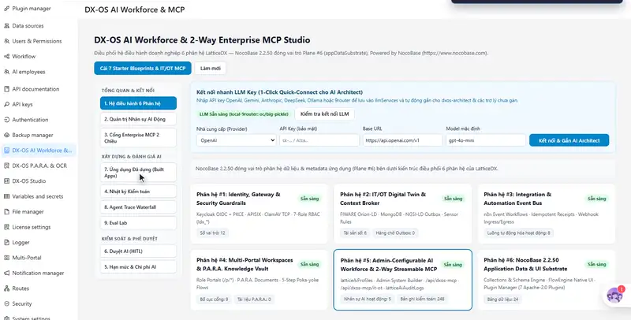
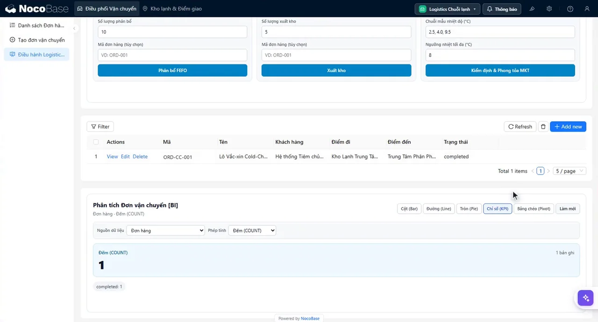
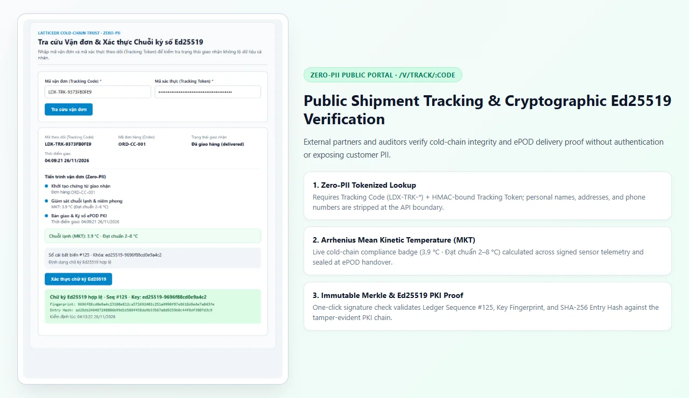
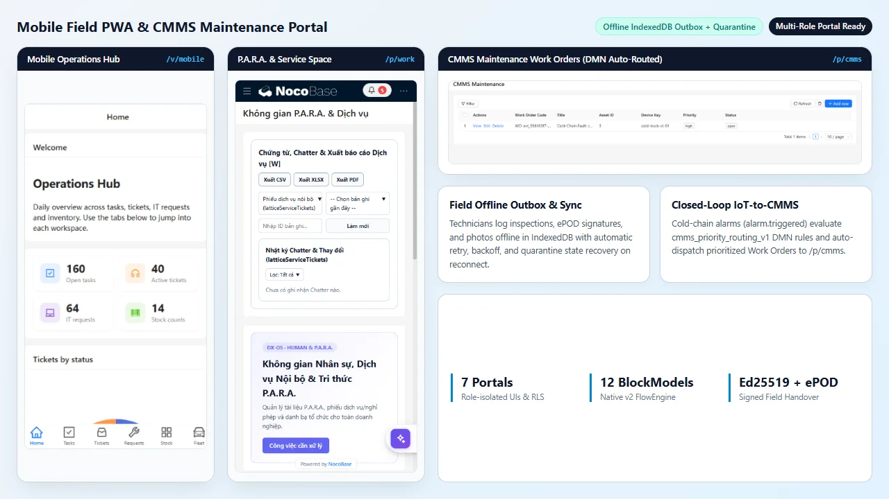
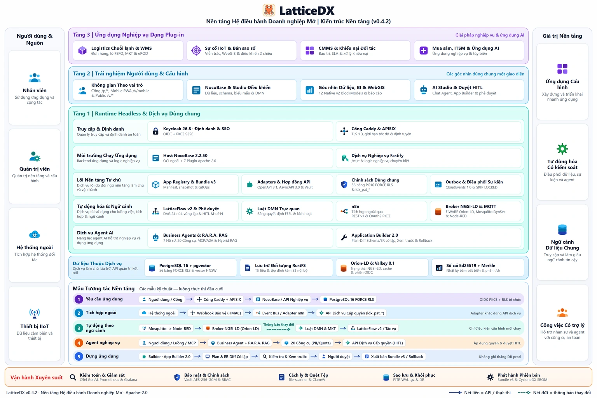
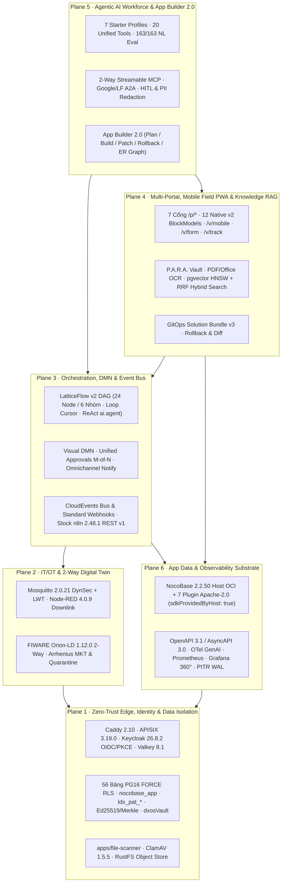
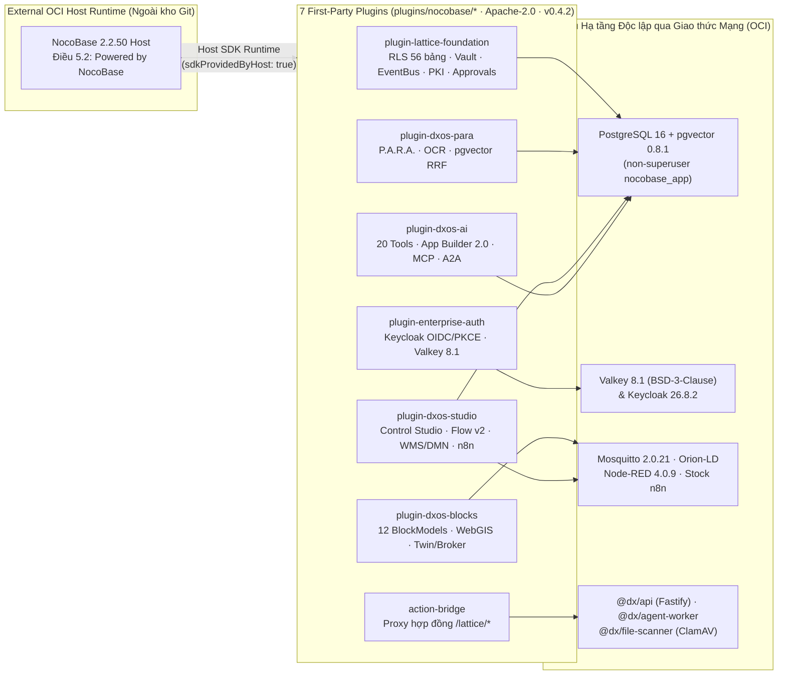

<!--
@file LatticeDX — Open Digital Enterprise Platform
@author CTU-OpenPaw
@copyright (C) 2026 CTU-OpenPaw
@license Apache-2.0
@see https://github.com/CTU-OpenPaw/lattice-dx
SPDX-License-Identifier: Apache-2.0
-->

<div align="center">

<picture>
  <source media="(prefers-color-scheme: dark)" srcset="./docs/assets/hero-dark.svg">
  <source media="(prefers-color-scheme: light)" srcset="./docs/assets/hero-light.svg">
  
</picture>

<h3>Nền tảng Hệ điều hành Doanh nghiệp Số Nguồn Mở (DX-OS Open-Core · <code>v0.4.2</code>)</h3>

<p>
  Hợp nhất <strong>Con người [H] – Quy trình [P] – Dữ liệu [D] – Trí tuệ [I]</strong> trên một nền tảng tự chủ 100% Pure-OSI <code>Apache-2.0</code>:<br>
  <strong>Agentic App Builder 2.0</strong> · <strong>LatticeFlow v2 DAG &amp; Visual DMN</strong> · <strong>56 bảng PG16 FORCE RLS</strong> · <strong>IIoT Digital Twin 2 chiều</strong> · <strong>P.A.R.A. Hybrid RAG</strong>
</p>

<p>
  <strong>Tiếng Việt</strong> | <a href="./README.en.md">English</a>
</p>

<p>
  <a href="https://github.com/CTU-OpenPaw/lattice-dx/actions/workflows/ci.yml"></a>
  <a href="https://github.com/CTU-OpenPaw/lattice-dx/actions/workflows/codeql.yml"></a>
  <a href="./LICENSE"></a>
  <a href="./CHANGELOG.md"></a>
  <a href="https://github.com/CTU-OpenPaw/lattice-dx/releases/tag/v0.4.1"></a>
  <a href="./package.json">=24 <25"></a>
</p>

<p>
  <a href="./docs/oss-pof-compliance.md"></a>
  <a href="./docs/sbom-cyclonedx.json"></a>
  <a href="./CHANGELOG.md"></a>
  <a href="./docs/E2E_TESTING_GUIDE_HUNG.md"></a>
  <a href="./scripts/eval-vietnamese-nl-agent.mjs"></a>
</p>

<p>
  <a href="https://ctu-openpaw.github.io/lattice-docs/">Tài liệu</a> •
  <a href="#-kiến-trúc-nền-tảng">Kiến trúc</a> •
  <a href="#-trình-diễn-hệ-thống-thực-tế">Showcase Giao diện</a> •
  <a href="#-khởi-chạy-nhanh-3-bước">Khởi chạy nhanh</a> •
  <a href="#-7-plugin-apache-20-trên-nocobase-2250">7 Plugin Mở rộng</a> •
  <a href="#-hệ-sinh-thái-ctu-openpaw">Hệ sinh thái</a> •
  <a href="#-tuân-thủ-nguồn-mở-pure-osi--pof">Tuân thủ PoF</a>
</p>

</div>

---

## 💡 Tại sao chọn LatticeDX?

Doanh nghiệp và tổ chức tại Việt Nam thường bị kẹt giữa hai thái cực: các công cụ Low-Code rời rạc thiếu năng lực điều phối IIoT/AI thực chiến, hoặc các nền tảng thương mại gắn giấy phép hạn chế (`BSL-1.1`) và khóa chặt hạ tầng đám mây. **LatticeDX `v0.4.2`** được đội ngũ **CTU-OpenPaw** xây dựng cho kỳ thi **OLP PMNM 2026 (VFOSSA)** nhằm giải quyết triệt để bài toán đó:

- **Agentic App Builder 2.0 (Plan → Diff → Patch → Rollback):** Thay vì sinh giao diện tĩnh một lần, tác tử AI tạo ứng dụng đa thực thể theo thứ tự topo (`hasOne`, `belongsToMany`, `FORCE RLS`, công thức AST an toàn), kết xuất sơ đồ ER, hỗ trợ chỉnh sửa lặp bằng ngôn ngữ tự nhiên (`patch_enterprise_app`), tự kiểm chứng và quay lui theo phiên bản (`rollback_enterprise_app`).
- **Quy trình Xác định & AI ReAct Bền vững:** Kết hợp **LatticeFlow v2 DAG** (`24` loại node / `6` nhóm, tách biệt `Draft`/`Publish`, lưu vết `loopCursor` qua bước tạm dừng HITL), **Visual DMN Engine** (4 Hit Policies không dùng `eval`), **Hộp thư Phê duyệt Thống nhất (`M-of-N`)**, thông báo đa kênh và cầu nối **Stock `n8n` REST v1 (`2.48.1`)**.
- **Bảo mật Đa Tenant Fail-Closed ở Tầng Lõi CSDL:** Cô lập chặt chẽ trên **56 bảng tĩnh PostgreSQL 16 `FORCE ROW LEVEL SECURITY`** (cùng các bảng động `latticeCustom*`) với vai trò không đặc quyền superuser `nocobase_app`, khóa API phạm vi (`ldx_pat_*`), sổ cái bất biến **Ed25519 + Merkle PKI**, và két bí mật **AES-256-GCM + OAuth2 PKCE**.
- **IIoT Digital Twin 2 Chiều & Cổng Trường Ngoại tuyến:** Giao tiếp trực tiếp **Eclipse Mosquitto `2.0.21` DynSec/LWT**, **FIWARE Orion-LD `1.12.0`**, **Node-RED `4.0.9`**, tính toán nhiệt độ động học **Arrhenius MKT**, điều phối kho lạnh **OMS/WMS/FEFO/ePOD**, bản đồ **WebGIS MapLibre** và **Mobile Field PWA (`/v/mobile`)** có hàng đợi ngoại tuyến IndexedDB.
- **100% Pure-OSI `Apache-2.0` — Không Khóa Vendor, Không `BSL-1.1`:** Kho Git và gói phát hành nguồn loại bỏ hoàn toàn `upstream/nocobase` và `.gitmodules`, nói không với `BSL-1.1` (`0` ThingsBoard, `0` EMQX), dùng **Valkey `8.1` (`BSD-3-Clause`)** và giữ nguyên nhận diện **Điều 5.2 NocoBase `2.2.50`**.

---

## 📸 Trình diễn Hệ thống Thực tế

<div align="center">
  
  <p>
    <em>Luồng trình diễn thực tế toàn hệ thống từ AI Studio 6 Mặt phẳng, App Builder ER, LatticeFlow v2 DAG đến WebGIS Digital Twin &amp; Mobile Field PWA.</em><br>
    Xem kịch bản tự kiểm chứng 15 phút tại <a href="./docs/DEMO_PACK.md"><code>docs/DEMO_PACK.md</code></a> và kịch bản thuyết trình Chung kết tại <a href="./docs/FINALS_15MIN_SCRIPT.md"><code>docs/FINALS_15MIN_SCRIPT.md</code></a>.
  </p>
</div>

<table width="100%">
  <tr>
    <td width="50%" valign="top">
      
      <br>
      <strong>1. DX-OS AI Studio (6 Mặt phẳng &amp; 9 Phân hệ)</strong><br>
      <sub>Trung tâm điều phối 7 Starter AI Profiles, 20 Unified Tools, thẻ Google/LF A2A, OTel GenAI Trace Waterfall và Eval Lab (<code>163/163</code> ca tiếng Việt).</sub>
    </td>
    <td width="50%" valign="top">
      
      <br>
      <strong>2. App Builder 2.0 &amp; Sơ đồ ER Trực quan</strong><br>
      <sub>Dựng ứng dụng đa thực thể tự động gắn PostgreSQL <code>FORCE RLS</code>, xem trước Plan-Diff, đồ thị quan hệ ER và Rollback tức thì.</sub>
    </td>
  </tr>
  <tr>
    <td width="50%" valign="top">
      
      <br>
      <strong>3. LatticeFlow v2 Studio (24 Node / 6 Nhóm)</strong><br>
      <sub>Trình biên tập đồ thị Canvas-First (<code>@xyflow/react</code> + <code>@dagrejs/dagre</code> MIT), tách Draft/Publish, Live Step Trace và Agent <code>dxos-architect</code> đồng bộ SSE.</sub>
    </td>
    <td width="50%" valign="top">
      
      <br>
      <strong>4. Visual DMN &amp; Hộp thư Phê duyệt HITL</strong><br>
      <sub>Bảng quyết định trực quan không <code>eval</code> (FIRST/UNIQUE/COLLECT/PRIORITY) cùng Hộp thư Phê duyệt Thống nhất hiển thị <code>diffPreview</code> trước/sau.</sub>
    </td>
  </tr>
  <tr>
    <td width="50%" valign="top">
      
      <br>
      <strong>5. Multi-Portal Logistics, BI &amp; Kho lạnh FEFO</strong><br>
      <sub>Cổng <code>/p/logistics</code> tích hợp <code>DxosWmsOpsBlockModel</code> (khóa hàng <code>FOR UPDATE</code>, giữ lô MKT), <code>DxosBiChartBlockModel</code>, Kanban 6 cột và xuất báo cáo Unicode RBAC.</sub>
    </td>
    <td width="50%" valign="top">
      
      <br>
      <strong>6. WebGIS MapLibre &amp; Digital Twin 2 Chiều</strong><br>
      <sub>Bản đồ chuỗi lạnh Việt Nam (<code>maplibre-gl</code> BSD-3-Clause), điều khiển Shadow 2 chiều qua Mosquitto DynSec / Orion-LD / Node-RED và giám sát Arrhenius MKT.</sub>
    </td>
  </tr>
  <tr>
    <td width="50%" valign="top">
      
      <br>
      <strong>7. Tra cứu Công khai Zero-PII &amp; Ed25519</strong><br>
      <sub>Cổng công khai <code>/v/track/:code</code> &amp; <code>/v/form/:slug</code> fail-closed không lộ dữ liệu cá nhân, mã QR ISO/IEC 18004 SVG và xác thực chữ ký Ed25519 + Merkle PKI.</sub>
    </td>
    <td width="50%" valign="top">
      
      <br>
      <strong>8. Mobile Field PWA (<code>/v/mobile</code>) &amp; CMMS</strong><br>
      <sub>Ứng dụng hiện trường ngoại tuyến dùng IndexedDB Outbox với trạng thái <code>quarantined</code> bảo toàn ePOD, kết nối trực tiếp bảo trì CMMS <code>/p/cmms</code>.</sub>
    </td>
  </tr>
</table>

---

## 🏗️ Kiến trúc Nền tảng

<div align="center">
  
  <p><em>Kiến trúc phân tầng LatticeDX v0.4.2: từ Cổng Đa vai trò &amp; Ứng dụng Nghiệp vụ (Tier 3–2) xuống Headless Runtime, 6 Mặt phẳng DX-OS &amp; 56 Bảng PG16 FORCE RLS (Tier 1 &amp; Data Layer).</em></p>
</div>

### 1. Ma trận 6 Mặt phẳng DX-OS (6-Plane Operating Matrix)



### 2. Mô-đun hóa 7 Plugin trên NocoBase `2.2.50` (`sdkProvidedByHost: true`)



---

## 🧩 7 Plugin Apache-2.0 trên NocoBase `2.2.50`

Năng lực cốt lõi đã kiểm chứng trên mã nguồn `v0.4.2`: **12** Native v2 BlockModels · **24** LatticeFlow v2 DAG nodes (6 nhóm) · **20** Unified AI Tools (`11` Admin Builder + `6` Operational + `3` Persistent Memory) · **7** Starter AI Profiles · **56** bảng tĩnh PostgreSQL `FORCE RLS` (+ bảng động `latticeCustom*`) · **2-Way Streamable MCP** & **Google/LF A2A** · **P.A.R.A. `pgvector` HNSW RRF** · **Ed25519 + Merkle PKI Ledger** · **Stock `n8n 2.48.1` REST v1** · **FIWARE Orion-LD + Mosquitto DynSec/LWT + Node-RED**.

| Package | Phiên bản | Trụ cột | `sdkProvidedByHost` | Vai trò chính trong DX-OS |
| --- | :---: | :---: | :---: | --- |
| [`@latticedx/plugin-lattice-foundation`](plugins/nocobase/plugin-lattice-foundation/README.md) | `0.4.2` | `[D][H][I]` | `true` | Collections lõi, 7 vai trò `ldx_*`, Multi-Portal, Mobile PWA (`/v/mobile`), Public Forms (`/v/form/:slug`), Multi-Level Approvals (`M-of-N`), Omnichannel Notify (`dxosNotify`), PaaS API Keys (`ldx_pat_*`), Ed25519/Merkle PKI Ledger (`dxosLedger`), Data Governance/MKT, **56 bảng PG16 `FORCE RLS`** (`nocobase_app`), OTel GenAI (`latticeAiTraces`), Connector Vault (`dxosVault`), Event Bus (`dxosEvents`), OpenAPI 3.1/AsyncAPI 3.0 & Prometheus `/api/dxos:metrics`. |
| [`@latticedx/plugin-enterprise-auth`](plugins/nocobase/plugin-enterprise-auth/README.md) | `0.4.2` | `[H]` | `true` | Đăng nhập Keycloak OIDC + PKCE S256 ánh xạ về phiên NocoBase native, **Valkey `8.1`** session cache, Backchannel Logout và đồng bộ nhóm→vai trò 2 chiều chống leo thang quyền. |
| [`@latticedx/plugin-dxos-para`](plugins/nocobase/plugin-dxos-para/README.md) | `0.4.2` | `[H]` | `true` | Kho tri thức P.A.R.A. (`latticeParaDocuments`/`Chunks`), ACL 7 vai trò theo `organizationId`, trích xuất PDF (ToUnicode CMap tiếng Việt)/DOCX/XLSX/PPTX, OCR Form Autofill và **Hybrid RAG `tsvector` + RRF + `pgvector` HNSW**. |
| [`@latticedx/plugin-dxos-blocks`](plugins/nocobase/plugin-dxos-blocks/README.md) | `0.4.2` | `[H][P][D][I]` | `true` | **12 Native v2 `BlockModel`s** (gồm `DxosBiChartBlockModel`, `DxosWebGisBlockModel` dùng `maplibre-gl`, `DxosKanbanScheduleBlockModel`, `DxosWmsOpsBlockModel`, `DxosRecordWorkbenchBlockModel`...), `aggregateQuery` & `collectionsMeta`, **2-Way Digital Twin Shadow**, **Mosquitto DynSec/LWT & Orion-LD 2-Way (`dxosBroker`)**, 2-Phase Bulk Import, cảnh báo IIoT, xuất báo cáo RBAC Unicode & `Ctrl+K`. |
| [`@latticedx/plugin-dxos-studio`](plugins/nocobase/plugin-dxos-studio/README.md) | `0.4.2` | `[P][H][D]` | `true` | Control Studio (`/admin/settings/dxos-studio`, 11 tab Studio + 6 Governance Consoles + Unified Inbox + Form Builder + **Visual DMN**) & **LatticeFlow v2 DAG Studio** (`/admin/settings/workflow/automation`, `@xyflow/react` + `@dagrejs/dagre` MIT: 24 node, Draft/Publish, Live Trace, ReAct `ai.agent`, HITL bền vững), OMS/WMS/FEFO/ePOD + QR SVG + `/v/track/:code` Ed25519, **Stock `n8n` REST v1 (`dxosN8n`)**, **Rich Schema Domain Builder**, Business Packs & **GitOps Bundle v3**. |
| [`@latticedx/plugin-dxos-ai`](plugins/nocobase/plugin-dxos-ai/README.md) | `0.4.2` | `[I][P][D][H]` | `true` | AI Studio (`/admin/settings/dxos-ai`, 9 phân hệ gồm Built Apps + Visual ER/Plan-Diff/Rollback, Trace Waterfall & Eval Lab UI): **7 Starter Profiles**, **20 Unified Tools**, **App Builder 2.0**, **Google/LF A2A Protocol**, Proactive Triage LLM, Hàng chờ HITL, hạn mức PG + che PII VN và **2-Way MCP Gateway**. |
| [`@latticedx/plugin-action-bridge`](plugins/nocobase/action-bridge/README.md) | `0.4.2` | `[P][I]` | `true` | Cầu nối hành động và tương thích hợp đồng quy trình giữa Core API/Studio và giao diện `/lattice/*`. |

---

## 🚀 Khởi chạy Nhanh (3 Bước)

Yêu cầu hệ thống: **Node.js `24.x`** (`>=24 <25`), **pnpm `10.23.0`**, **Git**, **tar** và **Docker Engine / Docker Compose v2+**.

### Bước 1 — Clone & Dựng NocoBase sạch từ DB 0 bảng (`NocoBase 2.2.50`)

```sh
git clone https://github.com/CTU-OpenPaw/lattice-dx.git
cd lattice-dx
pnpm install --frozen-lockfile
pnpm native:clean --port=13014
```

*(Lệnh `pnpm native:clean --port=13014` xuất mã nguồn từ `HEAD`, khởi tạo PostgreSQL trống 0 bảng, bật host `nocobase/nocobase:2.2.50`, cài đủ **7 plugin `0.4.2`**, xác minh migrations và in đường dẫn `<path-to-report.json>`.)*

### Bước 2 — Nạp Multi-Portal, AI Workforce & Dữ liệu Mẫu

```sh
node scripts/setup-native-multi-portal-demo.mjs "<path-to-report.json>"
node scripts/setup-native-workspace-demo.mjs "<path-to-report.json>"
pnpm setup:dxos-ai -- --origin=http://localhost:13014
NOCOBASE_ADMIN_PASSWORD="<admin-password>" node scripts/seed-v030-demo-showcase.mjs --origin=http://localhost:13014 --seed-samples
```

*(Để cài trắng không nạp dữ liệu mẫu, truyền cờ `--blank-slate` cho `pnpm native:clean`; để nạp đầy đủ dữ liệu trình diễn chuỗi lạnh & đối tác xem chi tiết tại [`docs/DEMO_PACK.md`](docs/DEMO_PACK.md).)*

### Bước 3 — Truy cập Portals & Xác minh Hệ thống

Mở `http://localhost:13014` và đăng nhập tài khoản fixture cục bộ `admin@nocobase.com` / `admin123` *(chỉ dùng trên loopback localhost)*:

- **Quản trị & Điều phối:** `/admin/lattice-workspace` · `/admin/settings/dxos-ai` (AI Studio) · `/admin/settings/dxos-studio` (Control Studio & DMN) · `/admin/settings/workflow/automation` (LatticeFlow v2) · `/admin/settings/dxos-para` (P.A.R.A. RAG)
- **Cổng Nghiệp vụ Đa vai trò:** `/p/procurement` · `/p/incidents` · `/p/logistics` · `/p/logistics-employee` · `/p/services` · `/p/cmms` · `/p/partner-claims`
- **Tuyến Di động & Công khai Zero-PII:** `/v/mobile` (Field PWA) · `/v/form/:slug` · `/v/track/:code` (Ed25519)

<details>
<summary><b>📦 Build từ Mã nguồn (Offline / CI), Nghiệm thu Tự động & Cấu trúc Kho mã</b></summary>

#### A. Build toàn bộ Monorepo & 7 Plugin (Offline / CI)

```sh
# 1. Cài đặt phụ thuộc khóa lockfile cho enterprise-auth (tắt lifecycle scripts)
npm ci --prefix plugins/nocobase/plugin-enterprise-auth --ignore-scripts --no-audit --no-fund

# 2. Build cả 7 plugin Apache-2.0 (sdkProvidedByHost: true)
node plugins/nocobase/action-bridge/build.mjs
node plugins/nocobase/plugin-lattice-foundation/scripts/build.mjs
node plugins/nocobase/plugin-enterprise-auth/build.mjs
node plugins/nocobase/plugin-dxos-para/build.mjs
node plugins/nocobase/plugin-dxos-blocks/build.mjs
node plugins/nocobase/plugin-dxos-studio/build.mjs
node plugins/nocobase/plugin-dxos-ai/build.mjs

# 3. Chạy typecheck, Vitest workspace, build services & kiểm thử 7 plugin + scripts
pnpm check
node --test plugins/nocobase/*/tests/*.test.cjs scripts/tests/*.test.mjs tests/native-ui-fixture.test.mjs tests/nocobase-externals.test.mjs
node scripts/eval-vietnamese-nl-agent.mjs --min-pass=95
```

#### B. Các lệnh Nghiệm thu & Diễn tập DR Toàn Stack

```sh
pnpm acceptance:headless-paas -- --origin=http://localhost:13014
pnpm acceptance:dxos-ai-mcp -- --origin=http://localhost:13014
pnpm acceptance:broker-automation-builder -- --origin=http://localhost:13014
pnpm acceptance:logistics-rbac -- "<path-to-report.json>"
pnpm backup:stack
pnpm backup:rehearse-stack -- "output/backups/stack/<bundle-id>"
```

#### C. Biến môi trường & Cấu trúc Kho mã (`lattice-dx`)

Tham khảo cấu hình mặc định tại [`.env.example`](.env.example) và [`infra/compose/prod.env.example`](infra/compose/prod.env.example). **Tuyệt đối không** dùng mật khẩu fixture cục bộ cho môi trường Internet.

| Thư mục / Tệp | Trách nhiệm |
| --- | --- |
| `plugins/nocobase/*` | 7 plugin NocoBase độc lập (`0.4.2`, `Apache-2.0`, `sdkProvidedByHost: true`) và bộ kiểm thử `node --test`. |
| `apps/api`, `apps/agent-worker`, `apps/file-scanner` | Fastify API (`@dx/api`), worker thuần `node:http` (`@dx/agent-worker`) và sidecar quét ClamAV/RustFS (`@dx/file-scanner`). |
| `packages/contracts`, `packages/uc1-procurement` | Hợp đồng schema/type dùng chung (`@dx/contracts`) và gói tham chiếu mua sắm. |
| `infra/compose/*.yml` & `infra/config/*` | Cấu hình Docker Compose khóa digest `@sha256:` cho **`19` OCI images** (PostgreSQL 16 + `pgvector 0.8.1`, Valkey `8.1`, Keycloak `26.8.2`, Caddy `2.10`, APISIX `3.19.0`, RustFS, ClamAV `1.5.5`, Mosquitto `2.0.21`, Node-RED `4.0.9`, Orion-LD `1.12.0`, MongoDB `8.0`, Stock `n8n 2.48.1`, OTel, Prometheus, Grafana OSS `11.5.8`, Gotenberg `8.20.1`). |
| `scripts/` | Bộ công cụ `native:clean`, seeders, nghiệm thu Headless PaaS / AI MCP / Broker / RBAC, kiểm toán PoF (`verify-pof-readiness.mjs`), sinh SBOM (`generate-sbom.mjs`) và đóng gói nguồn (`build-oss-release-tarball.mjs`). |
| `solutions/` | Hợp đồng mẫu Logistics, định nghĩa quy trình và tích hợp. |

</details>

---

## 🌐 Hệ sinh thái CTU-OpenPaw

Hệ sinh thái **LatticeDX** được tổ chức thành **4 kho mã nguồn mở** tách bạch vai trò và liên kết đồng bộ:

| Kho / Cổng | Liên kết | Vai trò trong Hệ sinh thái | Giấy phép |
| --- | --- | --- | :---: |
| **`CTU-OpenPaw/lattice-dx`** | [`github.com/CTU-OpenPaw/lattice-dx`](https://github.com/CTU-OpenPaw/lattice-dx) | Nền tảng lõi DX-OS (`v0.4.2`): 7 plugin NocoBase, Fastify API, file-scanner, hạ tầng Compose `@sha256:`, PoF & SBOM tooling. | `Apache-2.0` |
| **`CTU-OpenPaw/lattice-docs`** | [`ctu-openpaw.github.io/lattice-docs`](https://ctu-openpaw.github.io/lattice-docs/) · [Repo](https://github.com/CTU-OpenPaw/lattice-docs) | Cổng tài liệu kỹ thuật & quản trị nguồn mở song ngữ (Tiếng Việt / English) dựng bằng VitePress. | `MIT` / `Apache-2.0` |
| **`CTU-OpenPaw/lattice-templates`** | [`github.com/CTU-OpenPaw/lattice-templates`](https://github.com/CTU-OpenPaw/lattice-templates) | Thư viện mẫu cộng đồng đã làm sạch secret: LatticeFlow v2 blueprints, n8n workflows, DMN tables, Business Packs, Public Forms & Solution Bundle v3. | `Apache-2.0` |
| **`CTU-OpenPaw/.github`** | [`github.com/CTU-OpenPaw`](https://github.com/CTU-OpenPaw) · [Repo](https://github.com/CTU-OpenPaw/.github) | Hồ sơ tổ chức CTU-OpenPaw, quy chuẩn cộng đồng và quản trị nguồn mở chung. | `Apache-2.0` |

---

## 🛡️ Tuân thủ Nguồn mở Pure-OSI & PoF

### Chỉ số Kiểm chứng Tự động (trên nhánh `main` commit `42cdf3c`, `v0.4.2`)

| Tiêu chí Kiểm chứng | Lệnh Xác minh | Kết quả Đã kiểm chứng |
| --- | --- | --- |
| **SPDX & Bản quyền Mã nguồn** | `node scripts/source-headers.mjs --check` | **`1,098`** tệp mã nguồn gốc mang `@copyright (C) 2026 CTU-OpenPaw` + `SPDX-License-Identifier: Apache-2.0` |
| **Sẵn sàng Nguồn mở PoF** | `pnpm pof:check` (`scripts/verify-pof-readiness.mjs`) | **`6/6 PASS`** (`spdx-headers`, `governance-files`, `plugin-isolation`, `compose-digests`, `upstream-clean`, `no-secrets`) |
| **CycloneDX 1.5 SBOM** | `pnpm release:sbom -- --check` | **`257/257`** thành phần (`workspace=12, npm=226, oci=19`), **`0` `NONE`**, **`0` `BSL-1.1`** |
| **Kiểm toán Lỗ hổng Production** | `pnpm audit --prod --audit-level=low` | **`0`** lỗ hổng bảo mật ở cấp độ `low` trở lên |
| **Kiểm thử Đơn vị & Tích hợp** | `pnpm check` & `node --test ...` | **`2,509/2,509 PASS`** (`1,128` Vitest + `1,381` Node tests trên `174` tệp) |
| **Kiểm thử Hệ thống E2E** | Live Docker Playwright + API E2E | **`124/124 PASS`** toàn 8 miền, 5 vai trò |
| **Đánh giá AI Tiếng Việt** | `node scripts/eval-vietnamese-nl-agent.mjs --min-pass=95` | **`163/163` (`100%`)** qua 23 nhóm ý định & từ chối bảo mật |

### Cam kết Điều 5.2 NocoBase & Ranh giới Pure-OSI

- **Kho mã Git 100% thuần chuẩn OSI:** Kho Git chính thức và gói phát hành `latticedx-0.4.2-src.tar.gz` (`pnpm release:tarball`) hoàn toàn **không chứa** submodule `upstream/nocobase` hay `.gitmodules`, và không chứa bất kỳ phần mềm `BSL-1.1` nào (loại bỏ ThingsBoard & EMQX).
- **Ranh giới NocoBase `2.2.50` & Điều 5.2:** Runtime host `nocobase/nocobase:2.2.50` (`sha256:04b75164936e7314ef74d82844bc56c9f34ed7ff1ca976ca53ffac2d3c88d777`) chỉ được nạp độc lập lúc chạy dưới dạng OCI container bên ngoài kho Git. Toàn bộ 7 plugin khai báo `"sdkProvidedByHost": true` và bảo toàn nguyên vẹn nhận diện **Điều 5.2 NocoBase** (`Powered by NocoBase`, `v2.2.50`, `https://www.nocobase.com`, `License settings`).

### Tài liệu Kỹ thuật & Tuân thủ Cốt lõi (Trong kho `docs/`)

- **Build & PoF:** [`docs/build-from-source.md`](docs/build-from-source.md) · [`docs/oss-pof-compliance.md`](docs/oss-pof-compliance.md) · [`docs/third-party.md`](docs/third-party.md) · [`docs/dependency-inventory.md`](docs/dependency-inventory.md) · [`docs/nocobase-source-review.md`](docs/nocobase-source-review.md) · [`docs/sbom-cyclonedx.json`](docs/sbom-cyclonedx.json)
- **Kiến trúc & Vận hành:** [`docs/olp-2026-architecture-matrix.md`](docs/olp-2026-architecture-matrix.md) · [`docs/system-report-and-guide.md`](docs/system-report-and-guide.md) · [`docs/stack-backup-and-recovery.md`](docs/stack-backup-and-recovery.md) · [`docs/disaster-recovery-and-pitr.md`](docs/disaster-recovery-and-pitr.md)
- **Demo & Kiểm thử E2E:** [`docs/DEMO_PACK.md`](docs/DEMO_PACK.md) · [`docs/FINALS_15MIN_SCRIPT.md`](docs/FINALS_15MIN_SCRIPT.md) · [`docs/E2E_TESTING_GUIDE_HUNG.md`](docs/E2E_TESTING_GUIDE_HUNG.md)

---

## 🗺️ Lộ trình Phát triển (Nhánh `0.4.x`)

LatticeDX duy trì lộ trình phát triển thận trọng trên nhánh **`0.4.x`** (bản phát hành gần nhất [`v0.4.1`](https://github.com/CTU-OpenPaw/lattice-dx/releases/tag/v0.4.1), nhánh `main` hiện tại `0.4.2`, chưa mở khóa lên nhánh `1.x`):

- **Đã hoàn thành (`v0.4.0` → `v0.4.2`):** 7 plugin Apache-2.0 độc lập, 56 bảng PG16 `FORCE RLS`, App Builder 2.0 (Plan/Patch/Rollback/ER Graph), LatticeFlow v2 (24 node + ReAct + HITL bền vững), Visual DMN, WebGIS MapLibre + Digital Twin 2 chiều, Mobile Field PWA, 12 Native v2 BlockModels, CycloneDX 1.5 SBOM `257/257`, `163/163` NL Eval, `124/124` Live E2E.
- **Đang tiếp tục trong nhánh `v0.4.x`:** Mở rộng bộ template cộng đồng tại `CTU-OpenPaw/lattice-templates`, tối ưu hóa trải nghiệm cấu hình biên IIoT và diễn tập phục hồi PITR đa vùng.

---

## 🤝 Đóng góp, Bảo mật & Giấy phép

- **Đóng góp mã nguồn:** Xem hướng dẫn tại [`CONTRIBUTING.md`](CONTRIBUTING.md) và quy tắc ứng xử [`CODE_OF_CONDUCT.md`](CODE_OF_CONDUCT.md). Thảo luận và báo lỗi tại [GitHub Issues](https://github.com/CTU-OpenPaw/lattice-dx/issues) hoặc [GitHub Discussions](https://github.com/CTU-OpenPaw/lattice-dx/discussions).
- **Báo cáo bảo mật:** Không công khai lỗ hổng hoặc secret trên Issues/PR; xem quy trình tại [`SECURITY.md`](SECURITY.md) và gửi riêng tư qua [GitHub Security Advisories](https://github.com/CTU-OpenPaw/lattice-dx/security/advisories/new).
- **Giấy phép & Bản quyền:** Mã nguồn gốc do **CTU-OpenPaw** phát triển được cấp phép theo [`Apache-2.0`](LICENSE). Xem chi tiết quyền tác giả và thành phần bên thứ ba tại [`NOTICE`](NOTICE), [`COPYRIGHT.txt`](COPYRIGHT.txt) và lịch sử thay đổi tại [`CHANGELOG.md`](CHANGELOG.md).
