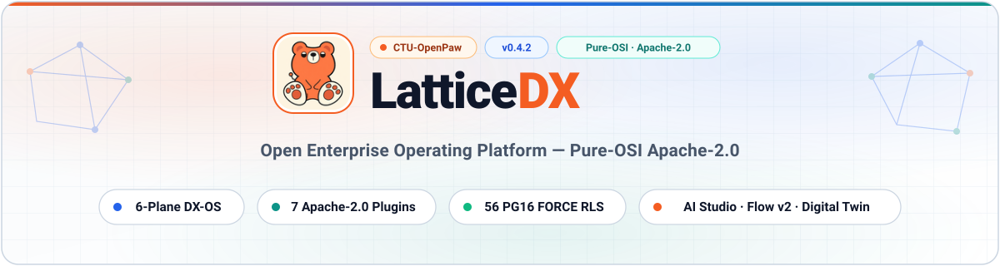
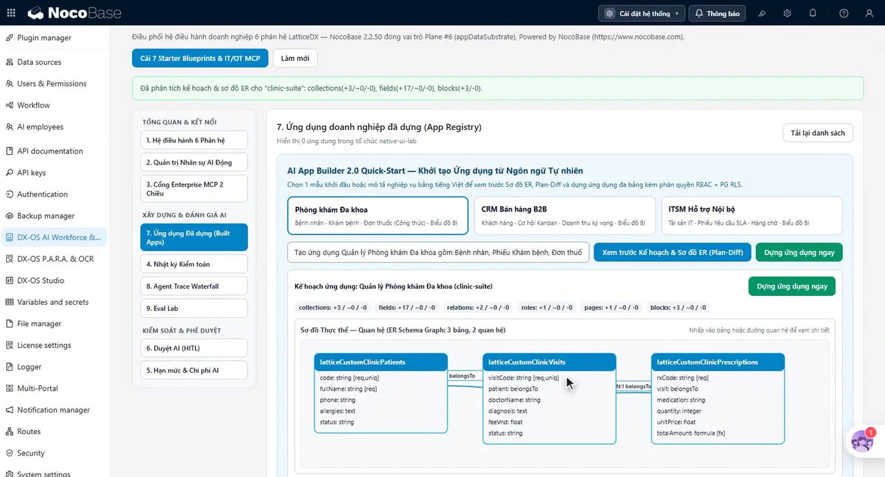
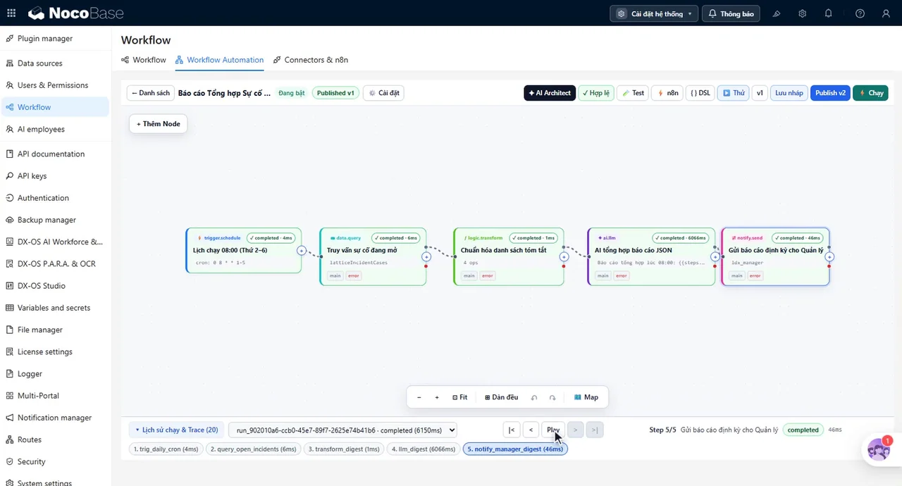
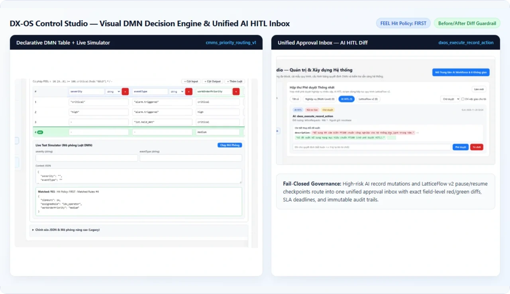
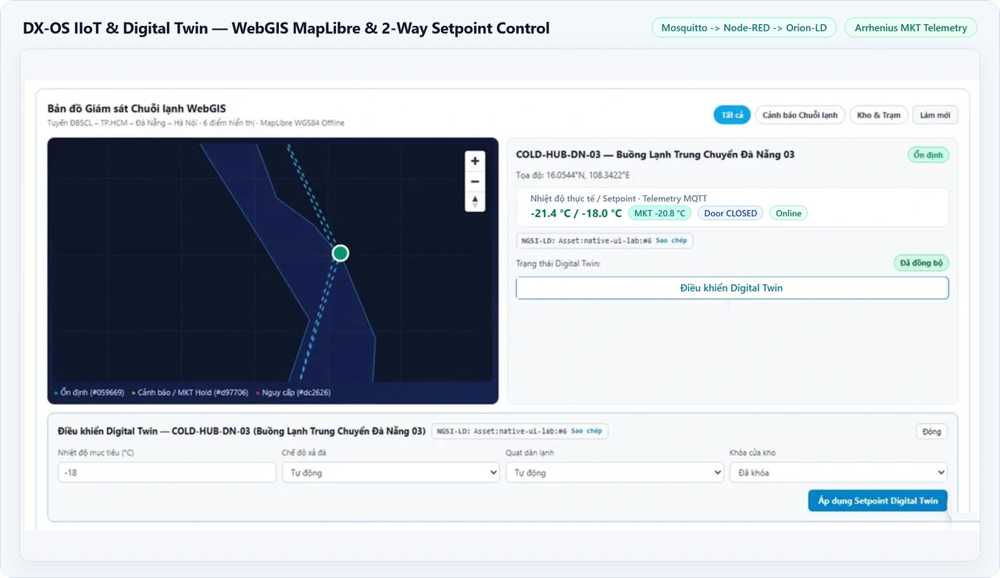

<!--
@file LatticeDX — Open Digital Enterprise Platform
@author CTU-OpenPaw
@copyright (C) 2026 CTU-OpenPaw
@license Apache-2.0
@see https://github.com/CTU-OpenPaw/lattice-dx
SPDX-License-Identifier: Apache-2.0
-->

<div align="center">

<picture>
  <source media="(prefers-color-scheme: dark)" srcset="./docs/assets/hero-dark.svg" />
  <source media="(prefers-color-scheme: light)" srcset="./docs/assets/hero-light.svg" />
  
</picture>

<p>
  <strong>Tiếng Việt</strong> | <a href="./README.en.md">English</a>
</p>

<p>
  <a href="https://github.com/CTU-OpenPaw/lattice-dx/actions/workflows/ci.yml"></a>
  <a href="https://github.com/CTU-OpenPaw/lattice-dx/actions/workflows/codeql.yml"></a>
  <a href="./LICENSE"></a>
  <a href="https://ctu-openpaw.github.io/lattice-docs/"></a>
</p>

<p>
  <a href="https://ctu-openpaw.github.io/lattice-docs/">Tài liệu</a> ·
  <a href="#khởi-chạy-nhanh">Khởi chạy nhanh</a> ·
  <a href="#kiến-trúc-nền-tảng">Kiến trúc</a> ·
  <a href="https://github.com/CTU-OpenPaw/lattice-templates">Templates</a> ·
  <a href="https://github.com/CTU-OpenPaw/lattice-dx/discussions">Thảo luận</a>
</p>

</div>

LatticeDX (`v0.4.2`) là nền tảng hệ điều hành doanh nghiệp mở, hợp nhất cổng nghiệp vụ đa vai trò, quy trình tự động hóa DAG/DMN, tác tử AI và dữ liệu IIoT trên 7 plugin `Apache-2.0` gắn vào runtime `NocoBase 2.2.50`. Mọi dữ liệu nghiệp vụ được cô lập đa tenant ở tầng lõi cơ sở dữ liệu với 56 bảng tĩnh PostgreSQL 16 `FORCE ROW LEVEL SECURITY` qua tham số phiên `app.current_org` và vai trò không đặc quyền `nocobase_app`.

---

## Năng lực Cốt lõi

| Phân hệ | Kiến trúc & Thành phần chính | Tài liệu |
| --- | --- | --- |
| **Cổng Đa vai trò & Giao diện v2** | 12 `Dxos*BlockModel`, 8 vai trò `ldx_*`, cổng `/p/*`, biểu mẫu công khai Zero-PII (`/v/form/:slug`) và Mobile Field PWA ngoại tuyến (`/v/mobile`) dùng IndexedDB outbox. | [Multi-Portal & Blocks](https://ctu-openpaw.github.io/lattice-docs/studio/native-blocks) |
| **Quy trình DAG & Quyết định DMN** | `LatticeFlow v2` (24 loại node thuộc 6 nhóm, `Draft/Publish`, `loopCursor` HITL), `Visual DMN` (`FIRST`, `UNIQUE`, `COLLECT`, `PRIORITY`), phê duyệt `M-of-N` và cầu nối `n8n` REST v1. | [LatticeFlow & DMN](https://ctu-openpaw.github.io/lattice-docs/automation/latticeflow-overview) |
| **AI Studio & App Builder 2.0** | 7 Starter Profiles, 20 Unified Tools có kiểm toán, vòng đời `plan -> build -> patch -> rollback -> safe teardown`, cổng Streamable MCP (`/api/dxos-mcp`) và Google/LF A2A. | [AI Studio](https://ctu-openpaw.github.io/lattice-docs/ai/overview-and-profiles) |
| **Kho Tri thức P.A.R.A. & Hybrid RAG** | Không gian P.A.R.A., trích xuất PDF/DOCX/XLSX/PPTX và OCR-to-Record, kết hợp chỉ mục `tsvector` tiếng Việt với `pgvector` theo công thức RRF (`k = 60`). | [P.A.R.A. Hybrid RAG](https://ctu-openpaw.github.io/lattice-docs/ai/para-knowledge-rag) |
| **IIoT Digital Twin & Chuỗi lạnh** | Mosquitto `2.0.21` DynSec/LWT, FIWARE Orion-LD `1.12.0` NGSI-LD 2 chiều, Node-RED `4.0.9` downlink, nhiệt độ động học Arrhenius MKT, WMS FEFO và ePOD ký số QR (`/v/track/:code`). | [IIoT Digital Twin](https://ctu-openpaw.github.io/lattice-docs/domains/iiot-digital-twin) |
| **Bảo mật & Cô lập Đa Tenant** | Caddy `2.10`, APISIX `3.19.0`, Keycloak `26.8.2` OIDC/PKCE, Valkey `8.1`, 56 bảng tĩnh PostgreSQL 16 `FORCE RLS`, khóa `ldx_pat_*`, két bí mật `AES-256-GCM` và sổ cái `Ed25519` + Merkle. | [Multi-Tenancy RLS](https://ctu-openpaw.github.io/lattice-docs/architecture/multi-tenancy-rls) |

---

## Kiến trúc Nền tảng

<p align="center">
  
  <br />
  <sub><em>Kiến trúc 4 tầng (Tầng 3 Ứng dụng Nghiệp vụ, Tầng 2 Trải nghiệm Người dùng &amp; Cấu hình, Tầng 1 Runtime Headless &amp; Dịch vụ Dùng chung, Dữ liệu Thuộc Dịch vụ &amp; Vận hành Xuyên suốt) cùng 5 Mẫu Tương tác Nền tảng chuẩn (1–5) từ biên Zero-Trust đến PostgreSQL 16 FORCE RLS. Khám phá sơ đồ tương tác tại <a href="https://ctu-openpaw.github.io/lattice-docs/architecture/overview">Trình khám phá Kiến trúc Nền tảng</a>.</em></sub>
</p>

---

## Kiến trúc Mô-đun 7 Plugin (`sdkProvidedByHost: true`)

Toàn bộ phần mở rộng nằm dưới `plugins/nocobase/*`, mang phiên bản `0.4.2`, giấy phép `Apache-2.0` và khai báo `"nocobase": { "sdkProvidedByHost": true }`. Nền tảng runtime `nocobase/nocobase:2.2.50` chạy tách biệt dưới dạng OCI container ngoài kho Git và bảo toàn nguyên vẹn ghi nhận Điều 5.2 NocoBase.

| Gói phần mềm | Phiên bản | Trách nhiệm chính | Tài liệu |
| --- | :---: | --- | --- |
| [`@latticedx/plugin-lattice-foundation`](plugins/nocobase/plugin-lattice-foundation/README.md) | `0.4.2` | 56 bảng tĩnh PostgreSQL 16 `FORCE RLS` (`app.current_org`), Multi-Portal, Mobile PWA, Public Forms, `dxosApprovals` (`M-of-N`), `dxosNotify`, `ldx_pat_*`, `dxosLedger` (`Ed25519` + Merkle), `dxosVault` (`AES-256-GCM`), CloudEvents `dxosEvents`, OpenAPI 3.1/AsyncAPI 3.0 và OTel/Prometheus. | [Architecture](https://ctu-openpaw.github.io/lattice-docs/architecture/plugin-system) |
| [`@latticedx/plugin-enterprise-auth`](plugins/nocobase/plugin-enterprise-auth/README.md) | `0.4.2` | Đăng nhập Keycloak OIDC + PKCE `S256` ánh xạ về phiên NocoBase, lưu trạng thái trên Valkey `8.1`, Backchannel Logout và đồng bộ nhóm sang vai trò chống leo thang quyền. | [Security Model](https://ctu-openpaw.github.io/lattice-docs/architecture/security-model) |
| [`@latticedx/plugin-dxos-para`](plugins/nocobase/plugin-dxos-para/README.md) | `0.4.2` | Kho tri thức P.A.R.A. (`latticeParaDocuments`, `latticeParaChunks`), trích xuất PDF/Office thuần Node.js, OCR-to-Record và Hybrid RAG `tsvector` + `pgvector` RRF. | [P.A.R.A. RAG](https://ctu-openpaw.github.io/lattice-docs/ai/para-knowledge-rag) |
| [`@latticedx/plugin-dxos-blocks`](plugins/nocobase/plugin-dxos-blocks/README.md) | `0.4.2` | 12 Native v2 `BlockModel`s (`DxosBiChartBlockModel`, `DxosWebGisBlockModel` dùng `maplibre-gl`, `DxosWmsOpsBlockModel`, `DxosKanbanScheduleBlockModel`), `dxosBroker` MQTT/Orion-LD và xuất báo cáo RBAC. | [Native Blocks](https://ctu-openpaw.github.io/lattice-docs/studio/native-blocks) |
| [`@latticedx/plugin-dxos-studio`](plugins/nocobase/plugin-dxos-studio/README.md) | `0.4.2` | Control Studio (11 tab Studio, 6 bảng điều phối quản trị, Visual DMN), LatticeFlow v2 (`@xyflow/react`), OMS/WMS FEFO/ePOD, cầu nối `n8n` REST v1, Custom Collections (`latticeCustom*`) + AST Formula và GitOps Solution Bundle v3. | [Control Studio & Flow](https://ctu-openpaw.github.io/lattice-docs/automation/latticeflow-overview) |
| [`@latticedx/plugin-dxos-ai`](plugins/nocobase/plugin-dxos-ai/README.md) | `0.4.2` | AI Studio với 7 Starter Profiles, 20 Unified Tools, App Builder 2.0, Streamable MCP (`/api/dxos-mcp`, `/api/dxos-mcp/it-ot`), A2A (`/.well-known/agent-card.json`), Eval Lab và che PII tiếng Việt. | [AI Studio & MCP](https://ctu-openpaw.github.io/lattice-docs/ai/mcp-gateway) |
| [`@latticedx/plugin-action-bridge`](plugins/nocobase/action-bridge/README.md) | `0.4.2` | Cầu nối thực thi hành động (`dxActions`) và tương thích định tuyến giữa dịch vụ Fastify `@dx/api` với không gian `/lattice/*`. | [REST API](https://ctu-openpaw.github.io/lattice-docs/reference/rest-api) |

---

## Khởi chạy Nhanh

Yêu cầu hệ thống: **Node.js `24.x`** (`>=24 <25`), **pnpm `10.23.0`**, **Git**, **tar** và **Docker Engine / Docker Compose v2+**.

### 1. Clone mã nguồn và cài đặt phụ thuộc

```sh
git clone https://github.com/CTU-OpenPaw/lattice-dx.git
cd lattice-dx
pnpm install --frozen-lockfile
```

### 2. Khởi tạo tệp cấu hình môi trường

```sh
cp .env.example .env
```

*(Với môi trường production Zero-Trust sử dụng Caddy, APISIX và role không đặc quyền `nocobase_app`, tham khảo [`infra/compose/prod.env.example`](infra/compose/prod.env.example) và thay toàn bộ mật khẩu cục bộ trước khi vận hành.)*

### 3. Khởi động runtime cô lập

```sh
# Dựng runtime NocoBase 2.2.50 sạch cùng 7 plugin Apache-2.0 trên cổng 13014
pnpm native:clean --port=13014

# Hoặc khởi chạy cụm Compose Core + NocoBase
docker compose --env-file .env -f infra/compose/core.yml -f infra/compose/nocobase.yml up -d
```

Sau khi khởi tạo xong, mở `http://localhost:13014` để truy cập không gian quản trị (`/admin/lattice-workspace`, `/admin/settings/dxos-ai`, `/admin/settings/dxos-studio`) hoặc các cổng nghiệp vụ (`/p/logistics`, `/p/incidents`, `/p/cmms`, `/v/mobile`). Xem hướng dẫn chi tiết về các profile Compose (`iiot`, `integration`, `observability`, `pdf`) tại [Tài liệu Khởi chạy nhanh](https://ctu-openpaw.github.io/lattice-docs/getting-started/quickstart) và [Triển khai Production](https://ctu-openpaw.github.io/lattice-docs/getting-started/production-deployment).

<details>
<summary>Lệnh Build từ mã nguồn và Kiểm thử cục bộ</summary>

```sh
# Cài đặt phụ thuộc khóa lockfile cho enterprise-auth và build 7 plugin
npm ci --prefix plugins/nocobase/plugin-enterprise-auth --ignore-scripts --no-audit --no-fund
node plugins/nocobase/action-bridge/build.mjs
node plugins/nocobase/plugin-lattice-foundation/scripts/build.mjs
node plugins/nocobase/plugin-enterprise-auth/build.mjs
node plugins/nocobase/plugin-dxos-para/build.mjs
node plugins/nocobase/plugin-dxos-blocks/build.mjs
node plugins/nocobase/plugin-dxos-studio/build.mjs
node plugins/nocobase/plugin-dxos-ai/build.mjs

# Kiểm tra typecheck, test đơn vị/tích hợp, build và tuân thủ Pure-OSI
pnpm check
node scripts/source-headers.mjs --check
pnpm pof:check
pnpm release:sbom -- --check
node --test plugins/nocobase/*/tests/*.test.cjs scripts/tests/*.test.mjs tests/native-ui-fixture.test.mjs tests/nocobase-externals.test.mjs

# Xác minh nghiệm thu runtime cục bộ trên cổng 13014
pnpm acceptance:broker-automation-builder -- --origin=http://localhost:13014
```

</details>

---

## Trình diễn Giao diện Sản phẩm

<table width="100%">
  <tr>
    <td width="50%" valign="top">
      
      <br />
      <sub><strong>App Builder 2.0 &amp; Visual ER</strong> — Tạo schema đa thực thể kèm PostgreSQL <code>FORCE RLS</code>, xem trước Plan-Diff và quay lui phiên bản.</sub>
    </td>
    <td width="50%" valign="top">
      
      <br />
      <sub><strong>LatticeFlow v2 DAG Studio</strong> — Biên tập 24 loại node trên canvas <code>@xyflow/react</code>, tách Draft/Publish và Live Step Trace.</sub>
    </td>
  </tr>
  <tr>
    <td width="50%" valign="top">
      
      <br />
      <sub><strong>Visual DMN &amp; Hộp thư HITL</strong> — Mô phỏng bảng quyết định FEEL và phê duyệt tác vụ AI kèm diff trước/sau.</sub>
    </td>
    <td width="50%" valign="top">
      
      <br />
      <sub><strong>Logistics, WMS FEFO &amp; BI</strong> — Điều phối kho lạnh xuất nhập FEFO, phong tỏa theo ngưỡng MKT và tổng hợp BI tại chỗ.</sub>
    </td>
  </tr>
  <tr>
    <td width="50%" valign="top">
      
      <br />
      <sub><strong>WebGIS &amp; Digital Twin 2 chiều</strong> — Theo dõi chuỗi lạnh trên <code>maplibre-gl</code> và đồng bộ setpoint qua Mosquitto, Orion-LD và Node-RED.</sub>
    </td>
    <td width="50%" valign="top">
      
      <br />
      <sub><strong>Tra cứu Zero-PII &amp; Ed25519 PKI</strong> — Kiểm chứng chữ ký giao nhận ePOD tại <code>/v/track/:code</code> mà không để lộ dữ liệu cá nhân.</sub>
    </td>
  </tr>
</table>

---

## Hệ sinh thái, Nguồn mở & Ghi nhận NocoBase

| Kho mã nguồn | Vai trò | Giấy phép | Liên kết |
| --- | --- | :---: | --- |
| **`CTU-OpenPaw/lattice-dx`** | Nền tảng lõi DX-OS (`v0.4.2`): 7 plugin NocoBase, dịch vụ Fastify, worker, file-scanner và hạ tầng Compose khóa digest. | `Apache-2.0` | [Repository](https://github.com/CTU-OpenPaw/lattice-dx) |
| **`CTU-OpenPaw/lattice-docs`** | Cổng tài liệu kỹ thuật song ngữ (Tiếng Việt / English) dựng trên VitePress kèm sơ đồ kiến trúc tương tác. | `MIT` / `Apache-2.0` | [Live Docs](https://ctu-openpaw.github.io/lattice-docs/) · [Repo](https://github.com/CTU-OpenPaw/lattice-docs) |
| **`CTU-OpenPaw/lattice-templates`** | Thư viện mẫu Solution Bundle v3, LatticeFlow v2, DMN, n8n, Public Forms và Business Packs đã làm sạch bí mật. | `Apache-2.0` | [Repository](https://github.com/CTU-OpenPaw/lattice-templates) |
| **`CTU-OpenPaw/.github`** | Hồ sơ tổ chức, chuẩn đóng góp cộng đồng và quy trình phản hồi bảo mật chung. | `Apache-2.0` | [Organization](https://github.com/CTU-OpenPaw) · [Repo](https://github.com/CTU-OpenPaw/.github) |

| Khía cạnh | Quy chuẩn & Chi tiết |
| --- | --- |
| Ranh giới Pure-OSI & Giấy phép | Toàn bộ mã nguồn gốc của LatticeDX phát hành theo [`Apache-2.0`](LICENSE). Kho Git và gói phát hành nguồn không nhúng submodule `upstream/nocobase`, không sử dụng `.gitmodules` và loại bỏ hoàn toàn phần mềm `BSL-1.1`. Xem chi tiết tại [Tài liệu Nguồn mở & Tuân thủ](https://ctu-openpaw.github.io/lattice-docs/open-source/licensing) và [`NOTICE`](NOTICE). |
| Ghi nhận NocoBase `2.2.50` (Điều 5.2) | Runtime host `nocobase/nocobase:2.2.50` được nạp độc lập dạng OCI container ngoài kho Git. Cả 7 plugin khai báo `"sdkProvidedByHost": true` và giữ nguyên ghi nhận `Powered by NocoBase` (`v2.2.50`, `https://www.nocobase.com`, `License settings`). Xem thêm tại [Third-Party & NocoBase Attribution](https://ctu-openpaw.github.io/lattice-docs/open-source/third-party-and-nocobase). |
| Đóng góp & Bảo mật | Tham khảo [`CONTRIBUTING.md`](CONTRIBUTING.md) và [`CODE_OF_CONDUCT.md`](CODE_OF_CONDUCT.md). Mọi lỗ hổng bảo mật cần báo cáo riêng tư theo hướng dẫn tại [`SECURITY.md`](SECURITY.md) qua [GitHub Security Advisories](https://github.com/CTU-OpenPaw/lattice-dx/security/advisories/new). |
