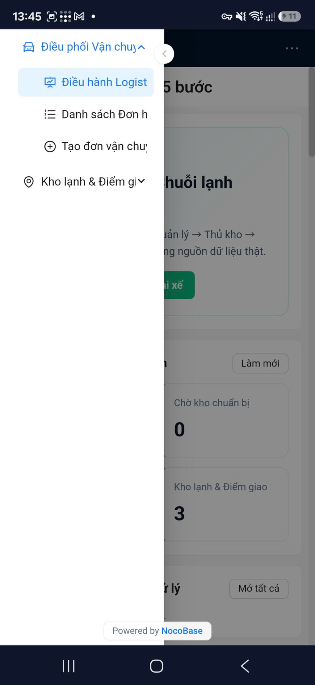

# Báo cáo Kiểm thử E2E Toàn Hệ thống LatticeDX v0.4.2

- **SHA dự kiến:** `3eaf363`
- **SHA thực tế đã kiểm thử:** `3eaf36381e85ddc6b26357d68642f07c47b06d59` (`3eaf363`)
- **Tình trạng working tree:** Sạch (không sửa bất kỳ file nào được git theo dõi)
- **Môi trường kiểm thử:** Windows, Node `v24.18.0`, pnpm `10.23.0`, Docker `29.9.2` / Docker Compose `v5.6.1`, Lab Docker riêng đang chạy tại `http://localhost:<cổng-lab>`
- **Trạng thái phiên kiểm thử:** Đã hoàn tất lượt kiểm theo checklist, gồm hai mục Hưng tự kiểm trên thiết bị thật. Báo cáo ghi các lỗi và giới hạn còn lại để nhóm xử lý.
- **Thời gian cập nhật:** 2026-11-27 sau lượt kiểm UX của Hưng

Bản kiểm thử ghi nhận kết quả trên commit `3eaf363`. Các ảnh chọn lọc được lưu cạnh báo cáo để xem trực tiếp trên GitHub. Những bằng chứng được đánh dấu **lưu cục bộ** nằm trong hồ sơ kiểm thử của Hưng.

## Tổng hợp Trạng thái (Đợt 6)

| Trạng thái | Số lượng |
|---|---:|
| Đạt | 59 |
| Lỗi | 8 |
| Bị chặn | 5 |
| Chờ kiểm thủ công | 0 |
| Chưa chạy | 0 |
| **Tổng cộng** | **72** |

### Phân loại theo Nguồn kiểm thử

| Nguồn kiểm thử | Đạt | Lỗi | Bị chặn | Chờ kiểm thủ công | Tổng |
|---|---:|---:|---:|---:|---:|
| CLI (`pnpm` / `node` / `backup:native`) | 9 | 1 | 1 | 0 | 11 |
| API (Live Acceptance / Seeder) | 8 | 2 | 2 | 0 | 12 |
| Trình duyệt / Giả lập (`webview_browser`) | 41 | 4 | 2 | 0 | 47 |
| Thiết bị thật (Hưng tự kiểm) | 1 | 1 | 0 | 0 | 2 |
| **Tổng cộng** | **59** | **8** | **5** | **0** | **72** |

---

## Đối chiếu Hướng dẫn (`docs/E2E_TESTING_GUIDE_HUNG.md`) với Repo (`package.json` & cấu hình hiện tại)

| STT | Mục trong hướng dẫn | Nội dung trong hướng dẫn | Thực tế trong repo (`package.json` / scripts / compose) | Tác động |
|---|---|---|---|---|
| 1 | Mục 0.3 dòng 48 (`--blank-slate`) | `LATTICE_SKIP_DEMO_SEED=1 pnpm native:clean --port=13014 --blank-slate` | Cú pháp env Bash (PowerShell dùng `$env:LATTICE_SKIP_DEMO_SEED="1"` hoặc chỉ `--blank-slate` vì `scripts/native-clean-install.mjs:24` tự inject env). Ngoài ra **thiếu cờ `--keep`**, khiến `native-clean-install.mjs:229-231` tự `compose down -v` ngay khi xong kiểm tra tự động. | Không mở được trình duyệt kiểm Onboarding Checklist nếu chạy đúng lệnh hướng dẫn. |
| 2 | Mục 0.4 (Bảng tài khoản) | Liệt kê 5 tài khoản đăng nhập + Khách ẩn danh, thiếu tài khoản Kho. | `scripts/setup-native-ui-lab.mjs:43` tạo tài khoản **`ldx_warehouse`**: `tài khoản thử`. | Cần dùng tài khoản này cho bước 3 luồng Logistics (Kho thấy việc). |
| 3 | Mục 0.3 dòng 30 (`pnpm native:clean --port=13014`) | Dựng NocoBase 2.2.50 + cài & bật đủ 7 plugin ở cổng 13014. | `scripts/native-clean-install.mjs:131` chỉ chạy `pnpm install --offline` trong `output/native-clean/<id>/source` khi `blankSlate === true`, trong khi `plugin-dxos-blocks/build.mjs` và `plugin-dxos-studio/build.mjs` cần `esbuild`, `maplibre-gl`, `@xyflow/react`, `@dagrejs/dagre`. | Gây lỗi dựng lab `13014` (xem Lỗi #1). |
| 4 | Mục 0.3 / Mục 1–7 (Compose lab) | Dùng `pnpm native:clean` để test cả Public routes, Redis/Valkey SSE, múi giờ `+07:00`, n8n/Keycloak/9router. | `native-clean-install.mjs` dùng `infra/compose/native-rehearsal.yml`: chỉ có `nocobase-db` + `nocobase`, **không** có Valkey/Redis, **không** mount `10-lattice-public-routes.sh`, **không** có `TZ=Asia/Ho_Chi_Minh`, và không có Keycloak/Orion-LD/Mosquitto/Node-RED/n8n/9router. | Các kiểm tra phụ thuộc n8n (`dxos-ai-mcp`, `broker-automation-builder`) bị chặn trên lab 2 container. |
| 5 | Mục 8.6 (`pnpm backup:stack`) | Chạy `pnpm backup:stack` & `pnpm backup:rehearse-stack`. | `scripts/stack-recovery.mjs` yêu cầu đủ 7 container của stack mặc định `lattice-dx-*`. | Phải dùng `backup:native` / `backup:rehearse-native` với `NATIVE_DATABASE_CONTAINER` cho lab `native-clean`. |
| 6 | Mục Dọn dẹp dòng 292 | `docker compose -f infra/compose/nocobase.yml down` | Lab `native:clean` chạy theo project riêng `lattice-native-clean-<id>` với `-f infra/compose/native-rehearsal.yml -f output/native-clean/6fed9510143d/overlay.yml`. | Lệnh trong hướng dẫn không tắt được lab `13017`. |
| 7 | `scripts/docker-desktop.ps1` | Script `pnpm docker:start` tìm `C:\Program Files\Docker\Docker\Docker Desktop.exe`. | Máy hiện tại cài Docker Desktop theo user tại `thư mục ứng dụng của người dùng Windows`. | `pnpm docker:start` báo không tìm thấy file nếu gọi trực tiếp. |
| 8 | Mục 5 (`DX-OS AI Studio`) | Đánh số `Tab 6 (HITL)`, `Tab 7 (Built Apps)`, `Tab 8 (Trace & Eval Lab)`, `Tab 9 (Quota & Audit)`. | Giao diện thực tế ở `/admin/settings/dxos-ai` hiển thị `Tab 4 (Built Apps 2.0)`, `Tab 5 (Nhật ký Kiểm toán)`, `Tab 7 (Eval Lab)`, `Tab 8 (Duyệt AI HITL)`, `Tab 9 (Hạn mức & Chi phí AI)`. | Đã kiểm đầy đủ theo đúng tên chức năng thực tế trên thanh bên trái. |

---

## Nhật ký Kết quả Theo Đợt

### Đợt 1 — Cài đặt, Build, Test Tự động & Tuân thủ Pure-OSI (Mục 0.2 & Phần 8.1–8.4)

| Mục | Vai trò | Nguồn | Trạng thái | Kết quả mong đợi | Kết quả thực tế | Bằng chứng |
|---|---|---|---|---|---|---|
| Mục 0.2 — `pnpm install --frozen-lockfile` | Hệ thống (CLI) | CLI | Đạt | Cài đủ dependency theo lockfile | `pnpm.exe` độc lập lỗi `UNABLE_TO_VERIFY_LEAF_SIGNATURE` khi tải npm registry. Chạy qua `NODE_OPTIONS="--use-system-ca" corepack pnpm install --frozen-lockfile` thành công 157 gói trong 5.1s. | `batch1-install.log` (lưu cục bộ) |
| Mục 8.1 — `pnpm check` (`typecheck` + `vitest` + `build`) | Hệ thống (CLI) | CLI | Đạt | Typecheck, Vitest (152 file / 1,128 test) và build 12 package/plugin đều xanh | Typecheck 12/13 workspace projects + `solutions/logistics` xanh; Vitest **152/152 file, 1,128/1,128 test** pass (20.66s); `pnpm -r build` build xong toàn bộ gồm UMD `plugin-dxos-blocks` & `plugin-dxos-studio`. | `batch1-pnpm-check.log` (lưu cục bộ) |
| Mục 8.2 — `node --test --test-concurrency=4` (174 file) | Hệ thống (CLI) | CLI | Đạt | Toàn bộ 174 file test Node pass (`0` fail) | `174` file (`152` plugin `.test.cjs` + `20` `scripts/tests/*.test.mjs` + `2` `tests/*.test.mjs`): `1,381` test — **`1,380` pass, `0` fail, `1` skipped** (29.02s). | `batch1-node-test.log` (lưu cục bộ) |
| Mục 8.3 — `node scripts/eval-vietnamese-nl-agent.mjs --min-pass=95` | Hệ thống (CLI) | CLI (Router) | Đạt | Đạt 163/163 (100%) | **163/163 (100%)**, 0 failures trên tất cả 23 category. | `batch1-eval.log` (lưu cục bộ) |
| Mục 8.4a — `node scripts/source-headers.mjs --check` | Hệ thống (CLI) | CLI | Đạt | Không file code thiếu SPDX Apache-2.0 | `alreadyPresent=1098, changed=0, wouldChange=0, needsReview=[]`. | `batch1-compliance.log` (lưu cục bộ) |
| Mục 8.4b — `pnpm pof:check` | Hệ thống (CLI) | CLI | Đạt | 6/6 kiểm tra Pure-OSI PASS | `PASS`: 6/6 (`spdx-headers`, `governance-files`, `plugin-isolation`, `compose-digests`, `upstream-clean`, `no-secrets`). | `batch1-compliance.log` (lưu cục bộ) |
| Mục 8.4c — `pnpm release:sbom -- --check` | Hệ thống (CLI) | CLI | Đạt | SBOM CycloneDX 1.5 khớp 257 thành phần | `SBOM check passed (docs/sbom-cyclonedx.json): 257 components (workspace=12, npm=226, oci=19).` | `batch1-compliance.log` (lưu cục bộ) |
| Mục 8.4d — `pnpm audit --prod --audit-level=low` | Hệ thống (CLI) | CLI | Đạt | 0 lỗ hổng production | Chạy qua `NODE_OPTIONS="--use-system-ca" corepack pnpm audit --prod --audit-level=low`: `No known vulnerabilities found`. | `batch1-compliance.log` (lưu cục bộ) |

### Đợt 2 — Dựng Lab Docker Cô lập, Chẩn đoán Bộ cài, Nạp Dữ liệu Demo & Nghiệm thu Live API (Mục 0.3 & Phần 8.5–8.6)

| Mục | Vai trò | Nguồn | Trạng thái | Kết quả mong đợi | Kết quả thực tế | Bằng chứng |
|---|---|---|---|---|---|---|
| Mục 0.3 — `pnpm native:clean --port=13014` (lượt 1: `6180ec6a00d5`) | Hệ thống (CLI) | CLI | Lỗi | Tự dựng NocoBase + 7 plugin và pass `acceptance:*` | Dừng ở `phase: failed` (`Workspace command failed; command output withheld`). Trong `output/native-clean/6180ec6a00d5/source` thiếu `node_modules` khi `blankSlate=false` (Lỗi #1). | `batch2-native-clean.log` (lưu cục bộ), `report.json (13014)` (lưu cục bộ) |
| Mục 0.3 — Lab `13017` (`6fed9510143d`, đã cài offline `node_modules` vào source xuất riêng): 7 plugin + 59 migrations + `acceptance-native-foundation.mjs` | Hệ thống (CLI) | CLI / API | Đạt | Cài 7 plugin `0.4.2`, chạy 59 migrations, `acceptance-native-foundation` PASS | Cài đủ 7 plugin (`0.4.2`), 59 migrations, `acceptance-native-foundation` PASS `8/8`. | `batch2-resume.log` (lưu cục bộ), `report.json (13017)` (lưu cục bộ) |
| Mục 0.3 — `scripts/acceptance-native-documents.mjs` trên `http://localhost:<cổng-lab>` | Hệ thống + các role | API | Lỗi | PASS toàn bộ kiểm tra workflow/ACL tài liệu | Thất bại (`Exit 1`) tại `scripts/acceptance-native-documents.mjs:79`: `409 !== 403` (Lỗi #2). | `batch2-documents-diag.log` (lưu cục bộ) |
| Mục 0.3 — `setup-native-ui-lab.mjs` trên `http://localhost:<cổng-lab>` | `root` | API | Đạt | Tạo 3 tài khoản (`employee`, `manager`, `worker`) + `/admin/nativeuilab...` | `CREATED` `/admin/nativeuilab1816f4b6c7`, 3 tài khoản + `workflowId=399979040276480` + backup DB. | `batch2-ui-lab.log` (lưu cục bộ), `lab-13017-report.json` (lưu cục bộ) |
| Mục 0.3 — `setup-native-multi-portal-demo.mjs` | `root` | API | Đạt | Dựng 5 portal + `dispatcher`, `driver` | PASS: tạo 14 trang trên 5 portal + 2 tài khoản `native.lab.dispatcher` & `native.lab.driver`. | `batch2-seed-13017.log` (lưu cục bộ) |
| Mục 0.3 — `setup-native-workspace-demo.mjs` | `root` | API | Đạt | Dựng workspace demo & nút tạo nhanh | PASS: `/admin/lattice-workspace?view=apps`, form `/admin/0ekwkzb1awr`. | `batch2-seed-13017.log` (lưu cục bộ) |
| Mục 0.3 — `pnpm setup:dxos-ai -- --origin=http://localhost:<cổng-lab>` | `root` | API | Đạt | Nạp 7 AI profiles + MCP + A2A | PASS: `bootstrappedCount=7`, `activeProfileCount=7`, `itOtMcpSynced=true` (`llm.skipped=true` vì chưa đặt `AGENT_API_KEY`). | `batch2-seed-13017.log` (lưu cục bộ) |
| Mục 0.3 — `node scripts/seed-v030-demo-showcase.mjs --origin=http://localhost:<cổng-lab>` | `root` | API | Lỗi | Nạp dữ liệu demo v0.3.0 | Thất bại (`Exit 1`): `latticeVoucher:submit HTTP 409: VOUCHER_SUBMIT_INVALID_STATE` (Lỗi #3). | `batch2-seed-13017.log` (lưu cục bộ) |
| Mục 0.3 — `pnpm seed:v100-showcase -- --origin=http://localhost:<cổng-lab>` | `root` | API | Đạt | Nạp dữ liệu cold-chain, OMS/WMS (`ORD-V100-001`), DMN, PKI, CMMS, automation | PASS (`Exit 0`): nạp đầy đủ dữ liệu trình diễn `ORD-V100-001`, `cold_chain_approval_v1`, `CLM-V100-001`, 7 automation rules, MQTT, webhooks. | `batch2-seed-13017.log` (lưu cục bộ) |
| Mục 8.5a — `pnpm acceptance:headless-paas -- --origin=http://localhost:<cổng-lab>` | Hệ thống + các role | API | Đạt | Toàn bộ kiểm tra Headless PaaS PASS | PASS (`Exit 0`): `9/9` checks passed (`SNP-MWYEO250-C22DDC88`, `LDX-TRK-503787FDC5`, `cold_route_dmn_yeo1qo`, Bundle v3). | `batch2-acc-headless-paas.log` (lưu cục bộ) |
| Mục 8.5b — `pnpm acceptance:dxos-ai-mcp -- --origin=http://localhost:<cổng-lab>` | Hệ thống + các role | API | Bị chặn | Nghiệm thu AI Studio & MCP PASS | Exit `1`: `list_n8n_workflows failed unexpectedly: n8n X-N8N-API-KEY is required.` Thiếu dịch vụ `n8n` trên lab 2 container. | `batch2-acc-dxos-ai-mcp.log` (lưu cục bộ) |
| Mục 8.5c — `pnpm acceptance:broker-automation-builder -- --origin=http://localhost:<cổng-lab>` | Hệ thống + các role | API | Bị chặn | Nghiệm thu Broker, Automation & Builder PASS | Exit `1`: `root dxosN8n:workflows failed (400): n8n X-N8N-API-KEY is required (N8N_API_KEY_MISSING)`. Thiếu dịch vụ `n8n` trên lab 2 container. | `batch2-acc-broker-builder.log` (lưu cục bộ) |
| Mục 8.5d — `pnpm acceptance:logistics-rbac -- "output/e2e-v042/lab-13017-report.json"` | 6 tài khoản lab | API | Đạt | Luồng 5 bước Logistics + Internal Service + 7 kiểm tra RBAC âm tính PASS | PASS (`Exit 0`): `logistics5Step` (`ORD-E2E-YEP2ZO` -> `completed`), `internalServiceDomain` (`SRV-E2E-YEP2ZO` -> `completed`), `negativeRbacChecks` `7/7` (`403`). | `batch2-acc-logistics-rbac.log` (lưu cục bộ) |
| Mục 8.6a — `pnpm backup:stack` & `backup:rehearse-stack` | Hệ thống (CLI) | CLI | Bị chặn | Sao lưu & phục hồi toàn stack 7 container | `scripts/stack-recovery.mjs` yêu cầu đủ 7 container stack chuẩn, trong khi lab `native-clean` chỉ có 2 container. | `batch2-backup.log` (lưu cục bộ) |
| Mục 8.6b — `pnpm backup:native` & `pnpm backup:rehearse-native` (`NATIVE_DATABASE_CONTAINER=lattice-native-clean-<id>-nocobase-db-1`) | Hệ thống (CLI) | CLI / DB | Đạt | Sao lưu & diễn tập phục hồi DB NocoBase của lab cô lập | PASS (`Exit 0`): dump `core-cd3caf73869545bcbbc6d08e3d6c07d2.dump` (`164` bảng, SHA-256 `579279...2958`) và `rehearse` vào `dx_restore_200ca0dde1a44fa8b1a1ccf23ed7374e` xác minh `164` bảng (`metadataVerified: true`). | `batch2-backup.log` (lưu cục bộ) |

### Đợt 3A — UI Phần 1: Onboarding, Đăng nhập, Bảo mật Auth & Cổng Công khai (`http://localhost:<cổng-lab>`)

| Mục | Vai trò | Nguồn | Trạng thái | Kết quả mong đợi | Kết quả thực tế | Bằng chứng |
|---|---|---|---|---|---|---|
| Test 1.1 — Màn hình đăng nhập `/signin` | Ẩn danh (chưa đăng nhập) | Trình duyệt | Đạt | Không bão `401`/`403`/`404`, không link đăng ký công khai, lỗi sai mật khẩu tiếng Việt | `50` request đầu đều `200` (`failedRequests: []`), không có link đăng ký (`hasSignup: 0`); nhập sai mật khẩu hiển thị `"Tên đăng nhập / email hoặc mật khẩu không đúng. Vui lòng kiểm tra lại."` | `transcript browser` (lưu cục bộ) |
| Test 1.2 — Đăng nhập `root` vào Workspace & Điều 5.2 | `root` | Trình duyệt | Đạt | Tự chuyển vào `/admin/lattice-workspace` (không rơi trang trống), giữ footer NocoBase Điều 5.2 | Tự chuyển thẳng vào `/admin/lattice-workspace`, thấy lối tắt `/p/*` và `DX-OS Inbox`; chân trang hiển thị `Powered by NocoBase` (`https://www.nocobase.com/`), `?` hiện `NocoBase v2.2.50` + `License`, Cài đặt có `License settings`. | `transcript browser` (lưu cục bộ) |
| Test 1.3 — SSO Enterprise Auth `/admin/settings/auth/enterprise-mappings` | `root` | Trình duyệt | Đạt | Không HTTP `500`, cảnh báo Keycloak sạch, bộ chọn thân thiện, có Popconfirm khi xóa | Trang tải HTTP `200`, hiển thị banner `"Kết nối Keycloak native"`, combobox chọn user thân thiện (6 tài khoản); bảng mapping đang trống nên chưa có dòng dữ liệu để kiểm nút xóa Popconfirm. | `transcript browser` (lưu cục bộ) |
| Test 1.4 — Biểu mẫu công khai `/v/form/yeu-cau-dich-vu-nhanh` | Ẩn danh (chưa đăng nhập) | Trình duyệt | Lỗi | Mở form công khai, kiểm tra validate, file, chống XSS, tra cứu Zero-PII | Trang trả HTTP `200` không lỗi `401`/`403`/`404` logo/favicon (`/v/lattice-brand.svg` `200`), nhưng hiển thị `"Biểu mẫu công khai không tồn tại hoặc đã ngừng tiếp nhận."` (Lỗi #4). | `transcript browser` (lưu cục bộ) |
| Test 1.5 — Tra cứu vận đơn & Quét QR Ed25519 `/v/track/:code?verify=...` | `root` -> Ẩn danh | Trình duyệt | Lỗi | In QR trên `/p/logistics`, mở ở ẩn danh thấy xác thực Ed25519 hợp lệ, PII fail-closed, eye toggle, mobile `>= 44x44px` | Điền sẵn `ORD-V100-001`, giữ kín ePOD/PII (fail-closed), nút `"Hiện"`/`"Ẩn"` hoạt động, mobile `390x844` nút `147.95x44px` & `44x44px`. Tuy nhiên cả `?verify=` ngắn lẫn hash 64 ký tự đều trả `POST /api/dxosWms:verifyTrackSignature` HTTP `401` `"Mã xác thực chữ ký QR không hợp lệ hoặc đã bị giả mạo."` (Lỗi #5). | `transcript browser` (lưu cục bộ) |
| Test 1.6 — Trang tương thích cũ `/lattice/workspace` | `root` | Trình duyệt | Bị chặn | Hiển thị breadcrumb `"Quay lại Workspace v2"` | Trả giao diện `404 — Sorry, the page you visited does not exist.` do lab `native-clean` không cài legacy bridge. | `final_step_69.png` (lưu cục bộ) |

### Đợt 3B — Test 2.2 (Phân quyền) & Luồng Logistics 3 Vai trò Riêng (`http://localhost:<cổng-lab>`)

| Mục | Vai trò | Nguồn | Trạng thái | Kết quả mong đợi | Kết quả thực tế | Bằng chứng |
|---|---|---|---|---|---|---|
| Test 2.2a — Tự chuyển hướng `/p/logistics` & Topbar | `ldx_employee` (`tài khoản thử`) | Trình duyệt | Đạt | Tự chuyển sang `/p/logistics-employee/...`, chỉ hiện 6 cổng được cấp quyền và đơn của mình | Tự chuyển hướng sang `/p/logistics-employee/7apuvkx7qyy`, Topbar hiển thị đúng 6 cổng, API lọc `requester.userId=15`. | `transcript 3B` (lưu cục bộ) |
| Test 2.2b — Chặn phân quyền Studio/AI/Flow | `ldx_employee` | Trình duyệt | Đạt | Chặn `403` tại `/admin/settings/dxos-studio`, `/admin/settings/dxos-ai`, `/admin/settings/workflow/automation` | Cả 3 đường dẫn đều hiển thị trang chặn `403` tiếng Việt (`dxosAi:listProfiles` `403`, `dxosAi:surfaceEvents` `403`). | `transcript 3B` (lưu cục bộ) |
| Luồng Logistics Bước 1 — Nhân viên tạo & gửi đơn mới | `ldx_employee` | Trình duyệt | Đạt | Tạo đơn mới trên UI và kích hoạt gửi duyệt | Tạo đơn `ORD-E2E-UI-3B01` (`id=5`, số lượng `25`) tại `/p/logistics-employee/ww88ljgvd2z` (`POST /api/latticeOrders:create` `200`), workflow chuyển trạng thái sang `submitted`. | `transcript 3B` (lưu cục bộ) |
| Luồng Logistics Bước 2 — Quản lý duyệt đơn & chặn `dxos-studio` | `ldx_manager` (`tài khoản thử`) | Trình duyệt | Đạt | Thấy tác vụ duyệt `ORD-E2E-UI-3B01`, bấm Duyệt thành công, bị chặn `403` vào `dxos-studio` | Thấy `Bước 2 — Quản lý duyệt đơn` cho `ORD-E2E-UI-3B01`, bấm `Duyệt đơn` (`POST /api/workflowManualTasks:submit` `202`) chuyển đơn sang `preparing`; vào `dxos-studio` bị chặn `403`. *(Ghi chú UX nhỏ: Kanban vẫn đặt thẻ `ORD-E2E-UI-3B01` ở cột `Bản nháp` do chưa có cột riêng cho `preparing`.)* | `transcript 3B` (lưu cục bộ) |
| Luồng Logistics Bước 3 — Kho nhận thấy việc | `ldx_warehouse` (`tài khoản thử`) | Trình duyệt | Đạt | Đăng nhập thấy việc mới được giao cho đúng đơn `ORD-E2E-UI-3B01` | Trên Workspace (`Mở công việc`, `filterbytk/399983979069440`) và `/p/logistics/755q8elxpv3` (`Công việc Logistics cần xử lý`) đều thấy `Bước 3 — Kho chuẩn bị hàng` cho đúng `ORD-E2E-UI-3B01` (`preparing`) kèm nút `Xác nhận đủ hàng`. | `final_step_61.png` (lưu cục bộ) |

### Đợt 4A — UI Phần 2: Toàn bộ 7 Portals & 12 Native v2 BlockModels (`http://localhost:<cổng-lab>`, Test 2.1 ở `1440x900` & `1280x800`)

| Mục | Vai trò | Nguồn | Trạng thái | Kết quả mong đợi | Kết quả thực tế | Bằng chứng |
|---|---|---|---|---|---|---|
| Test 2.1a — `/p/logistics`: WmsOps (FEFO, `holdLotByMkt`/`releaseLotByQa`) | `root` | Trình duyệt | Đạt | Phân bổ FEFO không `400`; `holdLotByMkt` -> `releaseLotByQa` sạch; in phiếu đơn nháp báo lỗi tiếng Việt | Phân bổ FEFO `200 OK` (`LOT-V100-FEFO-A: 10->5`); `holdLotByMkt` (MKT `13.754°C > 8°C`) -> `Tạm giữ MKT` (`200 OK`) -> `releaseLotByQa` -> `Sẵn sàng` (`200 OK`). *(Chưa thử được case lỗi in đơn nháp vì trên bảng không còn bản ghi `status=draft`; đơn `#5` `preparing` in chứng từ trả `200 OK`.)* | `transcript 4A` (lưu cục bộ) |
| Test 2.1b — `/p/logistics`: Kanban & Lịch biểu 7 ngày | `root` | Trình duyệt | Đạt | Chuyển Kanban/Lịch mượt, giờ `+07:00`, mở drawer chi tiết, có CTA duyệt | Chuyển qua lại 6 cột Kanban & Lịch 7 ngày mượt; drawer hiển thị `Asia/Ho_Chi_Minh`, Chatter `+07:00`, CTA `Mở Hộp Phê duyệt`. *(Ghi chú UX: thẻ `preparing` vẫn hiển thị ở cột `Bản nháp`.)* | `transcript 4A` (lưu cục bộ) |
| Test 2.1c — `/p/logistics`: BiChartBlock (5 chế độ & Modal Cấu hình) | `root` | Trình duyệt | Đạt | Đổi 5 chế độ Bar/Line/Pie/KPI/Pivot không lỗi SQL; modal `Cấu hình nội dung` ở `top: 24px` không cắt đỉnh ở `1440x900` & `1280x800`, dropdown dễ hiểu | Cả 5 chế độ render sạch (`0` lỗi `400/500`); modal `Cấu hình nội dung` ở `y=24px` (`600x656` tại `1440x900`, `600x744` tại `1280x800`) không bị cắt đỉnh, nhãn tiếng Việt rõ không dính tag `[BI]`. | `transcript 4A` (lưu cục bộ) |
| Test 2.1d — `/p/logistics`: RecordWorkbench (Chatter, PKI, Lineage, In, Xuất CSV/XLSX/PDF) | `root` | Trình duyệt | Lỗi | Chatter, Ed25519 PKI, Lineage, In chứng từ và Xuất CSV/XLSX/PDF hoạt động đầy đủ | Chatter `+07:00`, `Xác minh PKI` (`Hợp lệ (35 mục)`), `In chứng từ` (`200 OK`), Xuất CSV/XLSX/PDF (`exportReport` `200 OK`) đều đạt. Tuy nhiên **`Xem Phả hệ (Lineage)` trả HTTP `400`** với tài khoản `root` (Lỗi #6). | `transcript 4A` (lưu cục bộ) |
| Test 2.1e — `/p/incidents`: WebGIS MapLibre, Digital Twin HITL & AiProposalBlock | `root` | Trình duyệt | Đạt | Bản đồ hiện `COLD-CHILLER-CT-01`, `REEFER-TRUCK-HCM-02`, `COLD-HUB-DN-03`; đặt lệch `> 2°C` đẩy HITL; nút Phê duyệt/Từ chối hoạt động thật | Đủ 3 điểm chuỗi lạnh trên WebGIS (`latticeAssets:list` `200`); chỉnh `COLD-HUB-DN-03` `-10°C -> -2°C` (`deltaTempC: 8`) -> `gatedByHitl: true`, `approvalId: 4`, `pending_hitl`; duyệt Proposal `#3` & từ chối `#1` (`decideProposal` `200 OK`). | `transcript 4A` (lưu cục bộ) |
| Test 2.1f — `/p/services`: ParaVaultBlock (`contentMarkdown` & phân trang) | `root` | Trình duyệt | Bị chặn | Mở SOP thấy đủ Markdown (`contentMarkdown`), phân trang, không lộ `draft`/`archived` | Request gửi đúng bộ lọc `active=true` & `status=active`, nhưng DB hiện có **`0` tài liệu** `latticeParaDocuments` (`No data`) nên chưa có tài liệu để mở kiểm Markdown/phân trang. Sẽ kiểm lại sau khi tạo tài liệu ở Phần 4. | `transcript 4A` (lưu cục bộ) |
| Test 2.1g — Đủ 7 Portals ở `1440x900` & `1280x800` (`/p/procurement`, `/p/cmms`, `/p/partner-claims`, `/p/logistics-employee`, ...) | `root` | Trình duyệt | Đạt | Mở mượt cả 7 cổng không trắng trang, Việt hóa, không spam toast `503 local-9router` | Cả 7 cổng mở mượt ở `1440x900` & `1280x800`, thấy `CLM-V100-001`, `REQ-2026-001/002`, `WO-...`, không toast `503`. *(Ghi chú UX: nút Table chuẩn NocoBase vẫn tiếng Anh; footer hơi đè nhẹ phần cuối khi cuộn.)* | `final_step_110.png` (lưu cục bộ) |
| Test 2.1h — Topbar `Ctrl+K`, Chuông thông báo & `Add block` (12 BlockModels) | `root` | Trình duyệt | Đạt | `Ctrl+K` tìm nhảy thẳng; Chuông hoạt động; UI Editor `Add block` đủ 12 Native v2 BlockModels | `Ctrl+K` tìm `ORD-V100-001` nhảy tới `/p/logistics/755q8elxpv3`; Chuông gọi `unreadCount`/`listMine` `200 OK` (`0` chưa đọc nên chưa có item để thử `markRead`); `Add block` hiển thị đủ **12/12 DX-OS Native v2 BlockModels**. | `transcript 4A` (lưu cục bộ) |

### Đợt 4B — UI Phần 3: Mobile Field PWA Ngoại tuyến `/v/mobile` (`http://localhost:<cổng-lab>`, Tài xế `ldx_driver`, `390x844`)

| Mục | Vai trò | Nguồn | Trạng thái | Kết quả mong đợi | Kết quả thực tế | Bằng chứng |
|---|---|---|---|---|---|---|
| Test 3.1 — PWA Manifest, SW, nút `>= 44x44px` & ẩn Digital Twin theo ACL | `ldx_driver` (`tài khoản thử`) | Trình duyệt / Giả lập (`viewport 390x844`) | Đạt | Manifest + icon 192/512, SW `/api/dxos:sw.js`, nút `>= 44px`, ẩn Digital Twin không văng `403` | `/api/dxos:manifest`, icon PNG `192/512`, `/api/dxos:sw.js` đều `200`; `17/17` nút `>= 44x44px`; tab Digital Twin bị ẩn và mục Sự cố hiển thị `"Vai trò hiện tại không có quyền xem sự cố IoT."`. *(Giới hạn sandbox: khung webview giữ rộng `761.6px` dù `viewportSize=390x844` và khóa `page.evaluate` nên chưa đọc `navigator.serviceWorker` runtime.)* | `transcript 4B` (lưu cục bộ) |
| Test 3.2 — Ghi nhận ePOD kho lạnh mất GPS (`gpsUnavailable` + ảnh + chữ ký) & Phiếu dịch vụ | `ldx_driver` | Trình duyệt | Đạt | Lưu ePOD có `gpsUnavailable`, ảnh, chữ ký canvas & tạo phiếu dịch vụ | Ở chế độ Online: gửi `ORD-V100-001` (`gpsUnavailable`, ảnh `epod-evidence.png`, chữ ký canvas) thành công `200 OK` (`EPOD-MWYHM81M-82A6F2D8`, `LDX-TRK-85FDA30107`, `Ledger Seq #40`); tạo phiếu dịch vụ `TKT-MWYHMW36-S68Z` `200 OK`. *(Gửi `ORD-KHONG-TON-TAI-999` Online trả `404`.)* | `transcript 4B` (lưu cục bộ) |
| Test 3.3 — Offline Outbox, Quarantine & PWA/Camera trên điện thoại thật | `ldx_driver` | Android thật và đối chiếu DB lab | Đạt sau lần đồng bộ tiếp theo | Lưu 3 mục offline, đồng bộ 2 mục hợp lệ, giữ đơn sai ở Cách ly | PWA có biểu tượng trên màn hình chính, form hiện ảnh và chữ ký, Outbox tăng 0 → 3. Lần đầu hai mục hợp lệ báo `Network Error` và mã sai bị cách ly với HTTP 404. Ảnh sau ghi Outbox còn 1, phiếu `HUNG-OFFLINE-TEST` đã hiện trong danh sách và DB xác nhận ePOD của đơn đúng đã lưu. Xem Lỗi #8 về lần đồng bộ đầu. | Ngoại tuyến (bằng chứng lưu cục bộ) · Lần đầu (bằng chứng lưu cục bộ) · [Ảnh sau](evidence/ux-hung/image1.png) |
| Test 3.4 — Hết phiên `401` giữ Outbox, banner `"Đăng nhập ngay"` & Outbox Inspector | `ldx_driver` | Trình duyệt / Giả lập | Đạt | Dừng ngay ở `401` đầu tiên (không bão `401`), giữ ePOD trong Outbox, hiện banner `"Đăng nhập ngay"`, Inspector cho sửa mã/xuất JSON/xóa | Đăng xuất ở tab khác rồi gửi ePOD/Sync ở `/v/mobile` → gửi đúng 1 request `401`, giữ payload (`Hàng đợi: 1`), hiện banner `"Đăng nhập ngay"`; Outbox Inspector hiển thị `Lần thử: 1 · HTTP: 401`, ô sửa mã đơn + `Lưu & Thử lại`, `Thử lại`, `Xuất JSON`, `Xóa`. | `transcript 4B` (lưu cục bộ) |
| Test 3.5 — Chat AI trên `/v/mobile` khi LLM chưa cấu hình | `ldx_driver` | Trình duyệt | Đạt | Gửi câu chat không bị treo `"..."` vô hạn | `aiConversations:sendMessages` trả `500 LLM service not found`, app tự fallback sang `POST /api/dxos-a2a` (`200 OK`) hiển thị `"Governed A2A handoff accepted by dxos-logistics..."` (không treo `"..."`; không hiện nút `"Thử lại"` vì nhánh A2A thành công). | `final_step_67.png` (lưu cục bộ) |
| Mục UX thủ công — Đánh giá UX trên desktop & điện thoại | `root` / `ldx_driver` | Thiết bị thật, Hưng tự kiểm | Lỗi trình bày | Nội dung dễ đọc, điều hướng và nút dễ dùng | Workspace và những phần khác Hưng đã thử dùng bình thường theo phản hồi. Mobile có nút dễ chạm, menu Logistics và gợi ý GPS bị cắt chữ. Desktop cần chỉnh vị trí badge trạng thái và ô chọn tên trợ lý đang đè lên biểu đồ. Xem Lỗi #9 và ghi nhận UX bên dưới. | [Ảnh menu](evidence/mobile-hung/03-logistics-menu-clipped.png) · [Ảnh desktop](evidence/ux-hung/image5.png) |

### Đợt 5A — UI Phần 4 (P.A.R.A. + OCR + `/p/services`) & Phần 5 (DX-OS AI Studio 9 Tab + Chat nổi) (`http://localhost:<cổng-lab>`)

| Mục | Vai trò | Nguồn | Trạng thái | Kết quả mong đợi | Kết quả thực tế | Bằng chứng |
|---|---|---|---|---|---|---|
| Phần 4.1a — P.A.R.A. CRUD, Reindex & Hybrid RAG lọc `draft` / query rác trả rỗng | `root` | Trình duyệt | Đạt | Tạo 1 `active` (`SOP-KDL-E2E-01`) + 1 `draft` (`SOP-DRAFT-SECRET`), Reindex xong tìm không ra `draft`, query rác trả rỗng | Reindex `200 OK` (`2 tài liệu, 1 phân đoạn`); Hybrid RAG tìm `"Bản nháp bí mật"` không trả bản `draft`; tìm `"xyz_khong_ton_tai_99999"` trả `0` kết quả. | `transcript 5A` (lưu cục bộ) |
| Phần 4.1b — P.A.R.A. che PII (CCCD/SĐT) trong `summary` | `root` | Trình duyệt / API | Lỗi | `summary` / `snippet` che SĐT (`[SĐT mẫu]`) và CCCD (`[CCCD mẫu]`) | `latticeParaDocuments:get` & `hybridSearch` vẫn trả nguyên `[SĐT mẫu]` và `[CCCD mẫu]` trong `summary` / `snippet` (Lỗi #7). | `transcript 5A` (lưu cục bộ) |
| Phần 4.2 — OCR-to-Record (`latticeStockLots`) | `root` | Trình duyệt | Đạt | Sửa trực tiếp `productName`, `qtyOnHand`, `lotCode` → lưu DB đúng tuyệt đối | Upload `phieu-nhap-kho-e2e.txt`, sửa `productName="Vắc-xin E2E Sửa Tay"`, `qtyOnHand=77`, `lotCode="LOT-OCR-E2E-77"` → `dxosWms:receiveStock` `200 OK` giữ đúng cả 3 giá trị. *(Lưu ý phạm vi: chưa thử riêng OCR-to-Record cho bảng đích `latticeOrders`; chế độ `--blank-slate` Onboarding Checklist cũng chưa chạy riêng trong lượt lab có dữ liệu mẫu này.)* | `transcript 5A` (lưu cục bộ) |
| Test 2.1f (Kiểm lại sau khi tạo tài liệu) — `/p/services` ParaVaultBlock hiển thị Markdown | `root` | Trình duyệt | Đạt | Mở `SOP-KDL-E2E-01` hiện đầy đủ `contentMarkdown`, không lộ `draft` | Chỉ hiện `SOP-KDL-E2E-01` (ẩn `SOP-DRAFT-SECRET`), mở tài liệu hiển thị đầy đủ heading `Quy trình Kiểm định` & 3 bước. | `transcript 5A` (lưu cục bộ) |
| Phần 5.1 — AI Studio Tab 1: LLM Providers & SSRF guard | `root` | Trình duyệt | Đạt | Liệt kê LLM (`listLlmServices`) & chặn URL SSRF nội bộ/metadata | `listLlmServices` `200`; chặn `địa chỉ metadata nội bộ` & `địa chỉ loopback thử` bằng HTTP `400`. | `transcript 5A` (lưu cục bộ) |
| Phần 5.2 — AI Studio Tab 2: 7 Starter Profiles & tạo/sửa thử | `root` | Trình duyệt | Đạt | Đủ 7 profile & các trường cấu hình, lưu/xóa thử sạch | Đủ 7 starter profiles (`dxos-analyst`..`dxos-workspace`), tạo `e2e-test-ai` (`200`) rồi xóa sạch (`200`). | `transcript 5A` (lưu cục bộ) |
| Phần 5.3 — AI Studio Tab 3: MCP 2 Chiều & A2A Agent Card | `root` | Trình duyệt | Đạt | Danh mục tool động, Ping MCP & Agent Card version `0.4.2` | `20` Enterprise tools + `4` IT/OT tools + `3` Resources + `4` Prompts; Ping `/api/dxos-mcp` (`25ms`) & `/it-ot` (`10ms`); `/api/.well-known/agent-card.json` trả `200` `version: "0.4.2"` *(lưu ý `/.well-known/agent-card.json` không qua `/api` rơi SPA 404 trên `native-rehearsal` do thiếu nginx route)*. | `transcript 5A` (lưu cục bộ) |
| Phần 5.4 — AI Studio Tab 8 (HITL): Bộ lọc & `executionResult`/`expiresAt` | `root` | Trình duyệt | Đạt | Đủ bộ lọc (`pending`, `executing`, `failed`, `rejected`, `executed`), có `executionResult` & `expiresAt` | Có đủ bộ lọc trạng thái, cột `executionResult` và `expiresAt` (`GMT+7`). | `transcript 5A` (lưu cục bộ) |
| Phần 5.5 — AI Studio Tab 4 (Built Apps 2.0): Plan / Build / Patch / Rollback / Teardown | `root` | Trình duyệt | Đạt | Plan + ER Graph + Plan-Diff → Build → Patch → Rollback → Teardown `keepData` | Plan (`+1 col, +5 fields`) + ER Graph → Build (`PASS 5/5`) → Patch `v2` → Rollback `v1` → Teardown `keepData=false` (`200 OK`, xóa sạch app thử). | `transcript 5A` (lưu cục bộ) |
| Phần 5.6 — AI Studio Tab 7 (Eval Lab): `vietnamese-nl-agent` (`router`) | `root` | Trình duyệt | Đạt | Chạy đủ 163/163 ca (`100%`) ngay trong container | `POST /api/dxosAi:runEvalBenchmark` (`200 OK`): **`163 / 163` (`100%`)**, TB `0.436ms`. | `transcript 5A` (lưu cục bộ) |
| Phần 5.7 — AI Studio Tab 9 (Quota Policy) & Tab 5 (Audit Log) | `root` | Trình duyệt | Đạt | Lưu Quota reload vẫn còn; Audit Log lọc gọi lại API & `+07:00` | Lưu `6000000` / `75` (`saveQuotaPolicy` `200`) reload vẫn giữ (đã trả về mặc định); Audit Log đổi bộ lọc gọi lại `dxosAi:auditLogs` `200`, hiển thị `Thời gian (GMT+7)`. | `transcript 5A` (lưu cục bộ) |
| Phần 5.8 — Nút Chat Agent nổi trên `/p/logistics` khi LLM tắt | `root` | Trình duyệt | Đạt | Hiện thẻ lỗi rõ ràng + nút `"Thử lại"`, không treo `"is thinking..."` | Gửi `"Kiểm tra đơn ORD-V100-001"` hiện thẻ lỗi `NO_LLM_SERVICE · HTTP 503` / `LLM service not found` + nút `Thử lại` & `Đóng`. | `final_step_102.png` (lưu cục bộ) |

### Đợt 5B — UI Phần 6 (Control Studio 11 Tab) & Phần 7 (LatticeFlow v2 Studio) (`http://localhost:<cổng-lab>`)

| Mục | Vai trò | Nguồn | Trạng thái | Kết quả mong đợi | Kết quả thực tế | Bằng chứng |
|---|---|---|---|---|---|---|
| Phần 6.1 — Deep-link `?tab=dmn` & không cắt nút ngang ở `1280x800` | `root` | Trình duyệt | Đạt | `?tab=dmn` mở đúng tab DMN; các tab `dmn`, `broker`, `automation`, `data-gov` không cắt nút ở `1280x800` | `?tab=dmn` nạp đúng tab DMN; tại `1280x800` (`mainBox.right=1232`), tất cả nút chính nằm gọn trong khung hoặc container cuộn ngang hợp lệ. | `transcript 5B` (lưu cục bộ) |
| Phần 6.2 — Tab Thông báo Đa kênh (`dxosNotify`) | `root` | Trình duyệt | Đạt | Đủ kênh SMTP/Telegram/Slack/Webhook, cấu hình thử, `testSend` & `logs` | Đủ 4 kênh; SMTP chưa cấu hình trả `404` rõ; cấu hình test `partner-webhook-primary` (`200`) → `testSend` (`200`, `blocked` do SSRF/DNS `ENOTFOUND`) ghi vào `Nhật ký Gửi Thông báo (1)`. *(Thiếu SMTP/Telegram/Slack/Webhook thật ngoài mạng.)* | `transcript 5B` (lưu cục bộ) |
| Phần 6.3 — Public Form Builder + kiểm tra bổ sung Test 1.4 (`/v/form/yeu-cau-e2e-v042`) | `root` -> Công khai | Trình duyệt | Đạt | Form `select` + `options` + `maxLength`/`pattern` lưu không `400`; Live Preview; submit tiếng Việt + chống XSS + Sao chép Mã + Zero-PII + `listSubmissions` | Tạo `yeu-cau-e2e-v042` lưu `200`; Live Preview OK; gửi trống báo tiếng Việt; chèn XSS `` không bật alert, hiện `LDX-FRM-A35AA177` + Sao chép + Gửi hồ sơ khác + Tra cứu Zero-PII `200`; `listSubmissions` thấy bản ghi đã escape. *(Lỗi #4 vẫn giữ cho slug `yeu-cau-dich-vu-nhanh` bị thiếu.)* | `transcript 5B` (lưu cục bộ) |
| Phần 6.4 — Tab Bảng Quyết định DMN (`cold_chain_approval_v1`) | `root` | Trình duyệt | Đạt | Sửa rule chưa lưu -> Simulate chạy bản nháp; lưu 4 Hit Policy không `400` | Sửa Rule #1 chưa lưu → `Simulate` (`maxTempC=6`) trả `simulated: true` theo bản nháp (`draft_modified_urgent_hold`); lưu `COLLECT`, `UNIQUE`, `PRIORITY`, `FIRST` đều `200`. | `transcript 5B` (lưu cục bộ) |
| Phần 6.5 — Tab Unified Approval Inbox | `root` | Trình duyệt | Đạt | Giữ nguyên badge 4 tab khi chuyển tab; có `diffPreview` & Policy Drawer | Badge (`Nghiệp vụ 0`, `AI HITL 1`, `LatticeFlow v2 0`, `Đề xuất AI 2`) giữ nguyên khi chuyển tab; hiển thị `diffPreview` & Drawer Approval Policy. | `transcript 5B` (lưu cục bộ) |
| Phần 6.6 — Tab PKI & Merkle Ledger (`dxosLedger`) | `root` | Trình duyệt | Đạt | `Verify` xanh; `rotateKey` khóa cũ `retired` vẫn xác thực chữ ký cũ; xuất Merkle JSON | `Verify` (`45` mục) → `rotateKey` (`ed25519-5ee41fa6f0024c35` -> `retired`, khóa mới `active`) → `Verify` lại (`46` mục) hợp lệ → tải `dxos-merkle-proof-native-ui-lab.json`. | `transcript 5B` (lưu cục bộ) |
| Phần 6.7 — Tab API Keys (`PaaS PAT`) & Outbox/DLQ | `root` | Trình duyệt | Đạt | Cấp PAT theo Role, nút `Copy` trên banner 1 lần, `Revoke`; Outbox xem `payloadJson`, lọc & replay | Cấp PAT `ldx_manager`, có nút `Sao chép PAT`, `Revoke` `200`; Outbox lọc `pending(11)/sent(0)/failed(0)/all(11)`, xem payload & Replay `200`. | `transcript 5B` (lưu cục bộ) |
| Phần 6.8 — Tab GitOps Solution Bundle v3 (Self-Roundtrip) | `root` | Trình duyệt | Đạt | Export (có `latticeConnectors` che secret) & Dry-Run Diff `200 PASS` | Export `v3` có `connectors` (`requiresSecretConfig: true`); `solutionBundleImport` Dry-Run trả **`HTTP 200 PASS`** (`279 unchanged`) + Item-level Diff Tree. | `transcript 5B` (lưu cục bộ) |
| Phần 7.1 — LatticeFlow v2: 6 nhóm / 24 node & Validator tiếng Việt | `root` | Trình duyệt | Đạt | Đủ 6 nhóm / 24 loại node; kéo 2 Trigger báo lỗi tiếng Việt ở client | Đủ 24 node (`5/8/3/2/2/4`); thêm 2 Trigger cảnh báo `"Chỉ được phép tối đa 1 Trigger node trong một quy trình."` | `transcript 5B` (lưu cục bộ) |
| Phần 7.2 — Inspector `ai.agent`, visual row builder (`if`/`switch`/`transform`) & `trigger.schedule` `+07:00` | `root` | Trình duyệt | Đạt | `ai.agent` đủ 5 trường; dựng điều kiện/ánh xạ theo dòng; `trigger.schedule` tính `nextRunAt` đúng `+07:00` | `ai.agent` đủ 5 trường; `if`/`switch`/`transform` có nút thêm dòng; `auto_scheduled_ai_digest` (`Asia/Ho_Chi_Minh`) `toggleRule` tính `nextRunAt = 2026-11-30T01:00:00.000Z`. | `transcript 5B` (lưu cục bộ) |
| Phần 7.3 — Dry Run (Live Trace + Copy-cURL) & Publish / Draft / Rollback | `root` | Trình duyệt | Đạt | Dry Run hiện badge + Live Trace I/O JSON + Copy-cURL; Publish → Draft → Rollback | `Sao chép cURL` OK, `Dry Run` hiện Live Trace JSON; Publish `v1`/`v2` → Draft → Rollback về `v1` (`v3`) `200 OK`. | `transcript 5B` (lưu cục bộ) |
| Phần 7.4 — Thực thi `control.loop` HITL resume & `control.merge` `first_completed` | `root` | Trình duyệt | Đạt | `control.loop` chứa `control.approval` duyệt 2 vòng chạy tiếp qua cổng `done`; `control.merge` `first_completed` không bị kẹt nhánh chậm | `e2e_loop_hitl_test` duyệt 2 lần ở Hộp thư Phê duyệt chạy hết `Lô A`, `Lô B` tới `notify_done` (`7/7` bước); `e2e_merge_first_completed` nhánh nhanh `fast_1` (`2ms`) qua `merge_1` tới `notify_1` (`completed · 20ms`) không chờ `control.delay 60s`. | `final_step_166.png` (lưu cục bộ) |

---

## Danh sách Lỗi Ghi nhận

### Lỗi #1 — `pnpm native:clean --port=13014` lỗi build plugin khi `blankSlate=false`
- **Vai trò:** Hệ thống (CLI)
- **Bước tái hiện:** Chạy `pnpm native:clean --port=13014` ở commit `3eaf363`.
- **Kết quả mong đợi:** Cài và bật đủ 7 plugin NocoBase, sau đó chạy acceptance.
- **Kết quả thực tế:** `scripts/native-clean-install.mjs:131` chỉ cài `node_modules` trong `output/native-clean/<id>/source` khi `blankSlate=true`. Khi cài thường (`6180ec6a00d5`), `plugin-dxos-studio` (`dist=False`) thiếu `node_modules` nên thất bại với `Workspace command failed; command output withheld`.
- **Bằng chứng:** `batch2-native-clean.log` (lưu cục bộ), `report.json (13014)` (lưu cục bộ)

### Lỗi #2 — `scripts/acceptance-native-documents.mjs` thất bại (`409 !== 403`)
- **Vai trò:** `ldx_employee` / Hệ thống (API)
- **Bước tái hiện:** Chạy `$env:NOCOBASE_URL='http://localhost:<cổng-lab>'; node scripts/acceptance-native-documents.mjs`.
- **Kết quả mong đợi:** Script pass toàn bộ kiểm tra workflow và ACL.
- **Kết quả thực tế:** Dừng tại `scripts/acceptance-native-documents.mjs:79` với `AssertionError [ERR_ASSERTION]: Expected values to be strictly equal: 409 !== 403`. `updateScopedDocument` (`plugins/nocobase/plugin-lattice-foundation/src/server/native-scope.js:269-271`) trả HTTP `409 Conflict` (`VOUCHER_IMMUTABLE`) khi sửa chứng từ không còn `draft`, trong khi script kiểm thử lại assert HTTP `403`.
- **Bằng chứng:** `batch2-documents-diag.log` (lưu cục bộ)

### Lỗi #3 — `scripts/seed-v030-demo-showcase.mjs` thất bại (`HTTP 409 VOUCHER_SUBMIT_INVALID_STATE`)
- **Vai trò:** `root` (API)
- **Bước tái hiện:** Sau khi chạy `setup-native-ui-lab.mjs` trên `http://localhost:<cổng-lab>`, chạy `node scripts/seed-v030-demo-showcase.mjs --origin=http://localhost:<cổng-lab>`.
- **Kết quả mong đợi:** Nạp đủ dữ liệu mẫu v0.3.0 thành công (`Exit 0`).
- **Kết quả thực tế:** Exit `1`: `latticeVoucher:submit HTTP 409: VOUCHER_SUBMIT_INVALID_STATE: Chỉ chứng từ ở trạng thái nháp (draft) mới được trình duyệt.`
- **Bằng chứng:** `batch2-seed-13017.log` (lưu cục bộ)

### Lỗi #4 — Biểu mẫu công khai `/v/form/yeu-cau-dich-vu-nhanh` không tồn tại trên lab sau seed
- **Vai trò:** Khách ẩn danh (Trình duyệt)
- **Bước tái hiện:** Sau khi chạy đầy đủ các lệnh seed Mục 0.3 (`seed-v100-showcase` PASS) trên `http://localhost:<cổng-lab>`, mở `http://localhost:<cổng-lab>/v/form/yeu-cau-dich-vu-nhanh`.
- **Kết quả mong đợi:** Hiển thị form mẫu để test validate, đính kèm tệp, XSS và tra cứu Zero-PII (Test 1.4).
- **Kết quả thực tế:** Giao diện hiển thị `"Biểu mẫu công khai không tồn tại hoặc đã ngừng tiếp nhận."` (cùng có thể liên quan đến việc `seed-v030-demo-showcase.mjs` lỗi giữa chừng hoặc `seed-v100-showcase` không tạo slug này).
- **Bằng chứng:** `transcript browser` (lưu cục bộ)

### Lỗi #5 — QR xác thực chữ ký `/v/track/ORD-V100-001?verify=...` từ `In chứng từ` trả HTTP `401`
- **Vai trò:** `root` (in chứng từ) → Khách ẩn danh (quét QR) (Trình duyệt)
- **Bước tái hiện:** Đăng nhập `root`, vào `/p/logistics`, chọn đơn `ORD-V100-001`, bấm `Trình duyệt` → `In chứng từ` để lấy link `/v/track/ORD-V100-001?verify=<giá-trị-thử>` (và hash `#verify=<giá-trị-thử>`). Đăng xuất, mở URL ở trình duyệt ẩn danh.
- **Kết quả mong đợi:** Hiển thị kết quả xác thực chữ ký Ed25519 công khai hợp lệ (vẫn giữ kín ePOD/PII sau `trackingToken`).
- **Kết quả thực tế:** Cả `verify` ngắn lẫn hash 64 ký tự đều trả `POST /api/dxosWms:verifyTrackSignature` HTTP `401` với thông báo `"Mã xác thực chữ ký QR không hợp lệ hoặc đã bị giả mạo."` Ngoài ra trên UI `/p/logistics` không có nút `"In phiếu QR"` trong block `"WMS Ops"` như hướng dẫn ghi mà nằm ở `"In chứng từ"`.
- **Bằng chứng:** `transcript browser` (lưu cục bộ)

### Lỗi #6 — Nút `Xem Phả hệ (Lineage)` trên RecordWorkbench lỗi HTTP `400` với tài khoản `root`
- **Vai trò:** `root` (Trình duyệt)
- **Bước tái hiện:** Đăng nhập `root`, vào `/p/logistics` (`/p/logistics/755q8elxpv3`), chọn đơn `ORD-V100-001` (`#1`) hoặc `ORD-E2E-UI-3B01` (`#5`) trong `RecordWorkbenchBlock`, bấm `Xem Phả hệ`.
- **Kết quả mong đợi:** Hiển thị đồ thị/ngăn phả hệ dữ liệu của bản ghi.
- **Kết quả thực tế:** Request `GET /api/dxosDataGov:lineageTrace?collection=latticeOrders&recordId=1&maxDepth=3&direction=both` thiếu tham số `organizationId` khi gọi từ `root`, trả **HTTP `400 Bad Request`**: `{"errors":[{"message":"Valid organizationId is required for root data governance queries."}]}`.
- **Bằng chứng:** `transcript 4A` (lưu cục bộ)

### Lỗi #7 — P.A.R.A. `summary` / `snippet` chưa che PII nhạy cảm (SĐT / CCCD)
- **Vai trò:** `root` (Trình duyệt / API)
- **Bước tái hiện:** Mở `/admin/settings/dxos-para`, tạo tài liệu `SOP-KDL-E2E-01` có chứa SĐT `[SĐT mẫu]` và CCCD `[CCCD mẫu]` (cả trong nội dung và ô `summary`), chạy `Reindex`, sau đó gọi xem `latticeParaDocuments:get` và tìm kiếm `hybridSearch`.
- **Kết quả mong đợi:** Trường `summary` / `snippet` tự động che thông tin PII nhạy cảm (SĐT/CCCD).
- **Kết quả thực tế:** `summary` và `snippet` vẫn hiển thị nguyên văn `[SĐT mẫu]` và `[CCCD mẫu]`.
- **Bằng chứng:** `transcript 5A` (lưu cục bộ)

---

### Lỗi #8 — Hai mục hợp lệ hiện Network Error khi đồng bộ lại trên Android

- **Vai trò / môi trường:** Tài xế, PWA LatticeField trên Android thật, lab HTTPS riêng qua Tailscale.
- **Tái hiện:** Từ hàng đợi trống, bật chế độ máy bay. Lưu ePOD `ORD-V100-001` với ảnh và chữ ký, phiếu `HUNG-OFFLINE-TEST` và ePOD mã sai `ORD-KHONG-TON-TAI-999`. Sau đó kết nối lại và đồng bộ.
- **Mong đợi:** Hai mục hợp lệ đồng bộ, mục sai còn trong Cách ly.
- **Thực tế:** Hàng đợi giữ đủ ba mục. Cả hai mục hợp lệ hiện `Thất bại`, `Lần thử: 1`, `HTTP: —`, `Network Error`. Mã đơn sai trả HTTP 404 và được giữ ở `Cách ly (Lỗi dữ liệu)`. Nguyên nhân hai lỗi mạng chưa xác định. Sau đó phiếu `HUNG-OFFLINE-TEST` xuất hiện với mã `TKT-MWYMN14J-9GSU` và trạng thái `submitted`. Đối chiếu DB lab ở chế độ chỉ đọc xác nhận ePOD `EPOD-MWYN09A6-D2288750` cho `ORD-V100-001` được ghi lúc 14:05:38 ngày 27/11/2026 (giờ Việt Nam), trạng thái `delivered`. Ảnh lúc 14:28 cho thấy hàng đợi còn 1. [Ảnh sau đồng bộ](evidence/ux-hung/image1.png). Ảnh trung gian cũng cho thấy banner Online và thông báo mất kết nối xuất hiện đồng thời.
- **Bằng chứng:** [Biểu tượng đã cài](evidence/mobile-hung/01-pwa-installed.png), mốc hàng đợi 0 (bằng chứng lưu cục bộ), ảnh và chữ ký (bằng chứng lưu cục bộ), hai trạng thái mạng (bằng chứng lưu cục bộ), hàng đợi 3 mục (bằng chứng lưu cục bộ), kết quả đồng bộ (bằng chứng lưu cục bộ).

### Lỗi #9 — Menu Logistics trên điện thoại cắt mất phần cuối nhãn

- **Mức độ:** Nhỏ, lỗi trình bày ảnh hưởng khả năng đọc menu. Mục UX tổng thể vẫn chờ kiểm nên ghi phát hiện này riêng.
- **Tái hiện:** Mở `/p/logistics` trên Android ở chế độ dọc, mở menu bên trái rồi bung nhóm **Điều phối Vận chuyển**.
- **Thực tế:** Các nhãn bị cắt ngang ở mép phải, gồm **Điều hành Logistics**, **Danh sách Đơn hàng**, **Tạo đơn vận chuyển**, và hai nhãn nhóm.
- **Mong đợi:** Các tên mục đọc được đầy đủ trên màn hình dọc, ví dụ cho phép xuống dòng và giữ khoảng riêng cho biểu tượng mở rộng.
- **Bằng chứng:** [Ảnh 3 — Menu Logistics](evidence/mobile-hung/03-logistics-menu-clipped.png).

## Kết quả UX thủ công và ghi chú gửi Duy

Hưng đã thử trên điện thoại Android và máy tính. Workspace dùng ổn, các nút lọc trên Mobile dễ chạm và các phần khác anh đã kiểm dùng bình thường ngoài các điểm bên dưới.

| Màn hình | Quan sát | Điều chỉnh đề xuất |
|---|---|---|
| Logistics trên Android dọc | Menu trái cắt phần cuối nhiều nhãn. | Cho nhãn xuống dòng và giữ khoảng riêng cho mũi tên mở nhóm. [Ảnh menu](evidence/mobile-hung/03-logistics-menu-clipped.png) |
| Mobile ePOD | Chữ gợi ý trong hai ô GPS bị cắt trên màn hình hẹp. | Rút gọn chữ gợi ý hoặc xếp hai ô theo chiều dọc ở kích thước hẹp. Ảnh form GPS (bằng chứng lưu cục bộ) |
| Mobile Field PWA | Các thẻ phiếu dịch vụ cần dễ phân biệt hơn. Dòng phụ đầu trang hiện cả đường dẫn `/v/mobile`. | Tăng nhẹ độ rõ đường viền giữa các phiếu. Cân nhắc chỉ ghi **Giao nhận hiện trường** hoặc **Mobile**. [Ảnh Mobile](evidence/ux-hung/image1.png) |
| Chi tiết đơn Logistics trên desktop | Badge **Bản nháp** và **Hoàn tất** nằm sát sau tiêu đề nên đổi vị trí theo độ dài tiêu đề. | Cố định vùng trạng thái, chẳng hạn bên trái nút **Đóng**, cho mọi trạng thái. [Bản nháp](evidence/ux-hung/image3.png) · [Hoàn tất](evidence/ux-hung/image4.png) |
| Biểu đồ Logistics trên desktop | Ô chọn tên trợ lý nổi đè lên vùng biểu đồ và tên đang hiển thị bị cắt. | Rút ngắn tên hiển thị và giữ ô chọn trong vùng trợ lý hoặc dùng vị trí không che dữ liệu. [Ảnh biểu đồ](evidence/ux-hung/image5.png) |
| Thương hiệu trên desktop | Hưng muốn giao diện mang nhận diện nhóm rõ hơn. | Duy cân nhắc bổ sung logo, tên hoặc màu của nhóm ở những vị trí tùy chỉnh được, đồng thời đối chiếu yêu cầu giữ ghi công NocoBase trước khi chỉnh dòng **Powered by NocoBase**. [Ảnh chân trang](evidence/ux-hung/image2.png) |

## Bàn giao

Hai mục Hưng tự kiểm đã có kết quả. Giữ Lỗi #8 để điều tra lần đồng bộ đầu, dù dữ liệu hợp lệ đã được ghi nhận sau đó. Dùng các ảnh ở phần UX để giao việc chỉnh giao diện. Các mục bị chặn do dịch vụ hoặc cấu hình lab vẫn giữ nguyên trạng thái trong bảng.
