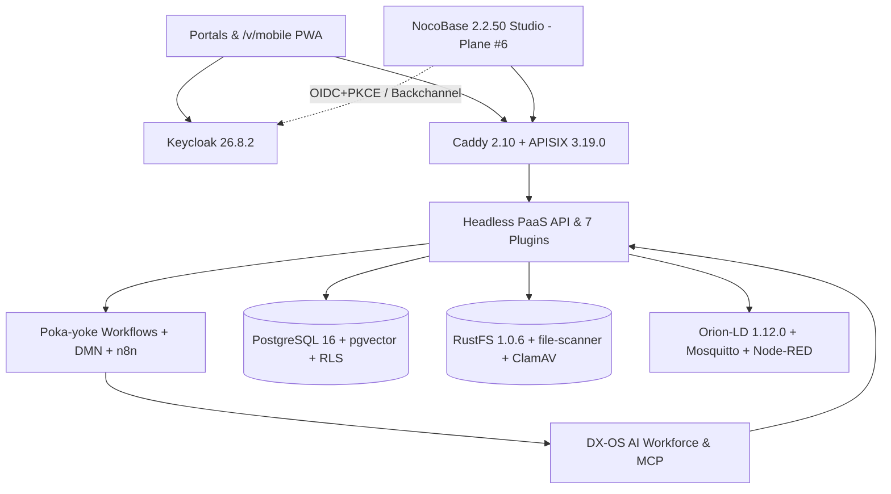

# Thiết kế DX-OS tối thiểu

Ngày khởi tạo: 2026-10-06 (lịch sử kiến trúc nền). Cập nhật đối chiếu nghiệm thu **`v0.4.2`**: **2026-11-26** — toàn bộ 11 hạng mục ở Mục 6 đã chuyển sang trạng thái **Đạt (`v0.4.2`)** với bằng chứng thực thi trong kho mã nguồn.

## 1. Mục tiêu và ranh giới

Xây một lõi dịch vụ có thể sử dụng qua API, độc lập với giao diện. Một ứng dụng minh họa sử dụng chung định danh, dữ liệu, tệp và workflow. NocoBase là ứng viên làm Studio và màn hình tác nghiệp; khả năng thực thi lõi không phụ thuộc vào việc mở Studio.

Tài liệu tham chiếu: [đề thi](https://vfossa.vn/tin-tuc/de-thi-phan-mem-nguon-mo-olp-2026-798.html), mục 3–4; [thể lệ](https://vfossa.vn/tin-tuc/the-le-olp-phan-mem-nguon-mo-nam-2026-760.html).

Danh sách bảy lớp công nghệ là tham chiếu; các nguyên lý kỹ thuật và yêu cầu dịch vụ vẫn phải được hiện thực và kiểm chứng.

## 2. Thành phần đề xuất

| Năng lực | Thành phần | Trách nhiệm | Trạng thái (khởi tạo 2026-10-06) |
| --- | --- | --- | --- |
| Identity/SSO | Keycloak | Định danh, đăng nhập OIDC và service account | Đề xuất (đã hiện thực `26.8.2` + `plugin-enterprise-auth`) |
| API Gateway | Apache APISIX | Cửa vào API, kiểm tra token theo cấu hình, định tuyến, giới hạn lưu lượng | Đề xuất (đã hiện thực `3.19.0` + `Caddy 2.10`) |
| Dữ liệu cấu trúc | PostgreSQL + API của nhóm | Hồ sơ, quyền nghiệp vụ, metadata và nhật ký tác vụ | Đề xuất (đã hiện thực `PG 16.16` + `pgvector 0.8.1` + **`52`-bảng tĩnh `FORCE ROW LEVEL SECURITY` + dynamic `latticeCustom*` RLS + role `nocobase_app`**) |
| Dữ liệu phi cấu trúc | RustFS S3 / S3-compatible + API tệp | Nội dung tệp; PostgreSQL giữ metadata và quyền truy cập | Đề xuất (đã hiện thực `RustFS 1.0.6` + `apps/file-scanner` + `ClamAV 1.5.5`) |
| Workflow | Workflow engine/REST + n8n + Native Automations | Trạng thái quy trình, user task, service task, lịch sử thực thi | Đề xuất (đã hiện thực NocoBase Workflow + Poka-yoke + **LatticeFlow v2 Draft/Publish + ReAct `ai.agent` + Multi-Level Approvals + Native Automations `dxosAutomations`** + **Stock `n8n 2.48.1` Public REST API v1 (`dxosN8n`) + 26-node Compliance Orchestrator**) |
| Giao diện | Multi-Portal + NocoBase UI | Cổng truy cập và giao diện minh họa | Đề xuất -> Đã nâng cấp lên 4 cổng `/p/*` (+ `/p/cmms`, `/p/partner-claims`, dynamic `/p/*`) + `/v/mobile` PWA (**IndexedDB**) + `/v/track/:code` + `/v/form/:slug` + **12 BlockModel v2** (gồm `DxosBiChartBlockModel`, `DxosWmsOpsBlockModel` & WebGIS `maplibre-gl@6.19.0`) |
| Studio low-code | NocoBase `2.2.50` | Tạo biểu mẫu, màn hình và cấu hình nghiệp vụ (Plane #6) | Đã tích hợp chuẩn Clause 5.2 (`7` plugin `Apache-2.0` `0.4.2`, Studio **9 tab** + Visual Interactive DMN + Rich Schema Domain Builder `dxosBuilder` với `hasOne`, `belongsToMany` + `FORCE RLS`, AST `formula`, `validation`) |
| Agent | DX-OS AI Workforce & MCP & A2A | Nhận tác vụ, gọi tools/GraphRAG và trả đề xuất HITL | Đã hiện thực `20` Unified Tools (gồm **App Builder 2.0 `dxos_provision_role_workspace`**, `dxos_configure_workflow`, `dxos_memory_*`) + **7 Starter AI Profiles** + **A2A Protocol** + **OTel GenAI (`latticeAiTraces`)** + **Proactive Triage LLM thật (`tokenSource`)** + `/api/dxos-mcp` (`163/163` NL eval) |
| NGSI-LD | FIWARE Orion-LD `1.12.0` + IIoT OSI | Thực thể ngữ cảnh, Digital Twin Shadow và subscriptions | Đã hiện thực Orion-LD **2-way subscriptions (`/orionNotify`)** + **Mosquitto `2.0.21` DynSec/LWT** + **Node-RED `4.0.9`** (IIoT time-series trên PG 16) |

Nguồn kiểm tra ban đầu: [Keycloak](https://github.com/keycloak/keycloak), [APISIX](https://github.com/apache/apisix), [PostgreSQL license](https://www.postgresql.org/about/licence/), [Flowable OSS](https://github.com/flowable/flowable-engine), [Flowable documentation](https://www.flowable.com/open-source/docs/bpmn/ch02-GettingStarted), [SeaweedFS](https://github.com/seaweedfs/seaweedfs).

## 3. Sơ đồ vận hành

## 4. Quyền sở hữu dữ liệu và quyền truy cập

- Keycloak quản lý danh tính; API quản lý quyền nghiệp vụ theo subject và tổ chức. Không coi token hợp lệ là đủ quyền trên mọi dữ liệu.
- API sở hữu hồ sơ nghiệp vụ và metadata tệp; workflow engine sở hữu tiến độ thực thi. Hai bên liên hệ bằng process ID và business ID, không cùng tự ghi một trạng thái quy trình.
- S3 giữ nội dung tệp; truy cập phải đi qua kiểm tra quyền hoặc URL có thời hạn sau khi kiểm tra quyền. Upload phải được kiểm dịch trước khi người khác tải xuống.
- Broker quản lý thuộc tính ngữ cảnh; dữ liệu đo có thời điểm và nguồn. Không đồng bộ hai chiều toàn bộ bảng/thuộc tính mặc định.
- Studio giữ cấu hình giao diện và dữ liệu nội bộ cần thiết của nó trong database riêng hoặc cấu hình plugin `sdkProvidedByHost: true`.
- Worker dùng danh tính dịch vụ, công cụ được cho phép và quyền giới hạn. Không truy cập thẳng database của ứng dụng khác. Agent đề xuất, user task / hàng chờ HITL ghi nhận quyết định của con người.

## 5. Luồng minh họa đầu tiên

1. Người dùng đăng nhập bằng Keycloak (`plugin-enterprise-auth`).
2. Gửi hồ sơ qua gateway (`Caddy` -> `APISIX`); API kiểm tra quyền RBAC/RLS và lưu vào PostgreSQL.
3. Upload tệp, kiểm dịch ClamAV (`apps/file-scanner`), lưu nội dung ở RustFS S3 và metadata tại API.
4. API khởi tạo quy trình Poka-yoke; worker/triage tạo đề xuất có bằng chứng và chuyển sang duyệt con người (Manual Task / AI HITL).
5. Người được giao nhiệm vụ xem hồ sơ, duyệt hoặc từ chối qua API/UI hoặc DMN/Delegation. Hệ thống ghi vết Chatter, Chứng từ bất biến và Sổ cái Ed25519/Merkle.
6. Người dùng xem trạng thái và phả hệ dữ liệu từ API/WebGIS/Kanban; dữ liệu bền vững sau khởi động lại và diễn tập khôi phục.

## 6. Đối chiếu yêu cầu và tiêu chí nghiệm thu (`v0.4.2`)

Bảng đối chiếu dưới đây cập nhật trạng thái thực tế của toàn bộ 11 tiêu chí thiết kế tối thiểu trên nhánh phát hành **`v0.4.2`** (chi tiết ánh xạ đầy đủ theo khung điểm OLP PMNM 2026 xem tại [olp-2026-architecture-matrix.md](olp-2026-architecture-matrix.md)):

| Yêu cầu | Bằng chứng cần có | Hiện tại (`v0.4.2`) |
| --- | --- | --- |
| Lõi headless | Gọi API và hoàn thành quy trình khi tắt giao diện | **Đạt (v0.4.2)** — Fastify headless backend [`apps/api/src/app.ts`](../apps/api/src/app.ts), hợp đồng [`packages/contracts/`](../packages/contracts/src/index.ts), Scoped PaaS API Keys [`paas-api-keys.js`](../plugins/nocobase/plugin-lattice-foundation/src/server/paas-api-keys.js) (`dxosApiKeys:issue`/`list`/`revoke`), đặc tả sống `/api/dxos:openapi` (OpenAPI `3.1.0`, tự phản chiếu các collection `latticeCustom*` & toàn bộ API `dxosVault`/`dxosEvents`/`dxosBroker`/`dxosAutomations`/`dxosBuilder`) & `/api/dxos:asyncapi` (AsyncAPI `3.0.0`) tại [`openapi-spec.js`](../plugins/nocobase/plugin-lattice-foundation/src/server/openapi-spec.js), và kiểm chứng 8 suite headless [`scripts/acceptance-headless-paas.mjs`](../scripts/acceptance-headless-paas.mjs) (`pnpm acceptance:headless-paas`). |
| Identity/SSO | Hai ứng dụng dùng cùng danh tính; request không có token bị từ chối | **Đạt (v0.4.2)** — Keycloak `26.8.2` + `adorsys/keycloak-config-cli` (`infra/compose/core.yml`, `prod.yml`), plugin [`plugin-enterprise-auth`](../plugins/nocobase/plugin-enterprise-auth/src/server/index.js) (OIDC + PKCE, **Valkey `8.1` (`BSD-3-Clause`, tương thích giao thức Redis)** session cache, `enterpriseAuth:backchannelLogout`, đồng bộ vai trò 2 chiều chống leo thang quyền tại `policy.js`, kiểm thử `routes.test.cjs` & `policy.test.cjs`), và JWT/PAT verification fail-closed `401`/`403` trên `/api/*`, `/api/dxos-mcp` & `/api/dxos-a2a`. |
| Gateway | Route và chính sách được cấu hình; backend nghiệp vụ không mở trực tiếp ra ngoài | **Đạt (v0.4.2)** — Edge Zero-Trust [`infra/compose/prod.yml`](../infra/compose/prod.yml): `Caddy 2.10` ([`Caddyfile`](../infra/config/caddy/Caddyfile)) chỉ mở cổng `80`/`443` với các header bảo mật `Strict-Transport-Security`, `X-Content-Type-Options`, `X-Frame-Options`, `Referrer-Policy`, `Permissions-Policy` và `-Server`, định tuyến toàn bộ `/api/*` qua `Apache APISIX 3.19.0` ([`apisix.prod.yaml`](../infra/config/apisix/apisix.prod.yaml)) có giới hạn lưu lượng **Valkey `8.1`** (plugin `limit-count` tương thích giao thức Redis), OIDC bridge `/api/dxos-oidc/*`, MCP `/api/dxos-mcp*`, `dxosBlocks:telemetryIngest` & `dxosBroker:orionNotify`; dịch vụ nội bộ nằm trên mạng bridge tách biên `app`/`data` (kiểm chứng bởi [`scripts/tests/infra-compose-security.test.mjs`](../scripts/tests/infra-compose-security.test.mjs)). |
| Dữ liệu cấu trúc/phi cấu trúc | Lưu hồ sơ và tệp; quyền đọc/ghi; dữ liệu còn sau restart | **Đạt (v0.4.2)** — PostgreSQL `16.16` + `pgvector 0.8.1` (chiều vector linh hoạt `20261127000200`) với **52 bảng tĩnh PostgreSQL `FORCE ROW LEVEL SECURITY`** qua vai trò non-superuser **`nocobase_app`** ([`pg-rls.js`](../plugins/nocobase/plugin-lattice-foundation/src/server/pg-rls.js) + migrations `20261125000100`–`20261202000500`) và **dynamic `latticeCustom*` RLS** (`attachAndVerifyPgRls`), khóa lạc quan `version`, composite indexes `(organizationId, code)`; lưu tệp qua [`apps/file-scanner/src/server.ts`](../apps/file-scanner/src/server.ts) + `RustFS 1.0.6` S3 + quét virus TCP `ClamAV 1.5.5` + trích xuất PDF (`ToUnicode` CMap tiếng Việt)/DOCX/XLSX/PPTX (`latticeParaChunks`, [`document-extractor.js`](../plugins/nocobase/plugin-dxos-para/src/server/document-extractor.js)); diễn tập bền vững với PITR WAL tách volume sau restart qua [`scripts/stack-recovery.mjs`](../scripts/stack-recovery.mjs) (`pnpm backup:rehearse-stack`). |
| Workflow | Start, chờ duyệt, hoàn thành và truy xuất lịch sử qua API | **Đạt (v0.4.2)** — 4 mẫu quy trình Poka-yoke ([`workflow-templates.js`](../plugins/nocobase/plugin-dxos-studio/src/server/workflow-templates.js)), vòng đời chứng từ bất biến `latticeVoucher:*`, bảng quyết định **DMN** `dxosDmn:*` + **Visual Interactive DMN**, **Multi-Level Approval Engine & Unified Approval Inbox (`dxosApprovals:*`)**, **Ủy quyền** `dxosDelegations:*`, SLA Engine (`latticeSla:*`), **Omnichannel Notifications (`omnichannel-notify.js`)**, **LatticeFlow v2 Draft/Publish (`latticeAutomationRuleVersions`) + Native Automation Engine (`dxosAutomations`: `Event -> DMN Table -> Actions`, `flow-snapshot` + `pg_advisory_lock` cron `20261127000300`, `ai.agent` ReAct nhiều lượt & `latticeflow.approval` HITL, `maxDepth 8`, `stepTracesJson` + Replay)** tại [`automation-engine.js`](../plugins/nocobase/plugin-dxos-studio/src/server/automation-engine.js), **Unified CloudEvents 1.0 + Standard Webhooks Event Bus (`dxosEvents`)**, **Connector Vault (`dxosVault`)**, và **Stock `n8n 2.48.1` Public REST API v1 (`dxosN8n`, `n8n-api-client.js`)**. |
| Ứng dụng H-P-D-I | Luồng nghiệp vụ dùng được từ giao diện | **Đạt (v0.4.2)** — 4 Cổng nghiệp vụ `/p/procurement`, `/p/incidents`, `/p/logistics`, `/p/services` + cổng `/p/cmms`, `/p/partner-claims`, tra cứu công khai **`/v/track/:code`** (Ed25519), **Public Form `/v/form/:slug`** + cổng di động **`/v/mobile` PWA** (IndexedDB outbox + camera ảnh ePOD, [`mobile-field-pwa.js`](../plugins/nocobase/plugin-lattice-foundation/src/client-v2/mobile-field-pwa.js)), **12 Native v2 `BlockModel`s** (gồm **`DxosBiChartBlockModel`**, **`DxosWmsOpsBlockModel`** & WebGIS `maplibre-gl@6.19.0`, [`block-models.js`](../plugins/nocobase/plugin-dxos-blocks/src/client/block-models.js)), Chuông SSE Topbar (`notification-bell.js`), **`/admin/settings/dxos-studio` (Tabs 1–9 + Governance Consoles + Unified Approvals + Public Forms)**, `/admin/settings/dxos-para`, Trung tâm AI `/admin/settings/dxos-ai` (Tab 7 Visual ER/Plan-Diff/Rollback, Trace Waterfall & Eval Lab) + 1 nút `PortalAgentLauncher`, và kịch bản seed [`scripts/seed-v100-championship-showcase.mjs`](../scripts/seed-v100-championship-showcase.mjs). |
| Vòng đời dữ liệu | Dữ liệu tác nghiệp tách với bản lịch sử; có job xuất dữ liệu và truy vấn bản xuất | **Đạt (v0.4.2)** — Phân tầng **Hot–Warm–Cold** + đóng băng bản chụp ký mật mã (`latticeFrozenSnapshots`, `dxosDataGov:tierSummary`/`freezeSnapshot`/`listSnapshots`/`getSnapshot` trong [`data-governance.js`](../plugins/nocobase/plugin-lattice-foundation/src/server/data-governance.js), migration `20261124000200`), xuất báo cáo kiểm soát RBAC theo cột CSV/XLSX/PDF Unicode (`dxosBlocks:exportReport` trong [`governed-export.js`](../plugins/nocobase/plugin-dxos-blocks/src/server/governed-export.js)) và chuỗi thời gian IIoT **`latticeTelemetryPoints` lưu trực tiếp trên PostgreSQL `16`** (không dùng container `timescaledb` tách rời). |
| IT/OT | Sự kiện dữ liệu hiện trường từ NGSI-LD tạo hoặc bổ sung một hồ sơ/quy trình | **Đạt (v0.4.2)** — **FIWARE Orion-LD `1.12.0` 2-Way Subscriptions** (`dxosBroker:orionEntities` diff, `/ngsi-ld/v1/subscriptions` CRUD và webhook `POST /api/dxosBroker:orionNotify` đẩy về `latticeTelemetryPoints` + `orion.notification` CloudEvent) + stack IIoT chuẩn OSI ([`infra/compose/iiot.yml`](../infra/compose/iiot.yml) chỉ chạy **Eclipse Mosquitto `2.0.21` Dynamic Security** (`allow_anonymous false`, `$CONTROL/dynamic-security/v1` qua thuần `node:net` MQTT 3.1.1, ACL `latticedx/<orgId>/<deviceKey>/*`, `BIRTH`/`DEATH` LWT `device.offline`) + **Node-RED `4.0.9`** -> `dxosBlocks:telemetryIngest`, `dxosBroker:deviceStatusIngest` & `alarmIngest`), **2-Way Digital Twin Shadow** (`latticeTwinShadows`, cổng HITL khi lệch `> 2.0°C`), cùng 4 IT/OT MCP tools & Proactive Triage. |
| Nguồn gốc và chất lượng | Trace được hồ sơ → bản đo/tệp → nguồn; dữ liệu sai bị cách ly hoặc đánh dấu | **Đạt (v0.4.2)** — Đồ thị **Phả hệ dữ liệu (`latticeDataLineage`)** + `dxosDataGov:lineage`/`lineageTrace` & AI tool `#16 dxos_graph_impact_analysis` ([`ai-operational-tools.js`](../plugins/nocobase/plugin-dxos-ai/src/server/ai-operational-tools.js)), **Sổ cái Ed25519 + Merkle (`latticeCryptoLedger`, `dxosLedger:signDocument`/`verify`/`verifySignature`)**, **Cách ly dữ liệu bất thường (`latticeDataQuarantine`, `dxosDataGov:listQuarantine`/`resolveQuarantine`)**, tính **Arrhenius MKT (`computeMeanKineticTemperature` + `dxosWms:holdLotByMkt`)**, và nhập liệu 2 pha chống công thức độc hại ([`bulk-import.js`](../plugins/nocobase/plugin-dxos-blocks/src/server/bulk-import.js)). |
| Zero-Trust và GitOps | Kiểm tra quyền ở dịch vụ, kiểm dịch tệp, cấu hình triển khai trong Git và reconciliation; thử restart/restore | **Đạt (v0.4.2)** — Fail-closed RBAC + **52-table PG `FORCE RLS` (`nocobase_app`, `20261127000100`..`20261202000500`)** (+ dynamic `latticeCustom*` RLS) + `apps/file-scanner` ClamAV + SSRF guard + AES-256-GCM/OAuth2 PKCE Connector Vault (`dxosVault`), **GitOps Solution Bundle v3** (`latticedx.solution-bundle/v3`: `Schema · RBAC · Portals · Workflows · AI · Governance` gồm DMN, SLA, Incident Rules, `automationRules` và `webhookSubscriptions` đã che secret tại [`solution-bundle.js`](../plugins/nocobase/plugin-dxos-studio/src/server/solution-bundle.js)), quan sát 360° **OTel GenAI (`otel-exporter.js`, `latticeAiTraces`) + Prometheus (`alerts.yml`, `/api/dxos:metrics`) + Grafana OSS `11.5.8` (`latticedx-360.json`)**, PITR WAL tách volume (`postgres-wal-archive`, `nocobase-wal-archive`), diễn tập khôi phục toàn stack (`pnpm backup:rehearse-stack`) và CI kiểm tra tự động ([`.github/workflows/ci.yml`](../.github/workflows/ci.yml): `check`, `dependency-audit`, `compose-validate`, `trivy-scan`). |
| Cắm/rút và tái sử dụng | Đăng ký app, khai báo endpoint/quyền; thay/tắt app không làm hỏng API lõi | **Đạt (v0.4.2)** — 7 plugin Apache-2.0 độc lập (`sdkProvidedByHost: true`) bật/tắt live trong NocoBase Plugin Manager (`/admin/pm/list`), khối `DxosParaVaultBlockModel` và cross-plugin loader hạ cấp mềm khi tắt mô-đun liên quan, **Rich Schema Domain Builder (`dxosBuilder`)** sinh runtime `latticeCustom*` (`hasOne`, `belongsToMany` + `FORCE RLS`, AST `formula`, `validation`, dynamic OpenAPI, RBAC, `/p/*`), **1-Click `cmms-maintenance` & `coldchain-partner-settlement` Business Packs**, **App Builder 2.0 (`dxos_provision_role_workspace` build/plan/patch/rollback)**, **1-Click Tenant Provisioning (`dxosBuilder:provisionTenant`)**, plug-and-play OMS/WMS/TMS chuỗi lạnh ([`wms-engine.js`](../plugins/nocobase/plugin-dxos-studio/src/server/wms-engine.js)), và cô lập PoF kiểm chứng bởi [`scripts/verify-pof-readiness.mjs`](../scripts/verify-pof-readiness.mjs) (`pnpm pof:check`). |

## 7. Ảnh hưởng đến repo

Cấu trúc đã triển khai thực tế:

- `infra/compose/` & `infra/config/`: tệp ghép dịch vụ khóa `@sha256:` và cấu hình Caddy, APISIX, Keycloak, Orion-LD, n8n, Mosquitto, Node-RED, OTel, Prometheus, Grafana.
- `apps/api/`, `apps/agent-worker/`, `apps/file-scanner/`: lõi API Fastify, worker sự cố, sidecar quét virus ClamAV + RustFS S3.
- `plugins/nocobase/`: 7 plugin Apache-2.0 (`0.4.2`, `sdkProvidedByHost: true`).
- `packages/contracts/`: API/event/workflow/workspace contracts.
- `solutions/` & `scripts/`: giải pháp mẫu Logistics/Workflows, seeder showcase, bộ nghiệm thu Headless PaaS / AI MCP / Blank-Slate & Live LLM App Builder / Logistics RBAC, trình sinh SBOM CycloneDX 1.5 và kiểm toán PoF.

## 8. Thứ tự triển khai (đã hoàn tất)

1. Dựng PostgreSQL, Keycloak và APISIX; bảo vệ API theo vai trò & `organizationId` -> **Hoàn tất + mở rộng Zero-Trust Caddy + 52-table static RLS (+ dynamic `latticeCustom*` RLS)**.
2. Lưu tệp + kiểm dịch ClamAV + workflow Poka-yoke + thử restart/restore -> **Hoàn tất + mở rộng RustFS + `stack-recovery.mjs`**.
3. Đưa luồng lên Multi-Portal + NocoBase `2.2.50` chuẩn Clause 5.2 -> **Hoàn tất + mở rộng `/v/mobile` PWA (IndexedDB outbox) + `/v/track/:code` Ed25519 + `/v/form/:slug` + 12 Native v2 BlockModels (gồm `DxosBiChartBlockModel`, `DxosWmsOpsBlockModel` & MapLibre WebGIS)**.
4. Nối FIWARE Orion-LD + IIoT OSI + 2-Way Digital Twin + AI Workforce 20 Tools (7 Profiles) + 2-Way MCP + A2A Protocol -> **Hoàn tất + mở rộng Proactive Triage + HITL + GraphRAG + Memory + OTel GenAI Trace/Eval Lab**.
5. Bổ sung Hot-Warm-Cold, Ed25519 PKI, Data Lineage, Quarantine, GitOps Bundle v3, OTel/Prometheus/Grafana, SBOM CycloneDX 1.5, Mosquitto DynSec + LWT & Orion-LD 2-way (`dxosBroker`), CloudEvents 1.0 + Standard Webhooks (`dxosEvents`), Connector Vault (`dxosVault`), Native Automation Engine (`dxosAutomations`) + Draft/Publish + Multi-Level Approvals + Omnichannel Notifications + Public Forms + Rich Schema Domain Builder & App Builder 2.0 + Valkey `8.1` (`BSD-3-Clause`) -> **Hoàn tất ở `v0.4.2`**.
