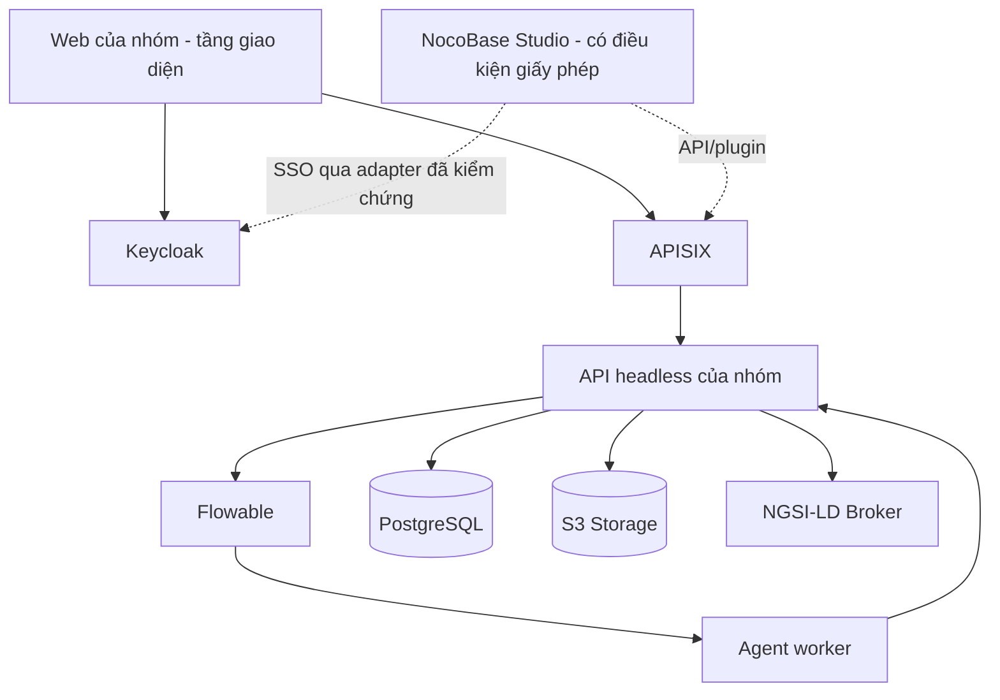

# Thiết kế DX-OS tối thiểu

Ngày: 2026-10-06. Trạng thái: phương án đề xuất để làm cơ sở triển khai. Chưa cài hoặc tích hợp những dịch vụ mới trong tài liệu này.

## 1. Mục tiêu và ranh giới

Xây một lõi dịch vụ có thể sử dụng qua API, độc lập với giao diện. Một ứng dụng minh họa sử dụng chung định danh, dữ liệu, tệp và workflow. NocoBase là ứng viên làm Studio và màn hình tác nghiệp; khả năng thực thi lõi không phụ thuộc vào việc mở Studio.

Tài liệu tham chiếu: [đề thi](https://vfossa.vn/tin-tuc/de-thi-phan-mem-nguon-mo-olp-2026-798.html), mục 3–4; [thể lệ](https://vfossa.vn/tin-tuc/the-le-olp-phan-mem-nguon-mo-nam-2026-760.html).

Danh sách bảy lớp công nghệ là tham chiếu; các nguyên lý kỹ thuật và yêu cầu dịch vụ vẫn phải được hiện thực và kiểm chứng.

## 2. Thành phần đề xuất

| Năng lực | Thành phần | Trách nhiệm | Trạng thái |
| --- | --- | --- | --- |
| Identity/SSO | Keycloak | Định danh, đăng nhập OIDC và service account | Đề xuất |
| API Gateway | Apache APISIX | Cửa vào API, kiểm tra token theo cấu hình, định tuyến, giới hạn lưu lượng | Đề xuất |
| Dữ liệu cấu trúc | PostgreSQL + API của nhóm | Hồ sơ, quyền nghiệp vụ, metadata và nhật ký tác vụ | Đề xuất |
| Dữ liệu phi cấu trúc | SeaweedFS S3 + API tệp | Nội dung tệp; PostgreSQL giữ metadata và quyền truy cập | Đề xuất |
| Workflow | Flowable OSS engine/REST | Trạng thái quy trình, user task, service task, lịch sử thực thi | Đề xuất |
| Giao diện | Next.js web | Cổng truy cập và giao diện minh họa ban đầu | Bộ khung đang chạy |
| Studio low-code | NocoBase | Tạo biểu mẫu, màn hình và cấu hình nghiệp vụ | Đã clone, giấy phép chưa xác minh đủ |
| Agent | Worker của nhóm | Nhận tác vụ, gọi mô hình/tools và trả đề xuất | Chỉ có demo kết nối |
| NGSI-LD | Broker phù hợp sau kiểm tra | Thực thể ngữ cảnh và subscriptions | Chưa chọn phiên bản/broker |

Nguồn kiểm tra ban đầu: [Keycloak](https://github.com/keycloak/keycloak), [APISIX](https://github.com/apache/apisix), [PostgreSQL license](https://www.postgresql.org/about/licence/), [Flowable OSS](https://github.com/flowable/flowable-engine), [Flowable documentation](https://www.flowable.com/open-source/docs/bpmn/ch02-GettingStarted), [SeaweedFS](https://github.com/seaweedfs/seaweedfs).

SeaweedFS là ứng viên S3 có LICENSE Apache-2.0 ở repo; không coi đó là kết quả kiểm toán dependency hoặc image. Chọn phiên bản, ghi checksum/image digest và kiểm tra license trước mỗi bước tích hợp. Không sử dụng plugin thương mại hoặc UI thương mại của Flowable trong phạm vi mặc định.

## 3. Sơ đồ vận hành

SSO NocoBase là mục tiêu cần kiểm chứng bằng plugin/adaptor hợp lệ; chưa giả định có connector miễn phí sẵn. UI quản trị của dịch vụ upstream chỉ phục vụ vận hành nội bộ, không là điều kiện sử dụng API. Nền tảng người dùng thuộc tầng giao diện; endpoint lõi không render màn hình nghiệp vụ.

## 4. Quyền sở hữu dữ liệu và quyền truy cập

- Keycloak quản lý danh tính; API quản lý quyền nghiệp vụ theo subject và tổ chức. Không coi token hợp lệ là đủ quyền trên mọi dữ liệu.
- API sở hữu hồ sơ nghiệp vụ và metadata tệp; workflow engine sở hữu tiến độ thực thi. Hai bên liên hệ bằng process ID và business ID, không cùng tự ghi một trạng thái quy trình.
- S3 giữ nội dung tệp; truy cập phải đi qua kiểm tra quyền hoặc URL có thời hạn sau khi kiểm tra quyền. Upload phải được kiểm dịch trước khi người khác tải xuống.
- Broker quản lý thuộc tính ngữ cảnh; dữ liệu đo có thời điểm và nguồn. Không đồng bộ hai chiều toàn bộ bảng/thuộc tính mặc định.
- Studio giữ cấu hình giao diện và dữ liệu nội bộ cần thiết của nó trong database riêng. Dùng plugin/custom data source gọi API cho hồ sơ dùng chung; đây là công việc phát triển và kiểm chứng, không là tính năng đã có.
- Worker dùng danh tính dịch vụ, công cụ được cho phép và quyền giới hạn. Không truy cập thẳng database của ứng dụng khác. Agent đề xuất, user task ghi nhận quyết định của con người.

## 5. Luồng minh họa đầu tiên

Chọn một luồng thử năng lực thuộc không gian P: tiếp nhận hồ sơ, đính kèm, phân tích và phê duyệt. Đây chưa là quyết định ngách nghiệp vụ cuối cùng.

1. Người dùng đăng nhập bằng Keycloak.
2. Gửi hồ sơ qua gateway; API kiểm tra quyền và lưu vào PostgreSQL.
3. Upload tệp, kiểm dịch, lưu nội dung ở S3 và metadata tại API.
4. API khởi tạo quy trình; workflow gọi worker để tạo đề xuất và chuyển sang user task.
5. Người được giao nhiệm vụ xem hồ sơ, duyệt hoặc từ chối qua API. Workflow ghi lịch sử và kết thúc/đi tiếp theo điều kiện.
6. Người dùng xem trạng thái từ API; kết quả tồn tại sau khi khởi động lại dịch vụ.

Ở bước đầu, web hiện tại cung cấp form. Khi NocoBase đủ điều kiện, tạo cùng một form bằng Studio và gọi cùng API để chứng minh tái sử dụng lõi.

## 6. Đối chiếu yêu cầu và tiêu chí nghiệm thu

| Yêu cầu | Bằng chứng cần có | Hiện tại |
| --- | --- | --- |
| Lõi headless | Gọi API và hoàn thành quy trình khi tắt giao diện | Chưa |
| Identity/SSO | Hai ứng dụng dùng cùng danh tính; request không có token bị từ chối | Chưa |
| Gateway | Route và chính sách được cấu hình; backend nghiệp vụ không mở trực tiếp ra ngoài | Chưa |
| Dữ liệu cấu trúc/phi cấu trúc | Lưu hồ sơ và tệp; quyền đọc/ghi; dữ liệu còn sau restart | Chưa |
| Workflow | Start, chờ duyệt, hoàn thành và truy xuất lịch sử qua API | Chưa |
| Ứng dụng H-P-D-I | Luồng nghiệp vụ dùng được từ giao diện | Chỉ có demo kết nối |
| Vòng đời dữ liệu | Dữ liệu tác nghiệp tách với bản lịch sử; có job xuất dữ liệu và truy vấn bản xuất | Chưa |
| IT/OT | Sự kiện dữ liệu hiện trường từ NGSI-LD tạo hoặc bổ sung một hồ sơ/quy trình | Chưa |
| Nguồn gốc và chất lượng | Trace được hồ sơ → bản đo/tệp → nguồn; dữ liệu sai bị cách ly hoặc đánh dấu | Chưa |
| Zero-Trust và GitOps | Kiểm tra quyền ở dịch vụ, kiểm dịch tệp, cấu hình triển khai trong Git và reconciliation; thử restart/restore | Chưa; CI hiện chỉ kiểm tra mã |
| Cắm/rút và tái sử dụng | Đăng ký app, khai báo endpoint/quyền; thay/tắt app không làm hỏng API lõi | Chưa |

Chỉ hoàn thành bốn dịch vụ bắt buộc chưa có nghĩa đã hoàn thành toàn bộ yêu cầu kỹ thuật. Agent và NGSI-LD là hướng phát triển đã chọn của nhóm, chưa được tính là năng lực thực tế.

## 7. Ảnh hưởng đến repo

Giữ cấu trúc hiện tại. Khi triển khai:

- `infra/compose/`: tệp ghép dịch vụ theo profile và phiên bản khóa.
- `infra/config/`: cấu hình realm/client, gateway và dịch vụ.
- `apps/api/`: module identity, hồ sơ, tệp và workflow adapter, thêm khi thực hiện từng lát chức năng.
- `apps/agent-worker/`: tools và handlers khi có tác vụ thật.
- `apps/studio/`: manifest nguồn/phiên bản, cấu hình và hướng dẫn build riêng NocoBase; không tự động ép vào pnpm workspace nếu không tương thích.
- `plugins/nocobase/`: plugin nhóm viết theo SDK phiên bản đã khóa.
- `packages/contracts/`: API/event schema; `packages/core/` chỉ tạo khi xuất hiện logic nền tảng dùng chung.
- `solutions/`: BPMN, mô hình, seed và mô tả ứng dụng demo.

Không nhân bản quy trình chính ở cả Flowable và NocoBase. NocoBase đóng vai trò giao diện/configuration và adapter với quy trình chính. Workflow nội bộ Studio, nếu dùng, phải có phạm vi riêng.

## 8. Thứ tự triển khai

1. Dựng PostgreSQL, Keycloak và APISIX; bảo vệ một API lưu hồ sơ và kiểm tra bằng hai người dùng khác quyền.
2. Thêm lưu tệp và Flowable; chạy luồng tiếp nhận → chờ duyệt → kết thúc, thử restart.
3. Đưa luồng lên giao diện; khảo sát giấy phép/version/plugin NocoBase song song, chỉ tích hợp khi xác định rõ quyền sử dụng.
4. Nối NGSI-LD và agent thật cho bài toán được chọn; ghi dữ liệu nguồn và kết quả đề xuất.
5. Bổ sung lịch sử/phân tích, lineage, quan sát, GitOps và kiểm thử khôi phục để chứng minh các nguyên lý kỹ thuật.

Tiêu chí chọn phiên bản mỗi dịch vụ: release ổn định, có source public và hướng dẫn build; license và dependency được ghi nhận; không yêu cầu secret/thành phần thương mại để chạy chức năng demo.
